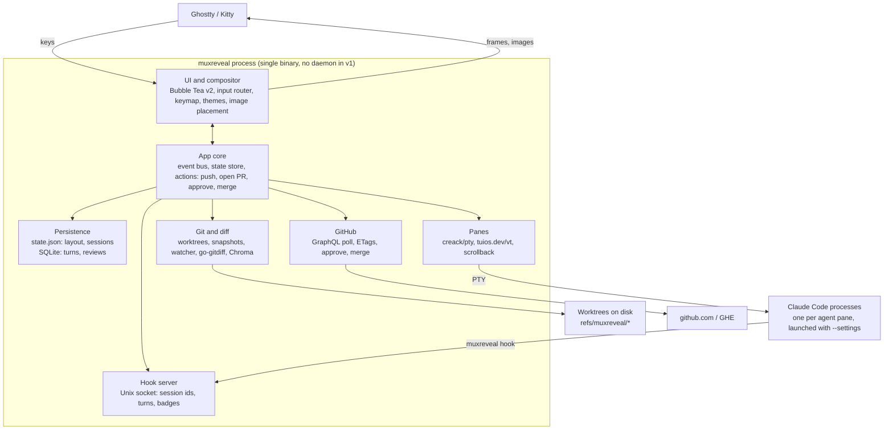

# MuxReveal v1 - Requirements & Architecture

As of 2026-10-26.

## Overview

MuxReveal is a single-binary Go TUI that hosts coding agents in live terminal panes and puts the review loop beside them: live diffs, PR review, CI status, push, open PR and merge. v1 is A-lite: one process owns the PTYs, with no daemon. Layout and agent sessions persist to disk and resume on start.

Terminal emulation comes from `tuios.dev/vt`, the emulator TUIOS publishes as a standalone library. MuxReveal owns everything above it: compositor, panes, review, GitHub.

**Goals for v1**

- Replace herdr for day-to-day agent multiplexing with Claude Code.
- Never open the GitHub web UI to read, approve or merge a PR.
- Look like a next-gen terminal app: own compositor, Catppuccin themes, inline images.
- Be fully keyboard driven.
- Be "just there": the review and PR views live next to the agents, not in a separate tool.

**Non-goals for v1**

- Detach and reattach while agents keep running (v2: daemon).
- Our own agent harness. Agents are external CLIs; Claude Code is the only adapter in v1.
- Inline review comments, or request-changes reviews.
- Remote machines over SSH, Windows, and a plugin system.
- Sixel or iTerm2 image fallbacks. Ghostty and Kitty both speak the Kitty graphics protocol.

## Functional requirements

IDs are referenced by milestones, commits and PRs. Priority: **P0** blocks v1, **P1** ships in v1 if possible, **P2** is v1.x.

### Agents and panes

| ID | Requirement | Pri |
| --- | --- | --- |
| AG-1 | Spawn an agent pane running `claude` in a chosen worktree | P0 |
| AG-2 | Splits (horizontal and vertical), resize, zoom, close, swap, and focus movement | P0 |
| AG-3 | Full-fidelity terminal: truecolor, alt screen, mouse, bracketed paste, synchronized output, Kitty keyboard protocol, OSC 8 and 52, wide chars | P0 |
| AG-4 | Scrollback and copy mode with vim motions | P0 |
| AG-5 | Per-pane state badge (working, blocked, idle) from Claude Code hooks | P0 |
| AG-6 | Desktop notification when an agent becomes blocked or finishes | P1 |
| AG-7 | Plain shell panes (non-agent), the default for splits; running `claude` in one makes it an agent pane, and an agent pane whose Claude exits becomes a shell again; the kind comes from the terminal's foreground process | P0 |
| AG-8 | Harness adapter interface so other agents (Codex, opencode) can be added | P0 (interface), P2 (adapters) |
| AG-9 | Tabs: each with its own split layout, focus and zoom; new, rename, close, jump and cycle; the tabs shown in the workspace bar | P0 |

### Persistence and resume

| ID | Requirement | Pri |
| --- | --- | --- |
| PR-1 | Persist the layout tree, pane cwd, harness and session id to disk on every change | P0 |
| PR-2 | On start, restore the layout and run `claude --resume <session_id>` in each agent pane | P0 |
| PR-3 | Survives reboots: state is plain files, never process memory | P0 |
| PR-4 | A pane whose session id is missing or invalid falls back to a fresh `claude` and shows a notice | P0 |
| PR-5 | Workspaces: named sets of repos, panes and layouts, switchable | P2 |

### Worktrees

| ID | Requirement | Pri |
| --- | --- | --- |
| WT-1 | Discover existing worktrees with `git worktree list --porcelain` | P0 |
| WT-2 | Create a worktree and branch from a base under the worktree root (default `<repo>/.worktrees/<branch>`), then spawn an agent in it. On first use in a repo, add `.worktrees/` to `.git/info/exclude`, keep it out of MuxReveal's own watcher, and list detected tools that need their own ignore entry (JetBrains, VS Code watcher, Jest/Vitest, pytest, tsc, ESLint, Docker). A sibling `../<repo>.worktrees/` layout is a config option | P0 |
| WT-3 | After merge, offer to remove the worktree and delete the local branch | P1 |

### Agent diff

| ID | Requirement | Pri |
| --- | --- | --- |
| DF-1 | Branch mode: diff from the merge-base with the base branch to the working tree, including untracked files. The base is the PR's base once a PR exists, else the repo default branch | P0 |
| DF-2 | Turn mode: diff of what the agent changed in its last turn; step back through earlier turns | P0 |
| DF-3 | Updates live as files change, debounced | P0 |
| DF-4 | Unified and side-by-side layouts, syntax highlighting, intra-line word diff | P0 |
| DF-5 | File tree with per-file stats; hunk navigation | P0 |
| DF-6 | Toggle any file between diff view and full file with changes highlighted | P0 |
| DF-7 | Reviewed-hunk tracking: mark hunks read, keyed by content hash; only unread shows by default | P1 |

### Pull requests and CI

| ID | Requirement | Pri |
| --- | --- | --- |
| GH-1 | PR list with tabs: agent branches, review requested, all open | P0 (agents), P1 (others) |
| GH-2 | PR diff rendered with the same engine as the agent diff, including the full-file toggle | P0 |
| GH-3 | Rendered PR description and conversation (read only) | P1 |
| GH-4 | Live CI checks per PR: status, duration, and link to logs; failed job log tail in-app | P0 (status), P1 (log tail) |
| GH-5 | Approve a PR | P0 |
| GH-6 | Merge with merge, squash or rebase; respects repo-allowed methods and branch protection; optional branch delete | P0 |
| GH-7 | github.com and GHE, using hosts and tokens from `gh` | P0 |

### Git actions

| ID | Requirement | Pri |
| --- | --- | --- |
| GA-1 | Push the current agent branch, setting upstream on first push | P0 |
| GA-2 | Open a PR: compose overlay with title, body, base branch and draft toggle | P0 |
| GA-3 | Body prefilled from `.github/pull_request_template.md`, else the commit log; edit in-app or in `$EDITOR` | P0 |
| GA-4 | Live markdown preview while composing | P1 |
| GA-5 | Auto-detect PRs that agents opened, by branch lookup | P0 |

### Markdown, UX and themes

| ID | Requirement | Pri |
| --- | --- | --- |
| MD-1 | Render markdown for PR bodies, agent plan files and repo docs: headings, lists, tables, code with highlighting, links | P0 |
| MD-2 | Inline images (local paths and remote URLs, including GitHub user-attachments with auth) via the Kitty graphics protocol | P0 |
| UX-1 | Every action reachable by keyboard; which-key style hint popup after the leader key | P0 |
| UX-2 | Command palette with fuzzy search over all actions | P0 |
| UX-3 | User-remappable keymap in config | P1 |
| TH-1 | Theme engine from day one; ship Catppuccin Latte, Frappé, Macchiato and Mocha | P0 |
| TH-2 | Syntax highlighting themed from the same palette | P0 |
| TH-3 | Follow terminal light/dark mode where the terminal reports it | P2 |

### Mouse and clipboard

| ID | Requirement | Pri |
| --- | --- | --- |
| UX-4 | Focus follows mouse: hovering a pane focuses it, no click needed. Config option, off by default; never steals focus from an open overlay or palette | P0 |
| UX-5 | Copy on select: a mouse selection is copied to the system clipboard on release, pasteable in any app. Config option, off by default | P0 |
| UX-6 | Selection works in terminal panes (including scrollback), diffs and rendered markdown; double-click selects a word, triple-click a line, alt+drag a rectangle | P0 |

```toml
[mouse]
focus_follows_mouse = false
copy_on_select = false

[clipboard]
osc52 = true
native = true
```

- `focus_follows_mouse`: hovering a pane's content or header focuses it, through the same path as a click, so guests get their focus reports. The outer terminal is asked for all-motion mouse reporting only while this is on, else cell-motion. Hovering the focused pane, a border, a bar or an empty cell does nothing, and so does hovering while a confirm, prompt, overlay, copy mode or the leader is open, or while a button is held.
- `copy_on_select`: the release that ends a drag, a double-click or a triple-click copies the selection when its text is not empty. A plain click never copies.

- The compositor gets every mouse event first, so selection lives in MuxReveal's own screen model. While a confirm, prompt, overlay, copy mode or the leader (with or without its popup) is open, every mouse event is ignored.
- A plain left-button drag selects in every pane, without a modifier. The selection stays in the pane where the drag began and is clamped to that pane's content even when the pointer leaves it. A drag is a stream selection, `alt+drag` a rectangle, a double-click selects a word and a triple-click a line (same cell within 400 ms). Soft-wrapped lines copy as one line.
- The selection is stored against the pane's scrollback by stable row, so it stays on the same text while output scrolls, and it is painted onto the rows as drawn, so a held synchronized update does not tear it; one selection exists at a time and it is drawn only while its pane is visible. A click in any pane's content, a new drag, a key or paste sent to its pane, or the pane closing, resizing or switching between the main and alt screen clears it. Opening copy mode (`leader [`) clears it; other leader commands and tab switches do not.
- A click in a pane's content focuses it; a click on its header only focuses; a click on a tab switches to it; separators and the status bar ignore clicks.
- A program that asked for mouse reporting gets a click (press then release) when the button is released in the cell where it went down, the wheel, middle and right buttons, and button-less motion only while `focus_follows_mouse` is on (the outer terminal is in cell-motion mode otherwise). A drag never reaches it: it selects instead. Selection gestures belong to MuxReveal and single clicks to the program: the second and third press of a double or triple click select a word or line and the program gets nothing for them (it already got the first click).
- `leader y` (`copy.selection`) copies the selection and keeps it. Every copy goes out as OSC 52 to the outer terminal (and as the primary selection on Linux); both Ghostty and Kitty accept it by default, and it works over SSH.
- `leader [` (`copy.mode`) enters copy mode on the focused pane, with a block cursor at the bottom-left of its current view. Copy mode owns every key (and drops pastes) until it ends, and the program receives none of them. The cursor and selection stay on the same text while output arrives. `y` copies the selection and exits, `q` or `esc` exits and returns the view to live; it also ends when the pane closes, resizes or switches between the main and alt screen. Keys: `h j k l`, `w b e`, `0 ^ $`, `g g` / `G`, `ctrl+u` / `ctrl+d`, `ctrl+b` / `ctrl+f`, `H M L`; `v` stream, `V` line and `ctrl+v` block selection; `/` and `?` search forward and backward, `n` / `N` repeat.
- On a local session (neither `SSH_CONNECTION` nor `SSH_TTY` set) a copy also writes the native clipboard, off the update loop with a 2 s timeout: `pbcopy` on macOS; otherwise `wl-copy` (and `wl-copy --primary`) when `WAYLAND_DISPLAY` is set, else `xclip -selection clipboard` (and `primary`) when `DISPLAY` is set, else no native write. A missing tool is logged once.
- A program's own OSC 52 write takes the same path, hidden tabs included. A program's clipboard read is never answered with the clipboard's content.

## Architecture

One process owns the screen, the PTYs and every service. It talks to Claude Code in two directions: bytes over the PTY, and events back through hooks.



The app core is the only thing that mutates state. Services post events to it; the UI renders from it.

**Module layout**

One Go module, `github.com/mhersson/muxreveal`.

| Package | Responsibility |
| --- | --- |
| `cmd/muxreveal` | Binary: CLI, `hook` subcommand, wiring |
| `internal/core` | Event bus, state store, actions, config |
| `internal/ui` | Compositor, layout tree, widgets, keymap, themes, image placement |
| `internal/term` | PTY plus the `VT` interface; `tuios.dev/vt` adapter (fallback `charmbracelet/x/vt`) |
| `internal/harness` | `Harness` interface; Claude Code adapter (launch args, hook settings, resume) |
| `internal/git` | Worktrees, turn snapshots, watcher, diff engine, highlighting |
| `internal/github` | Auth via `gh`, GraphQL and REST client, poller, PR actions |
| `internal/md` | Markdown to styled cells plus image references |
| `internal/store` | `state.json` and SQLite persistence |

```go
type Harness interface {
	ID() string                                             // saved with each agent pane: "claude-code"
	Program() string                                        // foreground process name of a running agent: "claude"
	Launch(settings string, resume core.SessionID) []string // agent argv; settings "" omits --settings, resume "" starts fresh
	Settings(exe string) ([]byte, error)                    // the --settings file whose hooks run `exe hook <ID()>`
	ParseEvent(payload []byte) (Event, error)               // one hook payload as read from stdin
}

type Event struct {
	Pane       core.PaneID     `json:"pane"`
	Name       string          `json:"name"`                 // the harness's hook event name, for logs
	Session    core.SessionID  `json:"session,omitempty"`
	Transcript string          `json:"transcript,omitempty"`
	State      core.AgentState `json:"state,omitempty"`      // AgentUnknown leaves the state as it is
	Start      bool            `json:"start,omitempty"`      // Session is now the pane's current session
	End        bool            `json:"end,omitempty"`        // the session ended
}
```

`internal/harness` also holds the hook socket, server and client (see Claude Code integration via hooks).

## Tech stack

Go 1.27 (`tuios.dev/vt` needs 1.26 or later). The reason for Rust was a proven VT emulator; `tuios.dev/vt` removes that reason, and Go is the team's main language.

| Concern | Choice | Why |
| --- | --- | --- |
| TUI | Bubble Tea v2 + Lip Gloss v2 + Bubbles v2 | Cell-based renderer, mature input handling; TUIOS proves it can host many busy panes |
| VT emulation | `tuios.dev/vt`; fallback `charmbracelet/x/vt` | Emulator TUIOS runs agent panes on daily: scrollback, Kitty graphics and keyboard protocol, OSC 133. Wrapped behind our `VT` interface. The fallback is as fast but has no Kitty keyboard, Kitty graphics, OSC 52 or OSC 133, and Claude Code does not use synchronized output on it (checked live with and without `TMUX` in Claude's environment). |
| PTY | `github.com/creack/pty` | Standard Go PTY package; macOS and Linux |
| Git | `git` CLI (plumbing and porcelain v2, `-z` output) | Keeps the user's credential helpers, hooks and config; fast enough; one code path for reads and writes |
| Diff | `git diff --histogram` parsed with `bluekeyes/go-gitdiff`; word spans with `sergi/go-diff` | Same hunks as git; intra-line highlighting on top |
| Syntax | Chroma v2 | Ships Catppuccin styles; wide language coverage |
| Markdown | `yuin/goldmark` (GFM) + our own renderer | Full control of layout and image placement; Glamour has no images |
| Images | Own Kitty graphics encoder; `image/*` + `golang.org/x/image` for decode and scaling | The protocol is small; port TUIOS's passthrough (MIT) if it's cleaner |
| File watching | `rjeczalik/notify` | Recursive FSEvents on macOS and inotify on Linux; `fsnotify` needs one fd per file on macOS |
| GitHub | `cli/go-gh/v2` for hosts and tokens; `net/http` REST with ETags; `Khan/genqlient` for typed GraphQL | Same auth as `gh`, full control of conditional requests |
| Fuzzy finder | `sahilm/fuzzy` | Palette and pickers |
| Config and state | `pelletier/go-toml/v2`; `encoding/json`; `modernc.org/sqlite` | TOML config, JSON layout state, pure Go SQLite (no cgo) for turns, reviewed hunks and caches |
| Clipboard | OSC 52 plus direct exec of `wl-copy`, `xclip` or `pbcopy` with explicit arguments | No cgo and no shell; `atotto/clipboard` is not used because its primary-selection switch is global state and it drops the clipboard arguments |
| Notifications | Terminal escapes (OSC 99 for Kitty, OSC 9 or 777 for Ghostty); fallback `gen2brain/beeep` | No extra daemon; native to both terminals |
| CLI | `spf13/cobra` | `muxreveal`, `muxreveal hook claude-code`, future subcommands |
| Diagnostics | `log/slog` to a file | Structured logs, never to the screen |

## Key technical designs

### Terminal layer

- `internal/term` defines a small `VT` interface: write bytes, resize, read the cell grid and cursor, scrollback access, title and mode queries, Kitty image events. Only the adapter imports `tuios.dev/vt`.
- Each pane runs one goroutine reading its PTY into the emulator, then sends a "pane dirty" message to Bubble Tea. Rendering is event driven: our code has no fixed tick. Bubble Tea v2's own 60 FPS ticker remains, so idle CPU is near zero (about 0.35 % of one core with six idle panes), not zero.
- Each pane keeps a per-row string cache; a dirty pane re-renders only its rows from cells to strings. Bubble Tea calls `View` after every message, so the frame is rebuilt from the row caches each time as one string that Bubble Tea re-parses and diffs in full, and it writes only the cells that changed. tuios has no damage API, so row-change detection is ours.
- The compositor honors synchronized output (mode 2026). tuios's own sync hold reads the wall clock, so MuxReveal tracks mode 2026 from the emulator's mode callbacks and applies its own 1 s hold on an injectable clock.
- Kitty graphics from MuxReveal's own views (markdown images) and from agents are placed by the compositor, which knows every cell's position. Agent image passthrough is v2.
- Panes answer OSC 10 and 11 queries with the theme's text and background colours (also during the theme picker's preview), through tuios `SetReportColors`; guests that turned on mode 2031 get a notice when they change.
- tuios encodes Kitty and modifyOtherKeys keys; the legacy encoding is ours: an xterm-style encoder with the `CSI 1;<mod>X` modifier forms, nothing sent for a key it cannot encode, and repeat events encoded like presses. Paste goes through tuios `SanitizePaste`.
- A pane can show its history instead of the live screen. Rows are numbered from the oldest history line, with the live screen after the history. A scrolled view is anchored to a row that does not move when output scrolls or when the 10000-line cap drops old lines, so it keeps showing the same text until that text is dropped, then clamps to the oldest line. The anchor is the row plus the number of lines dropped from the history so far, which `VT.HistoryTrimmed` counts (cap overflow, `CSI 3J`, reflow). A scrolled pane draws its history rows from a view cache keyed by the anchor, the history length, the size and the live rows' change count, so an unchanged frame reuses its strings; the live row cache is separate and unchanged. The alt screen has no history and is always live. A resize, a switch between the main and alt screen, a key and a paste all return the view to live; leader commands leave it alone, and `leader ctrl+space`, which sends ctrl+space to the pane, returns it to live.
- The mouse wheel acts on the pane under the pointer, in its content cells only (not the border, the bars or empty cells), without moving focus. If the guest tracks the mouse the event is forwarded in pane coordinates; else on the alt screen three up or down key presses per notch are sent, encoded per the guest's cursor-key mode; else the view scrolls three lines per notch, and scrolling down to the bottom is live. The wheel is ignored in every state where mouse events are (see Mouse and clipboard). The cursor is hidden while the focused pane is scrolled.
- Every pane PTY, agent or shell, gets `TERM=xterm-256color` and `COLORTERM=truecolor` and never inherits `TMUX` or `TMUX_PANE`, because MuxReveal is its terminal.

### Panes and layout

- Each tab has its own layout, focus and zoom; the rules below apply per tab. The layout is a binary tree in `internal/core`. A leaf is a pane; a split has two children, A (left or top) and B (right or bottom), and a `ratio`, the share of the space A takes. `vertical` splits put the children side by side with a one-column separator; `horizontal` splits stack them. Geometry is integer cells: A gets `floor((W-1)*ratio)` columns (vertical) or `floor(H*ratio)` rows (horizontal), B gets the rest. A side that gets less than one cell is omitted, so a tiny terminal drops panes instead of producing negative sizes.
- Splits follow vim: `leader s` opens a shell below the focused pane (`horizontal`), `leader v` opens one to the right (`vertical`). The new pane is child B, takes half of the focused pane (ratio 0.5) and gets focus.
- `h j k l` focus the nearest pane in that direction: least edge distance, then most overlap on the other axis, then top-most or left-most. There is no wrap. `H J K L` move the nearest divider on that axis by 0.05 of its split (`L` and `J` grow the left or top child), clamped to [0.1, 0.9].
- `leader ctrl+h`, `ctrl+j`, `ctrl+k`, `ctrl+l` swap the focused pane with its neighbour in that direction, chosen as for focus. The tree keeps its shape and ratios, so each position keeps its size and the moved pane takes the size of the position it lands in. Focus stays on the moved pane. A swap clears zoom; one with no neighbour does nothing and keeps it.
- `leader z` zooms the focused pane to fill the body. Opening a pane, closing a pane, or moving focus clears zoom; a focus move that has nowhere to go keeps it.
- Closing a pane gives its space to its sibling, in the pane's own tab even when that tab is hidden. Closing the focused pane focuses the first leaf of that sibling; closing another pane keeps focus. Pane and tab IDs (`p1`, `t1`, ...) are never reused within a session.
- At least one tab always exists. Closing a tab's last pane removes the tab unless it is the only one, which stays and shows the welcome card. Closing the active tab activates the tab to its left, or the new first tab; closing a hidden tab keeps the active tab. Switching tabs changes only which tab is active; each tab keeps its focus and zoom.
- MuxReveal starts with one shell pane in the launch directory, in the first tab. It never quits by itself.
- Shell panes run `$SHELL -l`. `leader n` opens an agent pane to the right of the focused pane, in its cwd, running `$SHELL -l -i -c 'claude --settings <file>; exec "$SHELL" -l'`, with the settings path and any session id single-quoted for the shell (a restore adds `--resume <id>`), so leaving Claude leaves a shell in the pane. `$SHELL` falls back to `/bin/sh`. Shell panes and agent panes both get `MUXREVEAL_PANE` and `MUXREVEAL_SOCK` in their environment.
- `leader x` closes the focused pane at once; for an agent pane it first asks in a confirm overlay (`y` or `enter` confirms, `n` or `esc` cancels). `leader q` quits and asks first when any agent pane is open. `leader X` closes the active tab with all its panes, asking first when it holds an agent pane. A pane whose process exits closes without asking, and so does an open confirm about it or about its tab once the tab is gone. The confirm owns every key while it is open.
- The cwd a pane shows and its splits inherit is the last OSC 7 path the pane reported, else on Linux the `/proc` cwd of the terminal's foreground process group, else the cwd the pane started in. It is looked up off the UI loop, at most every 500 ms per pane.
- A pane's kind follows its terminal's foreground process. The same probe reads the name of the foreground process group leader (`/proc/<pgrp>/comm` on Linux, the `kinfo_proc` `p_comm` on macOS). The harness's program (`claude`) makes the pane an agent; anything else makes it a shell. Becoming a shell clears the pane's harness, session, transcript and state. Hooks never change the kind, and hook events for a pane that is not an agent are ignored.
- Claude is the foreground leader only when it runs under a shell with job control, which `$SHELL -l -i -c` and an interactive shell pane both give.
- A pane that MuxReveal launched as an agent (`leader n` or a restore) stays an agent until Claude has been seen in the foreground and has left it, or has not appeared within 10 s of the launch (one extra probe fires at 10 s), so a slow shell start-up or a missing `claude` never demotes the pane early. A pane launched with `--resume` that has had no `SessionStart` yet is also exempt from the kind rule until that probe (see Persisted state, Resume).
- A hand-typed `claude` makes the pane an agent by this rule but has no hooks, so it shows no badge and has no session id; restored, it gets a fresh `claude` and a notice.

### Visual design

The chrome is framed: every pane sits inside one connected grid of rounded borders with its title in its top border. A workspace bar runs along the top row and a status bar along the bottom row. Colours come only from theme roles. Icons are single-cell Nerd Font glyphs (see Glyphs); `icons = false` drops every one of them, the segment edges included, while box drawing, block elements and braille stay.

#### Screen rows

- Row 0 is the workspace bar and the last row is the status bar; the rows between are the body.
- The body is framed. Panes are laid out in the inner rect `{X: 1, Y: 1, W: width-2, H: height-3}`: the outer frame takes column 0, the last column and the row above the status bar.
- Pane rects keep the geometry of Panes and layout. The first row of a pane rect is its top border, which is its header row; its content is the rows below. A vertical split's one-column separator is the border its two children share. In a horizontal split, the lower child's top border separates it from the upper child.
- The body needs at least 3 rows and 3 columns for its frame; a smaller body stays blank. Height 1 shows the status bar only; height 2 shows the workspace bar and the status bar. Every row is exactly the terminal width.
- An empty tab shows the welcome card in the body, without frames.

#### Frames

- Lines are single-weight box drawing: `╭ ╮ ╰ ╯` at the outer corners, and `┬ ┴ ├ ┤ ┼` wherever borders meet, so the frames read as one connected grid.
- Unfocused borders are `Border`. The focused pane's whole border, all four sides, is its kind colour (`Agent` for agents, `Shell` for shells) and wins in every cell it shares with a neighbour.
- The title is set into the top border from the cell after the corner: `─`, space, kind icon (kind colour, bold), space, title, ` · ` (`Subtle`), cwd basename, space. Focused: the title in the kind colour and bold, the cwd in `Fg`. Unfocused: the title in `Muted`, the cwd in `Subtle`. The title is the guest's OSC title, else `claude` or `shell`.
- Tags sit at the right end of the top border, ending one `─` before the corner, with one `─` between two tags: ` 󰊓 zoom ` (`Accent`, bold) on a zoomed pane, and ` 󰁝 N ` (the same style; ` ↑ N ` with icons off) on a scrolled pane, where N is the number of lines above the live screen, left of the zoom tag; and from M1d the state badge (` <icon> working `, ` <icon> blocked `, ` <icon> idle ` in `Working`, `Blocked`, `Idle`, bold), the rightmost tag, with the zoom tag and then the scroll tag to its left. The working icon is a braille spinner (`⠋⠙⠹⠸⠼⠴⠦⠧⠇⠏`, about 8 frames a second) that animates only while the agent works, so idle CPU is unchanged; blocked is 󰀦 and idle is 󰗡. With `icons = false` the badge reads ` ⠋ working `, ` blocked ` or ` idle ` (braille stays). An agent pane with no state yet, because Claude has sent no hook, shows no badge.
- When the title does not fit, the cwd goes first (it shows whole or not at all), then the title shrinks with `…`, and with three cells or fewer left the whole title goes. The tags stay; a tag that does not fit between the corners is left out.
- A title or tag never covers a junction: the title stays within the border run after the left corner, the tags within the run before the right corner.
- A zoomed pane fills the inner rect inside its own frame.
- Selected cells, from a mouse selection or copy mode, are drawn on the `Selection` background; the text keeps its colours.

#### Workspace bar (row 0)

Ground `Bar`.

- **Tabs**, from column 0, one segment each: ` N icon name `. N is the 1-based position; the icon is 󰚩 when the tab holds an agent pane, else ; the name is the custom name, else the basename of the tab's focused pane's cwd, else `shell`.
- Active segment: `Accent` background, text `OnAccent` and bold. Inactive: `Surface` background, the number `Muted` and bold, the icon and the name `Dim`. From M1d an inactive tab's icon takes the colour of its most urgent agent: blocked, then working, then idle.
- One edge cell follows each segment:  (U+E0BC) in the segment's colour on the next segment's colour, or on `Bar` after the last segment. Between two inactive segments the edge is a thin  (U+E0BB) in `Bar` on `Surface`.
- **Tray**, right-aligned to the last column, at least two cells from the tabs. One `Surface` region opens with  (U+E0BA, `Surface` on `Bar`); its modules are separated by  (`Bar` on `Surface`), and each reads ` icon value `. The clock closes the bar on its own `Clock` segment, opened by  (`Clock` on `Surface`, or on `Bar` when it is the only module): ` 󰥔 14:32 ` in `OnAccent`, bold.
- Modules, left to right:
  - **PR and CI** (M3; hidden until then) for the focused pane's branch: icon  (U+F407) in `Info`, the number (` #8`, `Fg`, bold), then the checks: 󰔟 and done/total (` 3/5`) in `Warning` while any check runs. M3 settles the passed and failed forms in the same slot.
  - **Agents** (absent while no agent pane is open): one 󰚩 per agent pane across all tabs, in `Agent`. From M1d each robot takes its state colour (`Working`, `Blocked`, `Idle`), followed by ` 󰀦N` in `Blocked`, bold, when N agents are blocked. With `icons = false` the text `agents N` is followed by ` blocked N` in `Blocked`, bold, when N > 0.
  - **Git** of the focused pane (absent outside a repo): icon  in `Git`, the branch in `Fg` (at most 18 cells, cut with `…`), then a space and the dirty marker  (U+F444) in `Warning` when there are changes; a detached HEAD shows the first 7 characters of the commit. The probe runs with fsmonitor off and without the inherited repository variables; repository-configured filters can still run, as they do for a shell prompt's git integration.
  - **Load:** icon 󰻠 in `Load`, a braille sparkline of the last 10 CPU samples (5 cells, two samples per cell, `Load`; a sample fills 1 to 4 dots of its braille column from the bottom, one per started quarter of CPU), the CPU share (` 12%`, `Fg`) (on macOS the one-minute load average over the cores), then `  󰍛 9.8G` of memory in use (`Muted`).
  - **Clock:** `HH:MM`, minute resolution.
- **Narrow terminals** give way in this order: load, git, PR and CI leave the tray; inactive tab names shrink to ` N icon `, then to ` N ` (longest names first); the clock leaves; the active tab's name shrinks, to ` N icon ` and then ` N `; the agents leave. The active tab always stays visible: if the ` N ` segments still do not fit, the segments farthest from the active tab are left out.
- With `icons = false`, segments are separated by one `Bar` cell, tray modules by `│` (`Bar` on `Surface`), and there are no edge cells. Text stands in for the module icons: the agents read `agents N` (`Fg`), the dirty marker is `*`, the load reads `cpu ` (`Muted`) before the sparkline and `  mem 9.8G` after the share, and the checks read `ci 3/5`.

#### Status bar (last row)

Ground `Bar`.

- **Mode segment** at column 0, followed by  in its colour on `Bar` and one `Bar` cell. Its text is `OnAccent` and bold:
  - ` 󰕮 MuxReveal ` on `Accent` normally;
  - ` 󰌌 ctrl+space ` on `Warning` while the leader waits for a key (the configured leader's name);
  - ` 󰑕 Rename tab ` on `Accent` while a tab is being renamed;
  - ` 󰆏 COPY ` on `Info` in copy mode;
  - ` 󰍉 Search ` on `Info` while a copy-mode search is typed (for `/` and `?`).
- **Key legend** after it: `ctrl+space then` in `Subtle`, then pairs of a key (`Key`, bold) and an action (`Muted`), three cells apart: `: palette`, `c new tab`, `, rename`, `z zoom`, `q quit`. While the leader waits: `esc cancel`. While renaming: `enter save`, `esc cancel`, `empty automatic name`. In copy mode: `v select`, `y copy`, `/ search`, `n next`, `q exit`. Only the normal legend has the `ctrl+space then` lead-in. While a search is typed, the input text (`Fg`, 32 characters at most) takes the legend's place, with the terminal cursor in it; `enter` jumps to the next match (an empty query repeats the last search), `esc` closes the prompt and stays in copy mode, and a miss shows the notice `not found: <query>`. Pairs that do not fit are dropped from the end.
- **Right side**, one cell from the edge: the notice (`Warning`, with 󰀪) while there is one, else the focused pane's cwd (`Muted`, with 󰉋), with the home directory shown as `~`. The legend stops two cells before it. A notice takes the room it needs before the legend, whose pairs and then the lead-in give way; the cwd takes at most the room left after the mode segment, the lead-in and 40 cells for the legend, cut with `…`.

#### Overlays

Square-cornered boxes (`┌ ┐ └ ┘`) on `Panel`. Each title is set into the top border two cells from the corner. Overlays are clipped to the screen, never wrapped.

- **Which-key.** Placed bottom-right, one cell from the right edge, with its bottom border on the row above the status bar. Border `BorderFocus`; title ` 󰌌 ctrl+space ` in `Accent`, bold.
  - Two columns, split by a `Border` rule that joins the top and bottom borders (`┬`, `┴`). Panes is on the left. Tabs, a blank row, then App are on the right.
  - Group heads `󰯌 Panes`, `󰓩 Tabs` and `󰒓 App` are `Accent` and bold, followed by a `Border` rule to the column's end.
  - Rows: the key in `Key`, bold, padded to the column's widest key; two cells; the title in `Fg`.
  - Directional commands collapse into one row each, their keys padded like any other row's: `h j k l` (Focus pane), `H J K L` (Resize pane), `^h^j^k^l` (Swap pane) and `1-9` (Jump to tab). The keys come from the bindings: a family collapses only when all its keys are bound (`1-9` only when they are consecutive); otherwise each bound key gets its own row.
- **Palette and theme picker.** Centred, width min(64, width-4), top at a quarter of the height, border `BorderFocus`.
  - Title: `  Commands ` (the theme picker: ` 󰏘 Theme `), in `Accent`, bold.
  - Input row: `❯ ` in `Accent`, then the query.
  - A divider row joined to both sides (`├`, `┤`).
  - Result rows: the command's icon (`Muted`; `Accent` when selected), the title (`Fg`, matched runes in `Match` and bold), and the key hint right-aligned (`Key`, bold). The selected row is on `Selection` with a bold title.
  - ` N of M ` (`Muted`) sits in the bottom border at the right.
- **Confirm.** Centred, width min(46, width-2), seven rows tall, top at a third of the height, border `Error`.
  - Title: ` 󰀪 <action> ` in `Error`, bold.
  - Inside, two cells from the left border: a blank row, the question in `Fg` and bold, the detail in `Muted`, a blank row, then the answers.
  - Answers: `[y] <action>    [n] Cancel`, with the brackets in `Subtle`, the keys in `Key` and bold, and the labels in `Fg`.
- **Rename.** Edits the tab in place. The active tab's segment becomes a text input on `Bg` of at most 32 characters that grows with the text: ` N 󰑕 name` with the number and the icon `Accent` and bold, the text `Fg`, the input's cursor, and one more `Bg` cell before the edge cell. The status bar shows the rename mode and its legend.

#### Theme roles

Existing roles keep their colours. New roles:

| Role | Catppuccin | Used for |
| --- | --- | --- |
| `Agent` | Mauve | agent frames, titles and icons; tray robots |
| `Shell` | Blue | shell frames, titles and icons |
| `Bar` | Crust | ground of the workspace bar and the status bar |
| `Dim` | Subtext0 | inactive tab text |
| `Clock` | Lavender | clock segment |
| `Git` | Flamingo | git icon |
| `Load` | Teal | load icon and sparkline |
| `Working`, `Blocked`, `Idle` (M1d) | Peach, Red, Green | agent state badges, robots and tab icons |

The PR and CI slot (M3) uses the existing `Info` role for its icon.

#### Glyphs

All single cell (Nerd Fonts v3 names):

| Glyph | Name | Code point | Use |
| --- | --- | --- | --- |
| 󰚩 | nf-md-robot | U+F06A9 | agent panes, agent tabs, tray agents |
|  | nf-oct-terminal | U+F489 | shell panes and tabs |
| 󰕮 | nf-md-view_dashboard | U+F056E | MuxReveal mode segment |
| 󰌌 | nf-md-keyboard | U+F030C | leader waiting |
| 󰑕 | nf-md-rename_box | U+F0455 | rename mode, rename command |
| 󰊓 | nf-md-fullscreen | U+F0293 | zoom tag, zoom command |
| 󰁝 | nf-md-arrow_up | U+F005D | scrolled pane tag |
| 󰥔 | nf-md-clock_outline | U+F0954 | clock |
|  | nf-dev-git_branch | U+E725 | git |
|  | nf-oct-dot_fill | U+F444 | uncommitted changes |
| 󰻠 | nf-md-cpu_64_bit | U+F0EE0 | load |
| 󰍛 | nf-md-memory | U+F035B | memory |
| 󰉋 | nf-md-folder | U+F024B | focused pane's path |
| 󰀪 | nf-md-alert_outline | U+F002A | notices, confirm title |
| 󰯌 | nf-md-view_split_vertical | U+F0BCC | Panes group, split right |
| 󰯋 | nf-md-view_split_horizontal | U+F0BCB | split below |
| 󰓩 | nf-md-tab | U+F04E9 | Tabs group, next, previous and jump |
| 󰝜 | nf-md-tab_plus | U+F075C | new tab |
| 󰒓 | nf-md-cog | U+F0493 | App group |
|  | nf-oct-command_palette | U+F4B5 | palette title and command |
| 󰏘 | nf-md-palette | U+F03D8 | theme picker and theme commands |
| 󰓾 | nf-md-target | U+F04FE | focus commands |
| 󰘖 | nf-md-arrow_expand | U+F0616 | resize commands |
| 󰓡 | nf-md-swap_horizontal | U+F04E1 | swap commands |
| 󰅖 | nf-md-close | U+F0156 | close pane, close tab |
| 󰈆 | nf-md-exit_to_app | U+F0206 | quit |
| 󰆏 | nf-md-content_copy | U+F018F | copy commands, copy mode |
| 󰍉 | nf-md-magnify | U+F0349 | search prompt |
|  | nf-ple-upper_left_triangle | U+E0BC | segment edge |
|  | nf-ple-lower_right_triangle | U+E0BA | tray edge |
|  | nf-ple-forwardslash_separator | U+E0BB | thin segment divider |
| 󰀦, 󰗡 (M1d) | nf-md-alert, nf-md-check_circle_outline | U+F0026, U+F05E1 | blocked and idle badges |
| , 󰔟 (M3) | nf-oct-git_pull_request, nf-md-timer_sand | U+F407, U+F051F | PR and CI slot |

#### Command icons

The palette shows each command's icon: `palette.open` , `theme.pick` and `theme.set.*` 󰏘, `agent.new` 󰚩, `pane.split.down` 󰯋, `pane.split.right` 󰯌, `pane.focus.*` 󰓾, `pane.resize.*` 󰘖, `pane.swap.*` 󰓡, `pane.zoom` 󰊓, `pane.close` and `tab.close` 󰅖, `copy.selection` and `copy.mode` 󰆏, `tab.new` 󰝜, `tab.rename` 󰑕, `tab.next`, `tab.prev` and `tab.jump.*` 󰓩, `app.quit` 󰈆.

### Claude Code integration via hooks

MuxReveal never edits the user's Claude settings. Every agent it launches runs `claude --settings <file>` (plus `--resume <id>` on a restore) with `MUXREVEAL_PANE` and `MUXREVEAL_SOCK` in the PTY environment. The settings file is generated per instance at `<state dir>/run/<pid>-claude.json` (mode 0600). Each event in the state table below gets one synchronous command handler, `timeout` 5, in the exec form, so no shell parses the path of the running binary:

```json
{
  "hooks": {
    "SessionStart":     [{"hooks": [{"type": "command", "command": "/opt/muxreveal/bin/muxreveal", "args": ["hook", "claude-code"], "timeout": 5}]}],
    "UserPromptSubmit": [{"hooks": [{"type": "command", "command": "/opt/muxreveal/bin/muxreveal", "args": ["hook", "claude-code"], "timeout": 5}]}],
    "Stop":             [{"hooks": [{"type": "command", "command": "/opt/muxreveal/bin/muxreveal", "args": ["hook", "claude-code"], "timeout": 5}]}]
  }
}
```

The example shows three events; the generated file has the same handler for every event in the table. The command is the absolute path of the running binary. Synchronous handlers keep the events in order, and the hook answers in milliseconds.

**State rules**

| Claude hook (`hook_event_name`) | Effect |
| --- | --- |
| `SessionStart` | session id and transcript recorded; state idle, except `source: "compact"`, which leaves the state |
| `SessionEnd` | session, transcript and state cleared |
| `UserPromptSubmit`, `PostToolUse`, `PostToolUseFailure`, `ElicitationResult` | working |
| `PreToolUse` | blocked when `tool_name` is `AskUserQuestion`, else working |
| `PermissionRequest`, `Elicitation` | blocked |
| `Notification` | blocked for `notification_type` `permission_prompt`, `elicitation_dialog`, `elicitation_url_dialog` and `agent_needs_input`; idle for `idle_prompt`; any other type changes nothing |
| `Stop`, `StopFailure` | idle |

An agent pane whose Claude has sent no hook has no state and shows no badge. The saved session follows every `SessionStart`, which covers `/clear` and fork (they change the id); a plain `--resume` keeps it.

**Quiet output.** Claude redraws its spinner several times a second while it works, and no hook fires when a denied permission prompt is dismissed with `esc`. So a working pane that has printed nothing for 3 s becomes idle, and a key that answers a dialog (`enter`, `esc` or a digit `1`-`9`) sent to a blocked pane makes it working, with the 3 s counted from that key. Hooks always win over these two rules. One app tick of 125 ms runs only while some pane is working; it advances the spinner and applies the quiet rule.

**Hook command and socket**

- `muxreveal hook claude-code` is a subcommand of the same binary. It reads the hook JSON from stdin, parses it with the harness, adds the pane id from `MUXREVEAL_PANE` and sends one compact event (pane, event name, session id, transcript path, state, start and end flags) as one JSON line over the Unix socket in `MUXREVEAL_SOCK`.
- The server listens on `<state dir>/run/<pid>.sock` (mode 0600; the `run` directory is mode 0700). Both the socket and the settings file are removed on exit. The client waits up to 2 s for the server's `ok` line, which the server writes after the event is queued. `UserPromptSubmit` waits for that answer; from M2 the server answers after the turn snapshot, so the snapshot lands before the agent edits anything.
- `muxreveal hook` always exits 0 and prints nothing to stdout or stderr, also when the environment variables are missing, the socket is gone or the payload is bad. Claude adds the stdout of `SessionStart` and `UserPromptSubmit` hooks to the model's context, so any output would leak into the conversation.
- If the socket or the settings file cannot be set up, MuxReveal runs agents without `--settings` and shows the notice `agent hooks are off: <error>`.
- Events are applied by the core. An event for a closed pane, an unknown pane id or a pane that is not an agent is ignored, as is an event after `SessionEnd` that has nothing to change.

**Observed on Claude Code 2.1.311**

- The exec form runs: a handler with `command` and `args` ran with its arguments.
- The project's hooks kept running alongside the `--settings` hooks; per the Claude Code hooks docs, settings levels merge rather than replace. Handlers of one event run in parallel.
- A denied permission prompt (`esc`) fires no hook. `Notification` with `notification_type` `permission_prompt` follows `PermissionRequest` after about 6 s. A mid-stream `esc` interrupt of a running turn was not observed live; the quiet rule covers it either way.
- A plain `--resume` fires `SessionStart` with `source: "resume"` and the same session id.
- A refused resume prints `No conversation found with session ID: <id>`, exits 1 within about a second, fires `SessionEnd` (reason `other`) and no `SessionStart`.
- The longest gap in Claude's PTY output while it worked was 0.24 s, so 3 s is a wide margin for the quiet rule.
- Claude's comm is `claude`; see Panes and layout for when it is the foreground leader.

### Turn snapshots

Each turn start records the full working tree as a commit under a private ref. A temporary index keeps the user's index and stash untouched.

```sh
export GIT_INDEX_FILE="$(mktemp)"
git -C "$wt" read-tree HEAD
git -C "$wt" add -A                      # respects .gitignore
tree=$(git -C "$wt" write-tree)
c=$(git -C "$wt" commit-tree "$tree" -p HEAD -m "muxreveal turn $n")
git -C "$wt" update-ref "refs/muxreveal/$session/$n" "$c"
```

- The live turn diff is snapshot `n` against the working tree. A past turn is snapshot `n` against snapshot `n+1`.
- Trees are compared, not HEAD, so agent commits mid-turn don't break the diff.
- The refs keep snapshots safe from `git gc`. They're pruned when a worktree is removed.

### One diff engine, three sources

The agent view and the PR view share one engine, so the full-file toggle and reviewed-hunk tracking work in both.

```go
type DiffSource interface{ diffSource() }

type BranchSource struct{ Worktree, Base string }                   // merge-base(base, HEAD) -> working tree + untracked
type TurnSource struct {
	Worktree string
	Session  SessionID
	Turn     int
}
type PRSource struct {
	Repo       RepoID
	Number     int
	Base, Head OID
}

type FileDiff struct {
	Path     string
	Old, New OID   // zero value for added or deleted files
	Hunks    []Hunk // line hunks with word-level spans
}
```

- Diffs are computed off the UI goroutine and cached by `(old, new)` blob id.
- Live mode: one recursive watcher per worktree, ignoring `.git` except HEAD, index and refs. Changes are debounced at 150 ms and only touched files are recomputed.
- Full-file view shows the new file with added lines marked and deleted lines as collapsible ghost lines.
- Large files are virtualized; highlighting is capped per frame.
- Reviewed hunks are keyed by a hash of the hunk content, so they stay read across rebases.

### GitHub and CI

- **Auth:** `go-gh` resolves hosts and tokens the way `gh` does; fall back to `gh auth token --hostname <host>` for keyring-only setups.
- **Host routing:** github.com uses `api.github.com`; GHE uses `https://<host>/api/v3` and `https://<host>/api/graphql`. The host comes from the remote URL.
- **Polling:** one GraphQL query per repo returns open PRs with `statusCheckRollup`. It runs every 10 s while a visible PR has pending checks, and every 60 s otherwise, with backoff on rate limits.
- **Focused PR:** REST check runs with ETags, since `304` responses don't count against the rate limit. GraphQL has no conditional requests.
- **PR diff:** fetch `refs/pull/<n>/head` into `refs/muxreveal/pr/<n>`, then diff locally from the merge-base. No checkout is needed, and it works the same on GHE.
- **Approve:** `POST /pulls/<n>/reviews` with `event: APPROVE`.
- **Merge:** `PUT /pulls/<n>/merge` with the chosen method and the reviewed head `sha`. If commits landed after you reviewed, GitHub rejects the merge, so you never merge code you haven't seen.

### Images and markdown

- MuxReveal owns the whole screen, so it knows where every image cell sits. Images are sent once per id over the Kitty graphics protocol, then placed and deleted as panes scroll or re-layout.
- Support is detected with a Kitty graphics query at startup. If it's missing, images render as `[image: alt]`.
- Remote images, including GitHub user-attachments, are fetched with the host token and cached under the cache dir.

### Config

The config file is `$XDG_CONFIG_HOME/muxreveal/config.toml` when `XDG_CONFIG_HOME` is set to an absolute path, else `~/.config/muxreveal/config.toml`, the same on Linux and macOS. `--config <path>` overrides it.

- A missing file at the default path means the defaults. A `--config` path that does not exist is an error.
- The file is strict: invalid TOML, unknown keys and values of the wrong type are errors.
- MuxReveal prints a config error, naming the file, and exits with status 1 before it takes over the terminal.
- `theme` is one of `catppuccin-latte`, `catppuccin-frappe`, `catppuccin-macchiato` or `catppuccin-mocha` (default). It sets the startup theme; a live switch lasts for the session. An unknown name is an error.
- `icons` is `true` by default; `false` drops every Nerd Font glyph (see Visual design).
- `[mouse]` has `focus_follows_mouse` and `copy_on_select`, both `false` by default (see Mouse and clipboard).
- `[clipboard]` has `osc52` and `native`, both `true` by default. `osc52 = false` stops copies from being sent to the outer terminal as OSC 52; `native = false` stops the native tool writes on a local session. Programs' own OSC 52 writes follow the same switches. Unknown keys in either section are errors.
- `--fresh` starts with one shell for this run, ignoring the saved layout; the first change replaces the saved state (see Persisted state).
- The hidden `--record <dir>` flag (diagnostics, not shown in `--help`) writes each pane's PTY output and resizes to `<dir>/<pane id>.rec`. It creates the directory with mode 0700 and each file with mode 0600, never overwrites an existing file, writes from a goroutine per pane (a full queue drops records and a write error stops the recording, each logged once). The files hold everything the guest printed. They exist for replay bench inputs and VT fixtures.
- The log is `muxreveal.log` in the state dir (see Persisted state). At startup the previous run's log is kept as `muxreveal.log.1`, replacing any older one.

```toml
theme = "catppuccin-mocha"
icons = true

[mouse]
focus_follows_mouse = false
copy_on_select = false

[clipboard]
osc52 = true
native = true
```

### Persisted state

State lives in the platform state dir (`$XDG_STATE_HOME/muxreveal` on Linux, `~/Library/Application Support/muxreveal` on macOS).

```json
{
  "version": 1,
  "active": 0,
  "tabs": [{
    "id": "t1",
    "name": "api",
    "focused": "p1",
    "zoomed": true,
    "layout": { "split": "vertical", "ratio": 0.55, "children": [ { "pane": "p1" }, { "pane": "p2" } ] }
  }],
  "panes": {
    "p1": {
      "kind": "agent",
      "harness": "claude-code",
      "cwd": "/home/me/code/api/.worktrees/feat-auth",
      "session_id": "7c0b6f1e-3a52-4d8e-9b41-2f5e8a1d0c37",
      "transcript": "/home/me/.claude/projects/-home-me-code-api--worktrees-feat-auth/7c0b6f1e-3a52-4d8e-9b41-2f5e8a1d0c37.jsonl"
    },
    "p2": { "kind": "shell", "cwd": "/home/me/code/api" }
  }
}
```

- A tab has `id`, `name` (omitted when the name is automatic), `focused`, `zoomed` (omitted when false) and `layout` (absent for an empty tab). A layout node is either `{ "pane": id }` or a split: `split` is `"vertical"` (children side by side) or `"horizontal"` (children stacked), `ratio` is the first child's share, and `children` lists the first child (left or top) before the second. A pane has `kind` (`shell` or `agent`) and `cwd`, and for agents `harness`, `session_id` and `transcript`.
- Saved: the version, the active tab, per tab its id, name, focused pane, zoom and layout (ratios rounded to 0.01), and per pane its kind and cwd and, for agents, the harness, session id and transcript path. Not saved: the theme (the config decides), agent states, scrollback, and what a shell was running.

**Writing**

- A saver goroutine gets the state after every successful dispatch and writes `state.json` atomically: a temp file in the same directory, fsync, then rename, mode 0600. The latest state wins, and a state that encodes to the bytes last written is skipped. Every successful dispatch counts as a change, cwd probes included, so a restored or `--fresh` state is rewritten within a probe of the start.
- Dispatches made while the restored panes start are not saved; the next change saves the state as it then is.

**Two instances**

- The first instance holds an exclusive non-blocking `flock` on `<state dir>/state.lock`. A second instance starts fresh, never saves, and shows the notice `another MuxReveal is running; this one does not save its layout`.

**Start-up**

- MuxReveal always restores. `--fresh` starts with one shell for this run and replaces the saved state at the first change. No file, or one with no panes, starts as without a state: one shell in the launch dir.
- A file that does not decode or validate is renamed to `state.json.bad` (replacing an older one) and the start is fresh, with the notice `the saved layout could not be read; it was kept as state.json.bad`.
- A restored pane that fails to start is closed as `ClosePane` does, so a tab whose panes all fail goes away; if no pane is left, one shell opens in the launch dir.
- The start-up notices (from the command, then any from starting the restored panes, such as a missing cwd) are collected in order and shown as one notice joined with `; `. It stays until the first key press like any notice; after start a new notice replaces the current one.

**Validation**

- Version 1; at least one tab; `active` in range; tab ids `t<N>` and pane ids `p<N>` unique; a node is a leaf (`pane`) or a split with `vertical` or `horizontal` and exactly two children; a ratio that is not finite fails, else it is clamped to [0.1, 0.9] and rounded to 0.01; every leaf names a pane in `panes` and every pane sits in exactly one leaf; kind `shell` or `agent`, and an agent's harness `claude-code`; a tab with no layout only when it is the only tab.
- These fall back instead of failing: a focused pane that is not a leaf of its tab becomes the tab's first leaf; a session id that is not a UUID is dropped, and so is that pane's transcript; a cwd that is not absolute becomes empty (the launch dir); a name is cut to 32 runes with control characters removed.
- `NextID` and `NextTabID` become the highest numbers in the file, so ids are not reused. Nothing from the file reaches a shell unquoted.

**Resume** (PR-2, PR-4)

- Before the TUI starts, an agent whose session is empty, or whose transcript file does not exist (`os.Stat` of the path Claude reported), starts a fresh `claude` with a notice. Every other agent starts `claude --settings <file> --resume <id>` in its saved cwd.
- A resumed pane stays marked resuming until its `SessionStart` arrives. A refused resume (Claude exits 1 within about a second and fires `SessionEnd`, no `SessionStart`) clears the session as the state table says, but the pane stays marked resuming, and the kind rule does not turn it into a shell before its 10 s probe. At that probe the resume check runs first: no `SessionStart` and Claude not in the foreground (which includes a Claude that was never seen in the foreground) means the pane restarts once, not demoted, in place, with a fresh `claude` and the notice; then the kind rule applies. The restarted pane is a new launch (launched now, not yet seen, not resuming), so the kind rule treats it as any agent launch.
- Notices: `started a fresh claude in <cwd basename>: its session could not be resumed`, or `started N fresh claudes: their sessions could not be resumed` when several panes fall back at start-up. A restart at the probe always shows the single form.

**Quit**

- The saver is closed (the pending state is written, later saves are dropped) before any pane is closed, so agents that die on quit, `SIGHUP` or `SIGTERM` are not saved as shells.

## Keymap draft

Terminal panes pass every key through to the agent, so global actions sit behind a leader key, `ctrl+space` by default, which few CLIs use. Review, PR and CI panes aren't terminals, so they take single keys directly. Pressing the leader and waiting 300 ms shows a which-key popup that groups the bindings under Panes, Tabs and App. Everything is remappable in `config.toml`.

### Global (after leader)

| Key | Action |
| --- | --- |
| `ctrl+space` | Send ctrl+space to the pane |
| `q` | Quit |
| `n` | New agent pane in the focused pane's cwd (worktree picker from M2) |
| `s` / `v` | Open a shell below / to the right of the focused pane (same cwd; `split_default` in config can flip this) |
| `h` `j` `k` `l` | Focus pane left, down, up, right |
| `H` `J` `K` `L` | Resize pane |
| `ctrl+h` `ctrl+j` `ctrl+k` `ctrl+l` | Swap pane left, down, up, right |
| `z` | Zoom pane |
| `x` | Close pane (confirms for agents) |
| `y` | Copy the selection |
| `d` | Toggle review pane for the focused agent |
| `g` | PR list |
| `p` | Push branch |
| `o` | Open PR (compose overlay) |
| `m` | Merge PR for the focused agent |
| `[` | Copy mode on the focused pane: `h j k l`, `w b e`, `0 ^ $`, `g g` / `G`, `ctrl+u` / `ctrl+d`, `ctrl+b` / `ctrl+f`, `H M L` move; `v` / `V` / `ctrl+v` select by stream, line or block; `y` copies and exits; `/` / `?` search, `n` / `N` repeat; `q` or `esc` exits |
| `:` | Command palette |
| `t` | Theme picker |
| `c` | New tab: a shell in the focused pane's cwd |
| `,` | Rename the active tab in place (`enter` saves, `esc` cancels, empty restores the automatic name) |
| `X` | Close the active tab (confirms when it has agent panes) |
| `tab` / `shift+tab` | Next / previous tab, wrapping |
| `1`–`9` | Jump to tab |

### Review pane (agent diff and PR diff)

| Key | Action |
| --- | --- |
| `j` / `k` | Next / previous line |
| `]` / `[` | Next / previous hunk |
| `}` / `{` | Next / previous file |
| `tab` | Focus file tree |
| `f` | Toggle diff and full file |
| `u` | Toggle unified and side-by-side |
| `b` / `t` | Branch mode / turn mode |
| `,` / `.` | Previous / next turn |
| `space` | Mark hunk reviewed |
| `R` | Show reviewed hunks too |
| `e` | Open file at line in `$EDITOR` |
| `/` | Search in diff |

### PR view

| Key | Action |
| --- | --- |
| `enter` | Open PR diff |
| `i` | Rendered description and conversation |
| `c` | CI checks; `enter` on a failed check tails its log |
| `a` | Approve (confirm) |
| `M` | Merge: choose method, delete branch, confirm |
| `O` | Open in browser (escape hatch) |
| `r` | Refresh now |

## Milestones and v2 backlog

v1 ships in five milestones, preceded by a VT spike. Each ends on a gate you can try yourself, and the terminal core gates everything after it.

0. **Spike: VT.** Two to six `claude` PTYs side by side on `tuios.dev/vt` + Bubble Tea v2 in `spikes/vt`. Confirm which features the published module has (scrollback, Kitty graphics and keyboard, OSC 133) and which backend it uses; measure frame time and CPU while panes are busy; compare with `charmbracelet/x/vt`.
    - Gate: a written go/no-go with numbers.
1. **M0 Skeleton.** Module layout, config, theme engine with all four Catppuccin flavors, command palette, empty app shell. Covers TH-1, TH-2, UX-1, UX-2.
    - Gate: the app launches and switches themes live.
2. **M1 Terminal core.** PTYs, `tuios.dev/vt` adapter, compositor, splits, tabs, shell panes, copy mode, mouse and clipboard, hook socket, state badges, persistence and resume. Covers AG-1 to AG-5, AG-7, AG-8 (interface), AG-9, PR-1 to PR-4, UX-4 to UX-6.
    - Gate: six busy Claude panes stay smooth at 60 fps, and a reboot brings back the same layout with every session resumed.
3. **M2 Worktrees and agent diff.** Worktree discovery and creation, branch and turn modes, live updates, file tree, full-file toggle. Covers WT-1, WT-2, DF-1 to DF-6.
    - Gate: a saved file shows in the diff within 300 ms, and turn mode isolates the last turn's changes.
4. **M3 GitHub loop.** Agent PRs, PR diff, CI status, push, PR compose, approve and merge on github.com and GHE. Covers GH-1 (agents), GH-2, GH-4 (status), GH-5 to GH-7, GA-1 to GA-3, GA-5.
    - Gate: agent change → push → PR → green CI → approve → merge, without opening a browser.
5. **M4 Markdown and polish.** Rendered markdown with images, PR conversation, compose preview, reviewed hunks, notifications, other PR tabs, CI log tail, remapping, worktree cleanup. Covers MD-1, MD-2, GH-1 (others), GH-3, GH-4 (logs), GA-4, DF-7, AG-6, UX-3, WT-3.
    - Gate: v1 release on macOS and Linux, tested in Ghostty and Kitty.

**v2 backlog**

- Daemon with detach and reattach while agents keep running
- Workspaces (PR-5)
- Inline review comments and request-changes reviews
- Harness adapters for Codex and opencode
- Remote machines over SSH
- Image passthrough from agent panes
- Sixel fallback
- Follow terminal light and dark mode (TH-3)

## Risks

The biggest risk is terminal-layer correctness and performance, so the spike and M1 are gated on it before any review work starts.

| Risk | Impact | Mitigation |
| --- | --- | --- |
| `tuios.dev/vt` is young or changes its API | Broken builds, emulator bugs | Pin the version, keep it behind the `VT` interface, keep `charmbracelet/x/vt` as a tested fallback |
| Published module lacks features TUIOS has internally | More work in M1 | The spike checks this first; port missing pieces under MIT with attribution |
| Frame rate with 4–8 busy Claude panes in Bubble Tea | Laggy, unusable | Event-driven rendering, per-row string cache, synchronized output; benchmark is the spike and M1 gate. Measured in the spike: 6 busy panes at p99 5 ms; 83-92 % of summed frame time is Bubble Tea's presenter, about half re-parsing the view string and half diffing cells and generating escapes. If M1's chrome pushes p99 toward the budget, draw pane cells directly instead of through a string (Bubble Tea v2.1's `View.Content` is a string, so this needs a cell-level path); that saves roughly half of present, not most of the frame time. |
| Claude Code changes `--settings`, hook payloads or resume behavior | Resume or turns break | Everything lives in the harness adapter; a weekly CI job runs against the latest `claude` |
| `--resume` fails for a session | Lost context on restore | Fresh `claude` with a visible notice (PR-4) |
| Kitty graphics differences between Ghostty and Kitty | Broken or ghost images | Test both from M3; detect support at startup; disable images under tmux or over SSH |
| Turn snapshots slow on large repos | Prompt submit feels sluggish | Measure in M2; skip when the watcher saw no changes |
| `rjeczalik/notify` maintenance | Watcher bugs | Small wrapper interface; `fsnotify` with a directory walk as fallback on Linux |
| GitHub rate limits with many PRs | Stale CI | Poll only repos with open panes, adaptive intervals, ETags on focused PRs |
| Merging something unreviewed | Bad merge | Head `sha` guard plus a confirm dialog |
| Scope | v1 never ships | P0 cut is strict; everything else waits for v1.x |

## Decisions

| Topic | Decision |
| --- | --- |
| Architecture | A-lite: own terminal layer, single process, no daemon until v2 |
| Language | Go 1.27 |
| Terminal emulator | `tuios.dev/vt` behind a `VT` interface; not the whole of TUIOS (`pkg/tuios` can't host our own panes as tiles) |
| Leader key | `ctrl+space` |
| Worktree root | `<repo>/.worktrees/<branch>`, managed through `.git/info/exclude`; sibling layout is a config option |
| Branch-mode base | The PR's base once a PR exists, else the repo default branch |
| Review pane | A normal layout pane, persisted and splittable |
| Hand-typed `claude` | Becomes an agent by its foreground process; hooks for it (a shim or shell integration) come later |
| New panes | `leader n` opens an agent; splits open a shell in the same cwd |
| Pane kind | The terminal's foreground process, on the cwd probe |
| State file | One per user, locked; a second instance runs unsaved |
| Terminals | Ghostty and Kitty on macOS and Linux; Kitty graphics protocol only |
| GitHub | github.com and GHE via `gh` tokens; approve and merge only in v1 |
| Third-party code | Porting TUIOS pieces (MIT) is allowed with attribution in `THIRD_PARTY.md` |
