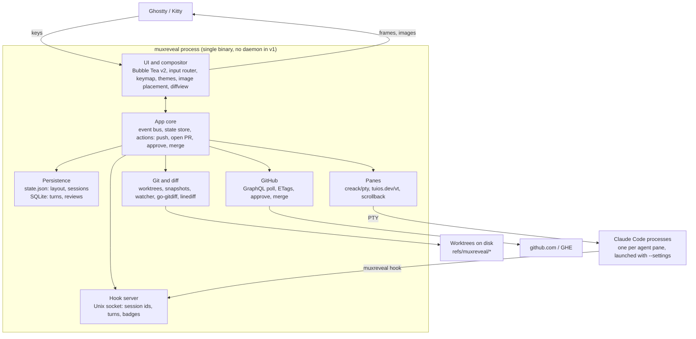

# MuxReveal v1 - Requirements & Architecture

As of 2026-10-26.

## Overview

MuxReveal is a single-binary Go TUI that hosts coding agents in live terminal panes and puts the review loop beside them: live diffs, PR review, CI status, push, open PR and merge. v1 is A-lite: one process owns the PTYs, with no daemon. Layout and agent sessions persist to disk and resume on start.

Terminal emulation comes from `tuios.dev/vt`, the emulator TUIOS publishes as a standalone library. MuxReveal owns everything above it: compositor, panes, review, GitHub.

**Goals for v1**

- Replace herdr for day-to-day agent multiplexing with Claude Code.
- Never open the GitHub web UI to read, approve or merge a PR.
- Look like a next-gen terminal app: own compositor, Catppuccin themes, inline images.
- Be fully keyboard driven.
- Be "just there": the review and PR views live next to the agents, not in a separate tool.

**Non-goals for v1**

- Detach and reattach while agents keep running (v2: daemon).
- Our own agent harness. Agents are external CLIs; Claude Code is the only adapter in v1.
- Inline review comments, or request-changes reviews.
- Remote machines over SSH, Windows, and a plugin system.
- Sixel or iTerm2 image fallbacks. Ghostty and Kitty both speak the Kitty graphics protocol.

## Functional requirements

IDs are referenced by milestones, plans and STATUS; commits and PRs do not carry them. Priority: **P0** blocks v1, **P1** ships in v1 if possible, **P2** is v1.x.

### Agents and panes

| ID | Requirement | Pri |
| --- | --- | --- |
| AG-1 | Spawn an agent pane running `claude` in a chosen worktree | P0 |
| AG-2 | Splits (horizontal and vertical), resize, zoom, close, swap, and focus movement | P0 |
| AG-3 | Full-fidelity terminal: truecolor, alt screen, mouse, bracketed paste, synchronized output, Kitty keyboard protocol, OSC 8 and 52, wide chars | P0 |
| AG-4 | Scrollback and copy mode with vim motions | P0 |
| AG-5 | Per-pane state badge (working, blocked, idle) from Claude Code hooks | P0 |
| AG-6 | Desktop notification when an agent becomes blocked or finishes | P1 |
| AG-7 | Plain shell panes (non-agent), the default for splits; running `claude` in one makes it an agent pane, and an agent pane whose Claude exits becomes a shell again; the kind comes from the terminal's foreground process | P0 |
| AG-8 | Harness adapter interface so other agents (Codex, opencode) can be added | P0 (interface), P2 (adapters) |
| AG-9 | Tabs: each with its own split layout, focus and zoom; new, rename, close, jump and cycle; the tabs shown in the workspace bar | P0 |
| AG-10 | Move the focused pane to tab N, either following it there or staying on the current tab. N one past the last tab creates a new tab | P0 |
| AG-11 | Break pane: move the focused pane into a new tab of its own, and follow it | P0 |
| AG-12 | Tiling layouts per tab: BSP with auto-split and preselection, master-stack, scrolling columns; rotate, equalize, promote to master | P0 |

### Persistence and resume

| ID | Requirement | Pri |
| --- | --- | --- |
| PR-1 | Persist the layout tree, pane cwd, harness and session id to disk on every change | P0 |
| PR-2 | On start, restore the layout and run `claude --resume <session_id>` in each agent pane | P0 |
| PR-3 | Survives reboots: state is plain files, never process memory | P0 |
| PR-4 | A pane whose session id is missing or invalid falls back to a fresh `claude` and shows a notice | P0 |
| PR-5 | Workspaces: named sets of repos, panes and layouts, switchable | P2 |

### Worktrees

| ID | Requirement | Pri |
| --- | --- | --- |
| WT-1 | Discover existing worktrees with `git worktree list --porcelain` | P0 |
| WT-2 | Create a worktree and branch from a base under the worktree root (default `<repo>/.worktrees/<branch>`), then spawn an agent in it. On first use in a repo, add `.worktrees/` to `.git/info/exclude`, keep it out of MuxReveal's own watcher, and list detected tools that need their own ignore entry (JetBrains, VS Code watcher, Jest/Vitest, pytest, tsc, ESLint, Docker). A sibling `../<repo>.worktrees/` layout is a config option | P0 |
| WT-3 | After merge, offer to remove the worktree and delete the local branch | P1 |

### Agent diff

| ID | Requirement | Pri |
| --- | --- | --- |
| DF-1 | Branch mode: diff from the merge-base with the base branch to the working tree, including untracked files. The base is the PR's base once a PR exists, else the repo default branch | P0 |
| DF-2 | Turn mode: diff of what the agent changed in its last turn; step back through earlier turns | P0 |
| DF-3 | Updates live as files change, debounced | P0 |
| DF-4 | Unified and side-by-side layouts, syntax highlighting, intra-line word diff | P0 |
| DF-5 | File tree with per-file stats; hunk navigation | P0 |
| DF-6 | Toggle any file between diff view and full file with changes highlighted | P0 |
| DF-7 | Reviewed-hunk tracking: mark hunks read, keyed by content hash; only unread shows by default | P1 |

### Pull requests and CI

| ID | Requirement | Pri |
| --- | --- | --- |
| GH-1 | PR list with tabs: agent branches, review requested, all open | P0 (agents), P1 (others) |
| GH-2 | PR diff rendered with the same engine as the agent diff, including the full-file toggle | P0 |
| GH-3 | Rendered PR description and conversation (read only) | P1 |
| GH-4 | Live CI checks per PR: status, duration, and link to logs; failed job log tail in-app | P0 (status), P1 (log tail) |
| GH-5 | Approve a PR | P0 |
| GH-6 | Merge with merge, squash or rebase; respects repo-allowed methods and branch protection; optional branch delete | P0 |
| GH-7 | github.com and GHE, using hosts and tokens from `gh` | P0 |

### Git actions

| ID | Requirement | Pri |
| --- | --- | --- |
| GA-1 | Push the current agent branch, setting upstream on first push | P0 |
| GA-2 | Open a PR: compose overlay with title, body, base branch and draft toggle | P0 |
| GA-3 | Body prefilled from `.github/pull_request_template.md`, else the commit log; edit in-app or in `$EDITOR` | P0 |
| GA-4 | Live markdown preview while composing | P1 |
| GA-5 | Auto-detect PRs that agents opened, by branch lookup | P0 |

### Markdown, UX and themes

| ID | Requirement | Pri |
| --- | --- | --- |
| MD-1 | Render markdown for PR bodies, agent plan files and repo docs: headings, lists, tables, code with highlighting, links | P0 |
| MD-2 | Inline images (local paths and remote URLs, including GitHub user-attachments with auth) via the Kitty graphics protocol | P0 |
| UX-1 | Every action reachable by keyboard; which-key style hint popup after the leader key | P0 |
| UX-2 | Command palette with fuzzy search over all actions | P0 |
| UX-3 | User-remappable keymap in config | P1 |
| TH-1 | Theme engine from day one; ship Catppuccin Latte, Frappé, Macchiato and Mocha | P0 |
| TH-2 | Syntax highlighting themed from the same palette | P0 |
| TH-3 | Follow terminal light/dark mode where the terminal reports it | P2 |

### Mouse and clipboard

| ID | Requirement | Pri |
| --- | --- | --- |
| UX-4 | Focus follows mouse: hovering a pane focuses it, no click needed. Config option, off by default; never steals focus from an open overlay or palette | P0 |
| UX-5 | Copy on select: a mouse selection is copied to the system clipboard on release, pasteable in any app. Config option, off by default | P0 |
| UX-6 | Selection works in terminal panes (including scrollback), diffs and rendered markdown; double-click selects a word, triple-click a line, alt+drag a rectangle | P0 |

```toml
[mouse]
focus_follows_mouse = false
copy_on_select = false

[clipboard]
osc52 = true
native = true
```

- `focus_follows_mouse`: hovering a pane's content or top border focuses it, through the same path as a click, so guests get their focus reports. The outer terminal is asked for all-motion mouse reporting only while this is on, else cell-motion. Hovering the focused pane, a side or bottom border, a bar or an empty cell does nothing, and so does hovering while a confirm, prompt, overlay, copy mode or the leader is open, or while a button is held.
- `copy_on_select`: the release that ends a drag, a double-click or a triple-click copies the selection when its text is not empty. A plain click never copies.

- The compositor gets every mouse event first, so selection lives in MuxReveal's own screen model. While a confirm, prompt, overlay, copy mode or the leader (with or without its popup) is open, every mouse event is ignored.
- A plain left-button drag selects in every pane, without a modifier. The selection stays in the pane where the drag began and is clamped to that pane's content even when the pointer leaves it. A drag is a stream selection, `alt+drag` a rectangle, a double-click selects a word and a triple-click a line (same cell within 400 ms). Soft-wrapped lines copy as one line.
- The selection is stored against the pane's scrollback by stable row, so it stays on the same text while output scrolls, and it is painted onto the rows as drawn, so a held synchronized update does not tear it; one selection exists at a time and it is drawn only while its pane is visible. A click in any pane's content, a new drag, a key or paste sent to its pane, or the pane closing, resizing or switching between the main and alt screen clears it. Opening copy mode (`leader [`) clears it; other leader commands and tab switches do not.
- A click in a pane's content focuses it; a click on its top border only focuses; a click on a tab switches to it; a pane's side and bottom borders, the rule and the toast ignore clicks, and a click on the toast reaches what is under it.
- A program that asked for mouse reporting gets a click (press then release) when the button is released in the cell where it went down, the wheel, middle and right buttons, and button-less motion only while `focus_follows_mouse` is on (the outer terminal is in cell-motion mode otherwise). A drag never reaches it: it selects instead. Selection gestures belong to MuxReveal and single clicks to the program: the second and third press of a double or triple click select a word or line and the program gets nothing for them (it already got the first click).
- `leader y` (`copy.selection`) copies the selection and keeps it. Every copy goes out as OSC 52 to the outer terminal (and as the primary selection on Linux); both Ghostty and Kitty accept it by default, and it works over SSH.
- `leader [` (`copy.mode`) enters copy mode on the focused pane, with a block cursor at the bottom-left of its current view. Copy mode owns every key (and drops pastes) until it ends, and the program receives none of them. The cursor and selection stay on the same text while output arrives, and the pane's top border carries the COPY tag. `y` copies the selection and exits, `q` or `esc` exits and returns the view to live; it also ends when the pane closes, resizes or switches between the main and alt screen. Keys: `h j k l`, `w b e`, `0 ^ $`, `g g` / `G`, `ctrl+u` / `ctrl+d`, `ctrl+b` / `ctrl+f`, `H M L`; `v` stream, `V` line and `ctrl+v` block selection; `/` and `?` search forward and backward, `n` / `N` repeat.
- On a local session (neither `SSH_CONNECTION` nor `SSH_TTY` set) a copy also writes the native clipboard, off the update loop with a 2 s timeout: `pbcopy` on macOS; otherwise `wl-copy` (and `wl-copy --primary`) when `WAYLAND_DISPLAY` is set, else `xclip -selection clipboard` (and `primary`) when `DISPLAY` is set, else no native write. A missing tool is logged once.
- A program's own OSC 52 write takes the same path, hidden tabs included. A program's clipboard read is never answered with the clipboard's content.

## Architecture

One process owns the screen, the PTYs and every service. It talks to Claude Code in two directions: bytes over the PTY, and events back through hooks.



The app core is the only thing that mutates state. Services post events to it; the UI renders from it.

**Module layout**

One Go module, `github.com/mhersson/muxreveal`.

| Package | Responsibility |
| --- | --- |
| `cmd/muxreveal` | Binary: CLI, `hook` subcommand, wiring |
| `internal/core` | Event bus, state store, actions, config, tab layouts (`internal/core/tiling`) |
| `internal/ui` | Compositor, widgets, keymap, themes, image placement |
| `internal/term` | PTY plus the `VT` interface; `tuios.dev/vt` adapter (fallback `charmbracelet/x/vt`) |
| `internal/harness` | `Harness` interface; Claude Code adapter (launch args, hook settings, resume) |
| `internal/git` | Worktrees, turn snapshots, watcher, diff engine, highlighting; `linediff` and `invisible` (ported from tuios) |
| `internal/github` | Auth via `gh`, GraphQL and REST client, poller, PR actions |
| `internal/md` | Markdown to styled cells plus image references |
| `internal/store` | `state.json` and SQLite persistence |

```go
type Harness interface {
	ID() string                                             // saved with each agent pane: "claude-code"
	Program() string                                        // foreground process name of a running agent: "claude"
	Launch(settings string, resume core.SessionID) []string // agent argv; settings "" omits --settings, resume "" starts fresh
	Settings(exe string) ([]byte, error)                    // the --settings file whose hooks run `exe hook <ID()>`
	ParseEvent(payload []byte) (Event, error)               // one hook payload as read from stdin
}

type Event struct {
	Pane       core.PaneID     `json:"pane"`
	Name       string          `json:"name"`                 // the harness's hook event name, for logs
	Session    core.SessionID  `json:"session,omitempty"`
	Transcript string          `json:"transcript,omitempty"`
	State      core.AgentState `json:"state,omitempty"`      // AgentUnknown leaves the state as it is
	Start      bool            `json:"start,omitempty"`      // Session is now the pane's current session
	End        bool            `json:"end,omitempty"`        // the session ended
	Cwd        string          `json:"cwd,omitempty"`        // the agent's working directory, from the hook
	TurnStart  bool            `json:"turn_start,omitempty"` // a prompt was submitted
	Done       func()          `json:"-"`                    // set by the server on a held event; call it once the turn snapshot is taken
}
```

`internal/harness` also holds the hook socket, server and client (see Claude Code integration via hooks).

## Tech stack

Go 1.27 (`tuios.dev/vt` needs 1.26 or later). The reason for Rust was a proven VT emulator; `tuios.dev/vt` removes that reason, and Go is the team's main language.

| Concern | Choice | Why |
| --- | --- | --- |
| TUI | Bubble Tea v2 + Lip Gloss v2 + Bubbles v2 | Cell-based renderer, mature input handling; TUIOS proves it can host many busy panes |
| VT emulation | `tuios.dev/vt`; fallback `charmbracelet/x/vt` | Emulator TUIOS runs agent panes on daily: scrollback, Kitty graphics and keyboard protocol, OSC 133. Wrapped behind our `VT` interface. The fallback is as fast but has no Kitty keyboard, Kitty graphics, OSC 52 or OSC 133, and Claude Code does not use synchronized output on it (checked live with and without `TMUX` in Claude's environment). |
| PTY | `github.com/creack/pty` | Standard Go PTY package; macOS and Linux |
| Git | `git` CLI (plumbing and porcelain v2, `-z` output) | Keeps the user's credential helpers, hooks and config; fast enough; one code path for reads and writes |
| Diff | `git diff --histogram` parsed with `bluekeyes/go-gitdiff`; intra-line spans from the ported tuios `diffview` (`Changed`), computed when rendering | Same hunks as git; tuios's span rule |
| Diff rendering | Ported tuios `diffview` with its lexers (M2b) | Highlighting, gutter, tints and side-by-side pairing built for the same job |
| Syntax | Chroma v2 | Ships Catppuccin styles; wide language coverage |
| Markdown | `yuin/goldmark` (GFM) + our own renderer | Full control of layout and image placement; Glamour has no images |
| Images | Own Kitty graphics encoder; `image/*` + `golang.org/x/image` for decode and scaling | The protocol is small; port TUIOS's passthrough (MIT) if it's cleaner |
| File watching | `fsnotify` with our own directory walk | Maintained; the walk skips `.git` internals, `.worktrees` and ignored directories; `rjeczalik/notify` is unmaintained since 2023 and uses FSEvents on macOS only with cgo |
| GitHub | `cli/go-gh/v2` for hosts and tokens; `net/http` REST with ETags; `Khan/genqlient` for typed GraphQL | Same auth as `gh`, full control of conditional requests |
| Fuzzy finder | `sahilm/fuzzy` | Palette and pickers |
| Config and state | `pelletier/go-toml/v2`; `encoding/json`; `modernc.org/sqlite` | TOML config, JSON layout state, pure Go SQLite (no cgo) for turns, reviewed hunks and caches |
| Clipboard | OSC 52 plus direct exec of `wl-copy`, `xclip` or `pbcopy` with explicit arguments | No cgo and no shell; `atotto/clipboard` is not used because its primary-selection switch is global state and it drops the clipboard arguments |
| Notifications | Terminal escapes (OSC 99 for Kitty, OSC 9 or 777 for Ghostty); fallback `gen2brain/beeep` | No extra daemon; native to both terminals |
| CLI | `spf13/cobra` | `muxreveal`, `muxreveal hook claude-code`, future subcommands |
| Diagnostics | `log/slog` to a file | Structured logs, never to the screen |

## Key technical designs

### Terminal layer

- `internal/term` defines a small `VT` interface: write bytes, resize, read the cell grid and cursor, scrollback access, title and mode queries, Kitty image events. Only the adapter imports `tuios.dev/vt`.
- Each pane runs one goroutine reading its PTY into the emulator, then sends a "pane dirty" message to Bubble Tea. Rendering is event driven: our code has no fixed tick. Bubble Tea v2's own 60 FPS ticker remains, so idle CPU is near zero (about 0.35 % of one core with six idle panes), not zero.
- Each pane keeps a per-row string cache; a dirty pane re-renders only its rows from cells to strings. Bubble Tea calls `View` after every message, so the frame is rebuilt from the row caches each time as one string that Bubble Tea re-parses and diffs in full, and it writes only the cells that changed. tuios has no damage API, so row-change detection is ours.
- The compositor honors synchronized output (mode 2026). tuios's own sync hold reads the wall clock, so MuxReveal tracks mode 2026 from the emulator's mode callbacks and applies its own 1 s hold on an injectable clock.
- Kitty graphics from MuxReveal's own views (markdown images) and from agents are placed by the compositor, which knows every cell's position. Agent image passthrough is v2.
- Panes answer OSC 10 and 11 queries with the theme's text and background colours (also during the theme picker's preview), through tuios `SetReportColors`; guests that turned on mode 2031 get a notice when they change.
- tuios encodes Kitty and modifyOtherKeys keys; the legacy encoding is ours: an xterm-style encoder with the `CSI 1;<mod>X` modifier forms, nothing sent for a key it cannot encode, and repeat events encoded like presses. Paste goes through tuios `SanitizePaste`.
- A pane can show its history instead of the live screen. Rows are numbered from the oldest history line, with the live screen after the history. A scrolled view is anchored to a row that does not move when output scrolls or when the 10000-line cap drops old lines, so it keeps showing the same text until that text is dropped, then clamps to the oldest line. The anchor is the row plus the number of lines dropped from the history so far, which `VT.HistoryTrimmed` counts (cap overflow, `CSI 3J`, reflow). A scrolled pane draws its history rows from a view cache keyed by the anchor, the history length, the size and the live rows' change count, so an unchanged frame reuses its strings; the live row cache is separate and unchanged. The alt screen has no history and is always live. A resize, a switch between the main and alt screen, a key and a paste all return the view to live; leader commands leave it alone, and `leader ctrl+space`, which sends ctrl+space to the pane, returns it to live.
- The mouse wheel acts on the pane under the pointer, in its content cells only (not the border, the bars or empty cells), without moving focus. If the guest tracks the mouse the event is forwarded in pane coordinates; else on the alt screen three up or down key presses per notch are sent, encoded per the guest's cursor-key mode; else the view scrolls three lines per notch, and scrolling down to the bottom is live. The wheel is ignored in every state where mouse events are (see Mouse and clipboard). The cursor is hidden while the focused pane is scrolled.
- Every pane PTY, agent or shell, gets `TERM=xterm-256color` and `COLORTERM=truecolor` and never inherits `TMUX` or `TMUX_PANE`, because MuxReveal is its terminal.

### Panes and layout

- Each tab has its own layout mode, pane order, focus and zoom; the rules below apply per tab. The mode is `bsp`, `master-stack` or `scrolling`; a new tab starts in the configured `default_mode` (see Config), and `leader space` cycles it in that order (`layout.set.*` in the palette sets one). The layout code is `internal/core/tiling`, tuios's layout package ported with its tests; it knows window ids and rectangles and nothing of MuxReveal. Core keeps each tab's layout as plain values (the mode, the panes in order, the BSP tree, the master ratio, the scrolling columns), so a state copy stays a value copy, and one function, `core.Arrange`, turns a tab into the pane rects the UI draws and the sizes the PTYs get.
- Geometry is integer cells. Tiles are laid out over the body (the rows from the one under the rule to the last, the full width) edge to edge, with no gap, and each tile is a pane's rect: the pane's rounded box is drawn on the rect's outline, so neighbouring boxes touch, and its content is the rect inset by one cell on every side. A BSP split of a box `W` wide at ratio `r` gives its first child `floor(W*r)` columns and the second child the rest; a horizontal split does the same with the height and rows. A pane is drawn only when its rect is at least 3x3 (a frame around one content cell), lies inside the body and is disjoint from the panes kept before it in the tab's pane order; every mode applies this rule. A pane that is not drawn is left out of the rects and sizes, so a tiny terminal drops panes instead of producing negative sizes; the UI gives it a 1x1 PTY. A body under 3x3 yields no rects and stays blank. A pane's PTY size is its content rect. Focus and swap moves read the same rects the UI draws, so a pane that is left out is never a target.
- **BSP** keeps a binary tree. A leaf is a pane; a split has two children, A (left or top) and B (right or bottom), and a `ratio`, the share of the space A takes. `vertical` splits put the children side by side; `horizontal` splits stack them.
- **Master-stack** lays the tab's panes out in their order: the first `master_count` are masters and the rest form the stack, placed by `master_position` (left, right, top, bottom or center) with `master_grid` as configured. The tab has its own master ratio, initially `master_ratio`.
- **Scrolling** keeps columns of panes, each with a width (a share of the body). Only columns that fit whole are drawn, and the visible ones stretch to fill the body, so no pane is clipped and no space is left empty. The tab keeps its first visible column, `first`. The visible set starts at `first` and takes columns while their widths sum to at most 100 %; `first` moves only as far as needed to keep the focused column visible (a focused column left of `first` becomes `first`; one right of the visible set makes `first` the smallest value whose run to the focused column fits). The visible columns split the body width in proportion to their widths, and neighbouring columns' frames touch; the panes of a column split its height equally. Hidden panes are not drawn, not hit by the mouse and not reached by focus moves other than left and right; their PTYs are sized as if their column were shown alone at its nominal width (`round(width x body width)`, at least 3, minus the frame) with the column's height split equally. The bottom borders of the edge panes show how many columns are hidden (see Frames). A new column takes `column_width` percent of the body (50 by default, so two fit).
- Splits follow vim: `leader s` opens a shell below the focused pane and `leader v` one to the right, and the new pane takes focus. In BSP the new pane is child B, takes half of the focused pane (ratio 0.5) and splits it along the matching axis; the auto scheme (`auto_scheme`) decides the axis only where no direction is given, for a pane moved into the tab and for the rebuild on a mode switch. In master-stack the new pane is appended to the end of the order. In scrolling `leader v` adds a column after the focused column and `leader s` adds the pane to the focused column right below the focused pane. `leader n` opens an agent pane to the right of the focused one, as `leader v` places a shell. A preselection overrides the side (see below).
- `h j k l` focus the nearest pane in that direction by tuios's `Neighbour` rule on the tiles: a candidate must lie fully beyond the focused tile on that axis; panes that share at least one cell across the axis win; then the nearest; at equal distance an overlap of two cells or more beats one cell; then the closest centre across the axis; then the largest overlap; then the lowest index in the tab's pane order. There is no wrap. In scrolling, left and right go to the adjacent column, to the pane at the same index in it (clamped to its last pane), and scroll it into view; up and down move within the column.
- `H J K L` resize the focused pane in steps of 0.05, rounded to 0.01 and clamped to [0.1, 0.9]; `L` and `J` grow the left or top child. In BSP they move the nearest divider on that axis. In master-stack, on the axis that divides masters from the stack (left, right and center positions divide columns; top and bottom divide rows), `L` and `J` add to the share of the left or top region and `H` and `K` take it away (with the masters on the right or bottom that region is the stack, so the masters' ratio shrinks; in center `L` grows the middle column); the other axis does nothing. In scrolling `H` and `L` shrink and grow the focused column's width by 0.05 within [0.1, 1.0] and `J` and `K` do nothing.
- `leader ctrl+h`, `ctrl+j`, `ctrl+k`, `ctrl+l` swap the focused pane with its neighbour in that direction, chosen as for focus. In BSP the swap exchanges two leaves and the tree keeps its shape and ratios, so each position keeps its size and the moved pane takes the size of the position it lands in. In master-stack the focused pane exchanges places with its `Neighbour` in the order. In scrolling left and right exchange it with the pane at the same index of the adjacent column, and up and down exchange within the column. Focus stays on the moved pane. A swap clears zoom; one with no neighbour does nothing and keeps it.
- `leader z` zooms the focused pane to fill the body. Opening a pane, closing a pane, or moving focus clears zoom; a focus move that has nowhere to go keeps it.
- Closing a pane gives its space to the rest of its tab, in the pane's own tab even when that tab is hidden. Closing another pane keeps focus. In BSP the sibling takes the space and closing the focused pane focuses the first leaf of the sibling. In master-stack the pane leaves the order, and a closed focused pane passes focus to the pane now at its index, else the one before. In scrolling the pane leaves its column and a column left empty is removed; a closed focused pane passes focus to the pane now at its index in the column, else the one above, else the top pane of the column to the left, else the top pane of the column to the right. Pane and tab IDs (`p1`, `t1`, ...) are never reused within a session.
- **Preselection** (BSP only, per tab, not saved): `leader ;` then `h j k l` sets the side where the next pane opens, and `leader ;` then `esc` clears it. The next pane that opens in that tab by any means (split, agent, a move in) opens on that side of the focused pane at ratio 0.5 (`h` and `k` put the new pane first, `l` and `j` second) and the preselection is cleared. A mode switch clears it too; focus moves keep it. The focused pane's top border shows it as a tag (see Frames). In other modes `leader ;` shows the notice `preselection works in BSP layouts`.
- **Rotate** (`leader r`) flips the axis of the focused pane's parent split and keeps its ratio; a focused pane with no parent shows the notice `nothing to rotate`, and outside BSP the notice is `rotate works in BSP layouts`. **Equalize** (`leader =`) makes panes equal along each axis rather than setting every ratio to 0.5: in BSP each split's ratio becomes `w(A) / (w(A) + w(B))`, where for a vertical split `w` counts columns (a leaf is 1, a vertical split adds its children, a horizontal split takes the larger child) and for a horizontal split it counts rows the same way, rounded to 0.01 and clamped to [0.1, 0.9]; in master-stack it resets the tab's ratio to `master_ratio`; in scrolling it sets every column to `column_width`. **Promote** (`leader enter`, master-stack only, dwm's zoom) swaps the focused pane with the first pane of the order, or with the second when the focused pane is first, and focuses the pane now first; outside master-stack the notice is `promote works in master-stack layouts`.
- **Mode switches** rebuild the tab from its pane order, as tuios does: BSP inserts the panes one by one, each splitting the pane inserted before it with the auto scheme; master-stack uses the order as is (masters first) with the configured ratio; scrolling makes one column per pane at the configured width. Split ratios and column widths reset. A switch clears zoom and the preselection, keeps focus and every pane and process, and shows the notice `layout: <mode>`; setting the mode a tab already has changes nothing, and an empty tab only gets its mode.
- **Moving panes**: `leader > 1-9` moves the focused pane to tab N and follows it, `leader . 1-9` moves it and stays on the current tab, and `leader !` breaks it into a new tab of its own and follows it. N is the tab's 1-based position; N one past the last tab creates a new tab at the end in the configured default mode. The pane keeps its process, PTY, scrollback, id and agent state; only its size changes. Placement follows the target's mode: BSP at the target's preselection, which is then cleared, else beside the target's focused pane with the auto scheme; master-stack appended; scrolling a new column after the focused one. The moved pane becomes the target tab's focused pane, and the target's zoom is cleared. The source tab loses the pane as closing it would treat focus, and its zoom is cleared when the moved pane was the zoomed one; a source tab left empty is removed, and tab numbers shift as when a tab is closed. Following makes the target tab active (by its index after any removal); not following keeps the source tab active, unless that tab was removed, in which case the target becomes active. Copy mode and any selection on the moved pane end. These do nothing and show a notice: a move to the pane's own tab (`the pane is already in tab N`), a move to a tab more than one past the tab count, or above 9 (`there is no tab N`), and moving or breaking the only pane of a tab to a new tab (`the pane is alone in its tab`).
- A session holds at most 64 panes across all tabs (`core.MaxPanes`, also the limit of the saved file). Opening another with a split, `leader n` or a new tab shows the notice `at most 64 panes` and starts no process.
- At least one tab always exists. Closing a tab's last pane removes the tab unless it is the only one, which stays and shows the welcome card. Closing the active tab activates the tab to its left, or the new first tab; closing a hidden tab keeps the active tab. Switching tabs changes only which tab is active; each tab keeps its layout mode, focus and zoom.
- Without a saved layout MuxReveal starts with one shell pane in the launch directory, in the first tab; with one, the first size message starts every saved pane at its own rect (see Persisted state). It never quits by itself.
- Pane output, exit, hold, cwd and grace-probe messages carry the pane they came from; one from a pane since replaced under the same id (a restarted agent) is dropped, so an old process's late exit never closes the new pane.
- Shell panes run `$SHELL -l`. `leader n` opens an agent pane to the right of the focused pane, in its cwd, running `$SHELL -l -i -c 'claude --settings <file>; exec "$SHELL" -l'`, with the settings path and any session id single-quoted for the shell (a restore adds `--resume <id>`), so leaving Claude leaves a shell in the pane. `$SHELL` falls back to `/bin/sh`. Shell panes and agent panes both get `MUXREVEAL_PANE` and `MUXREVEAL_SOCK` in their environment.
- `leader x` closes the focused pane at once; for an agent pane it first asks in a confirm overlay (`y` or `enter` confirms, `n` or `esc` cancels). `leader q` quits and asks first when any agent pane is open. `leader X` closes the active tab with all its panes, asking first when it holds an agent pane. A pane whose process exits closes without asking, and so does an open confirm about it or about its tab once the tab is gone. The confirm owns every key while it is open.
- The cwd a pane shows and its splits inherit is the last OSC 7 path the pane reported, else on Linux the `/proc` cwd of the terminal's foreground process group, else the cwd the pane started in. It is looked up off the UI loop, at most every 500 ms per pane.
- A pane's kind follows its terminal's foreground process. The same probe reads the name of the foreground process group leader (`/proc/<pgrp>/comm` on Linux, the `kinfo_proc` `p_comm` on macOS). The harness's program (`claude`) makes the pane an agent; anything else makes it a shell. Becoming a shell clears the pane's harness, session, transcript and state. Hooks never change the kind, and hook events for a pane that is not an agent are ignored.
- Claude is the foreground leader only when it runs under a shell with job control, which `$SHELL -l -i -c` gives in sh, bash and zsh and an interactive shell pane gives everywhere; for fish the agent command turns it on with `status job-control full`.
- A pane that MuxReveal launched as an agent (`leader n` or a restore) stays an agent until Claude has been seen in the foreground and has left it, or has not appeared within 10 s of the launch (one extra probe fires at 10 s), so a slow shell start-up or a missing `claude` never demotes the pane early. A pane launched with `--resume` that has had no `SessionStart` yet is also exempt from the kind rule until that probe (see Persisted state, Resume).
- A hand-typed `claude` makes the pane an agent by this rule but has no hooks, so it shows no badge and has no session id; restored, it gets a fresh `claude` and a notice.

### Visual design

The chrome is framed: every pane is its own rounded box with its title in its top border. A workspace bar runs along the top row and a rule under it; the body takes every row below. There is no status bar: notices are a toast, and copy mode, the leader and a pending key sequence show in the pane's own borders and in popups. Colours come only from theme roles. Icons are single-cell Nerd Font glyphs (see Glyphs); `icons = false` drops every one of them, the segment edges included, while box drawing, block elements and braille stay.

#### Screen rows

- Row 0 is the workspace bar and row 1 is the rule; the rows from 2 to the last are the body.
- The rule is a full-width `─` in `Border`; it takes no clicks.
- Panes are laid out in the body `{X: 0, Y: 2, W: width, H: height-2}`; there is no outer frame.
- Pane rects follow Panes and layout. A pane's frame is on its rect's outline; the first row of the rect is its top border, which is its header row, and its content is the rect inset by one cell on every side. Two neighbours' frames touch (`││`, `╮╭`) and share no cell.
- A pane needs at least 3 rows and 3 columns for its frame, and so does the body; a smaller body stays blank. Height 1 shows the workspace bar only; height 2 adds the rule. Every row is exactly the terminal width.
- An empty tab shows the welcome card in the body, without frames.

#### Frames

- Lines are single-weight box drawing: every pane's box has `╭ ╮ ╰ ╯` at its four corners, `─` along the top and bottom and `│` on the sides. There are no junction glyphs.
- Unfocused borders are `Border`. The focused pane's whole box, all four sides, is its kind colour (`Agent` for agents, `Shell` for shells).
- The title is set into the top border from the cell after the corner: `─`, space, kind icon (kind colour, bold), space, title, space. Focused: the title in the kind colour and bold. Unfocused: the title in `Muted`. The title is the guest's OSC title, else `claude` or `shell`.
- Tags sit at the right end of the top border, ending one `─` before the corner, with one `─` between two tags: ` 󰊓 zoom ` (`Accent`, bold) on a zoomed pane, and ` 󰁝 N ` (the same style; ` ↑ N ` with icons off) on a scrolled pane, where N is the number of lines above the live screen, left of the zoom tag; and the state badge (` <icon> working `, ` <icon> blocked `, ` <icon> idle ` in `Working`, `Blocked`, `Idle`, bold), the rightmost tag, with the zoom tag and then the scroll tag to its left. The working icon is a braille spinner (`⠋⠙⠹⠸⠼⠴⠦⠧⠇⠏`, about 8 frames a second) that animates only while the agent works, so idle CPU is unchanged; blocked is 󰀦 and idle is 󰗡. With `icons = false` the badge reads ` ⠋ working `, ` blocked ` or ` idle ` (braille stays). An agent pane with no state yet, because Claude has sent no hook, shows no badge.
- In copy mode the copy pane's top border carries the leftmost tag of the border, ` 󰆏 COPY ` (`Info`, bold; ` COPY ` with `icons = false`), left of the scroll tag. Tags that do not fit between the corners are left out, the badge, then the zoom tag, then the scroll tag, and COPY is the last to go.
- While a copy-mode search is typed, that pane's bottom border shows, after `╰─` and a space, the mark `/` or `?` (`Info`, bold), the query (`Fg`, at most 32 characters, cut to the room the border has) and the terminal cursor on the cell after it. `enter` jumps to the next match (an empty query repeats the last search), `esc` closes the prompt and stays in copy mode, and a miss shows the toast `not found: <query>`. In a scrolling tab this prompt takes the place of a hidden-column count in that border.
- While a preselection is set, the focused pane's top border carries the tag ` <arrow> next ` in `Accent`, bold, right of the COPY tag and left of the scroll tag. The arrows are 󰁍 (left), 󰁅 (down), 󰁝 (up) and 󰁔 (right); with `icons = false` they are `←`, `↓`, `↑` and `→`.
- In a scrolling tab, the bottom border of the bottom pane of the leftmost visible column shows how many columns are hidden on the left, ` ‹ N ` after `╰─`, and that of the rightmost visible column shows the hidden count on the right, ` N › ` before `─╯`, in `Accent`, bold, only when N > 0 (the same with `icons = false`). Like a title, they are left out when they do not fit.
- When the title does not fit, it shrinks with `…`, and with three cells or fewer left the whole title goes. The tags stay; a tag that does not fit between the corners is left out.
- A title or tag never covers a corner: the title starts after `╭─`, the tags end before `─╮`, and a title with no tag may end right before the `╮`, cut to leave it.
- A zoomed pane's rect is the body, inside its own frame.
- Selected cells, from a mouse selection or copy mode, are drawn on the `Selection` background; the text keeps its colours.

#### Workspace bar (row 0)

Ground `Bar`.

- **Tabs**, from column 0, one segment each: ` N icon name `. N is the 1-based position; the icon is 󱙺 when the tab holds an agent pane, else ; the name is the custom name, else the basename of the tab's focused pane's cwd, else `shell`.
- Active segment: `Accent` background, text `OnAccent` and bold. Inactive: `Surface` background, the number `Muted` and bold, the icon and the name `Dim`. An inactive tab's icon takes the colour of its most urgent agent: blocked, then working, then idle.
- One edge cell follows each segment:  (U+E0BC) in the segment's colour on the next segment's colour, or on `Bar` after the last segment. Between two inactive segments the edge is a thin  (U+E0BB) in `Bar` on `Surface`.
- **Tray**, right-aligned to the last column, at least two cells from the tabs. One `Surface` region opens with  (U+E0BA, `Surface` on `Bar`); its modules are separated by  (`Bar` on `Surface`), and each reads ` icon value `. The clock closes the bar on its own `Clock` segment, opened by  (`Clock` on `Surface`, or on `Bar` when it is the only module): ` 󰥔 14:32 ` in `OnAccent`, bold.
- Modules, left to right:
  - **PR and CI** (M3; hidden until then) for the focused pane's branch: icon  (U+F407) in `Info`, the number (` #8`, `Fg`, bold), then the checks: 󰔟 and done/total (` 3/5`) in `Warning` while any check runs. M3 settles the passed and failed forms in the same slot.
  - **Agents** (absent while no agent pane is open): one 󱙺 per agent pane across all tabs, in `Agent`. Each icon takes its state colour (`Working`, `Blocked`, `Idle`), followed by ` 󰀦N` in `Blocked`, bold, when N agents are blocked. With `icons = false` the text `agents N` is followed by ` blocked N` in `Blocked`, bold, when N > 0.
  - **Git** of the focused pane (absent outside a repo): icon  in `Git`, the branch in `Fg` (at most 18 cells, cut with `…`), then a space and the dirty marker  (U+F444) in `Warning` when there are changes; a detached HEAD shows the first 7 characters of the commit. The probe runs with fsmonitor off and without the inherited repository variables; repository-configured filters can still run, as they do for a shell prompt's git integration.
  - **Load:** icon 󰻠 in `Load`, a braille sparkline of the last 10 CPU samples (5 cells, two samples per cell, `Load`; a sample fills 1 to 4 dots of its braille column from the bottom, one per started quarter of CPU), the CPU share (` 12%`, `Fg`) (on macOS the one-minute load average over the cores), then `  󰍛 9.8G` of memory in use (`Muted`).
  - **Clock:** `HH:MM`, minute resolution.
- **Narrow terminals** give way in this order: load, git, PR and CI leave the tray; inactive tab names shrink to ` N icon `, then to ` N ` (longest names first); the clock leaves; the active tab's name shrinks, to ` N icon ` and then ` N `; the agents leave. The active tab always stays visible: if the ` N ` segments still do not fit, the segments farthest from the active tab are left out.
- With `icons = false`, segments are separated by one `Bar` cell, tray modules by `│` (`Bar` on `Surface`), and there are no edge cells. Text stands in for the module icons: the agents read `agents N` (`Fg`), the dirty marker is `*`, the load reads `cpu ` (`Muted`) before the sparkline and `  mem 9.8G` after the share, and the checks read `ci 3/5`.

#### Notices and the status bar's contents

There is no status bar. What it showed has these homes:

| It showed | Now |
| --- | --- |
| The notice (`Warning`, with 󰀪) | The toast, below |
| The mode segment ` MuxReveal `, and the key legend with its `ctrl+space then` lead-in | Dropped: the leader's which-key popup lists the keys |
| The leader waiting (` 󰌌 ctrl+space `, `esc cancel`) | Only the which-key popup, after its delay |
| A pending sequence (` 󰌌 ctrl+space > `, `1-9 tab`, `esc cancel`) | The sequence popup, at once (see Overlays) |
| Copy mode (` 󰆏 COPY `, `v select`, `y copy`, `/ search`, `n next`, `q exit`) | The COPY tag in the pane's top border; the legend is dropped, the keys are in the keymap |
| The search prompt (` 󰍉 Search `, the query) | The pane's bottom border (see Frames) |
| Rename (` 󰑕 Rename tab `, `enter save`, `esc cancel`, `empty automatic name`) | The in-place input in the workspace bar, without a legend |
| The tab's layout mode | Not shown until the tray's layout module lands; the notice `layout: <mode>` still shows when it changes |
| The focused pane's cwd | Dropped: no screen element shows the full cwd; a tab's automatic name is the basename of its focused pane's cwd, and titles do not carry it |

- **Toast.** A rounded box at the bottom right of the body, one cell from the right edge, its bottom border on the last row. Ground `Panel`, border `Warning`, one row ` 󰀪 <notice> ` with the icon in `Warning` and the text in `Fg` (no icon with `icons = false`). The box is as wide as the text needs and at most the body width minus 2, with the text cut by `…`; it is left out when the body is under 3 rows or the text has no room. It shows while a notice is set and goes with the first key press. It never takes keys or mouse events, which reach what is under it, and the which-key popup and the other overlays draw over it. Notices are the ones the commands raise (`layout: bsp`, `ctrl+space > x is not bound`, `not found: <query>` and the rest).

#### Overlays

Square-cornered boxes (`┌ ┐ └ ┘`) on `Panel`. Each title is set into the top border two cells from the corner. Overlays are clipped to the screen, never wrapped, and draw over the toast.

- **Which-key.** Placed bottom-right, one cell from the right edge, with its bottom border on the last row. Border `BorderFocus`; title ` 󰌌 ctrl+space ` in `Accent`, bold.
  - Two columns, split by a `Border` rule that joins the top and bottom borders (`┬`, `┴`). Panes, then Layout, are on the left. Tabs, a blank row, then App are on the right.
  - Group heads `󰯌 Panes`, `󰕴 Layout`, `󰓩 Tabs` and `󰒓 App` are `Accent` and bold, followed by a `Border` rule to the column's end.
  - Rows: the key in `Key`, bold, padded to the column's widest key; two cells; the title in `Fg`.
  - Directional commands collapse into one row each, their keys padded like any other row's: `h j k l` (Focus pane), `H J K L` (Resize pane), `^h^j^k^l` (Swap pane), `1-9` (Jump to tab), `> 1-9` (Move pane to tab), `. 1-9` (Send pane to tab) and `; hjkl` (Preselect). A key that starts a two-key sequence closes the popup and opens the sequence popup. The keys come from the bindings: a family collapses only when all its keys are bound (`1-9` only when they are consecutive); otherwise each bound key gets its own row.
- **Sequence popup.** A sequence prefix (`>`, `.`, `;` after the leader) opens it at once, in the which-key box's place and style: a single column titled ` 󰌌 ctrl+space > ` (the leader's name, then the first key; no icon with `icons = false`) in `Accent`, bold, with one row per second key, laid out like which-key rows, with the key column padded to the widest key as there (`esc      Clear preselection`): after `>`, `1-9  Move pane to tab N` and `esc  Cancel`; after `.`, `1-9  Send pane to tab N` and `esc  Cancel`; after `;`, `h j k l  Preselect side` and `esc      Clear preselection`. The second key closes it, as does `esc`, a paste or an opened overlay.
- **Palette and theme picker.** Centred, width min(64, width-4), top at a quarter of the height, border `BorderFocus`.
  - Title: `  Commands ` (the theme picker: ` 󰏘 Theme `), in `Accent`, bold.
  - Input row: `❯ ` in `Accent`, then the query.
  - A divider row joined to both sides (`├`, `┤`).
  - Result rows: the command's icon (`Muted`; `Accent` when selected), the title (`Fg`, matched runes in `Match` and bold), and the key hint right-aligned (`Key`, bold). The selected row is on `Selection` with a bold title.
  - ` N of M ` (`Muted`) sits in the bottom border at the right.
- **Confirm.** Centred, width min(46, width-2), seven rows tall, top at a third of the height, border `Error`.
  - Title: ` 󰀪 <action> ` in `Error`, bold.
  - Inside, two cells from the left border: a blank row, the question in `Fg` and bold, the detail in `Muted`, a blank row, then the answers.
  - Answers: `[y] <action>    [n] Cancel`, with the brackets in `Subtle`, the keys in `Key` and bold, and the labels in `Fg`.
- **Rename.** Edits the tab in place. The active tab's segment becomes a text input on `Bg` of at most 32 characters that grows with the text: ` N 󰑕 name` with the number and the icon `Accent` and bold, the text `Fg`, the input's cursor, and one more `Bg` cell before the edge cell.

#### Theme roles

Existing roles keep their colours. New roles:

| Role | Catppuccin | Used for |
| --- | --- | --- |
| `Agent` | Mauve | agent frames, titles and icons; tray agent icons |
| `Shell` | Blue | shell frames, titles and icons |
| `Bar` | Base | ground of the workspace bar |
| `Dim` | Subtext0 | inactive tab text |
| `Clock` | Lavender | clock segment |
| `Git` | Flamingo | git icon |
| `Load` | Teal | load icon and sparkline |
| `Working`, `Blocked`, `Idle` | Peach, Red, Green | agent state badges, tray agent icons and tab icons |

The PR and CI slot (M3) uses the existing `Info` role for its icon.

#### Glyphs

All single cell (Nerd Fonts v3 names):

| Glyph | Name | Code point | Use |
| --- | --- | --- | --- |
| 󱙺 | nf-md-robot_outline | U+F167A | agent panes, agent tabs, tray agents |
|  | nf-oct-terminal | U+F489 | shell panes and tabs |
| 󰌌 | nf-md-keyboard | U+F030C | which-key and sequence popup titles |
| 󰑕 | nf-md-rename_box | U+F0455 | rename command |
| 󰊓 | nf-md-fullscreen | U+F0293 | zoom tag, zoom command |
| 󰁝 | nf-md-arrow_up | U+F005D | scrolled pane tag, preselect up |
| 󰥔 | nf-md-clock_outline | U+F0954 | clock |
|  | nf-dev-git_branch | U+E725 | git |
|  | nf-oct-dot_fill | U+F444 | uncommitted changes |
| 󰻠 | nf-md-cpu_64_bit | U+F0EE0 | load |
| 󰍛 | nf-md-memory | U+F035B | memory |
| 󰀪 | nf-md-alert_outline | U+F002A | toast, confirm title |
| 󰯌 | nf-md-view_split_vertical | U+F0BCC | Panes group, split right |
| 󰯋 | nf-md-view_split_horizontal | U+F0BCB | split below |
| 󰓩 | nf-md-tab | U+F04E9 | Tabs group, next, previous and jump |
| 󰝜 | nf-md-tab_plus | U+F075C | new tab |
| 󰒓 | nf-md-cog | U+F0493 | App group |
|  | nf-oct-command_palette | U+F4B5 | palette title and command |
| 󰏘 | nf-md-palette | U+F03D8 | theme picker and theme commands |
| 󰓾 | nf-md-target | U+F04FE | focus commands |
| 󰘖 | nf-md-arrow_expand | U+F0616 | resize commands |
| 󰓡 | nf-md-swap_horizontal | U+F04E1 | swap commands |
| 󰕴 | nf-md-view_quilt | U+F0574 | BSP mode, Layout group, cycle layout |
| 󰛽 | nf-md-page_layout_sidebar_left | U+F06FD | master-stack mode |
| 󰕭 | nf-md-view_column | U+F056D | scrolling mode |
| 󰶭 | nf-md-application_export | U+F0DAD | move and send pane to tab |
| 󰏌 | nf-md-open_in_new | U+F03CC | break pane |
| 󰁍 | nf-md-arrow_left | U+F004D | preselect left |
| 󰁅 | nf-md-arrow_down | U+F0045 | preselect down |
| 󰁔 | nf-md-arrow_right | U+F0054 | preselect right |
| 󰑧 | nf-md-rotate_right | U+F0467 | rotate split |
| 󰇼 | nf-md-equal | U+F01FC | equalize |
| 󰆥 | nf-md-crown | U+F01A5 | promote to master |
| 󰅖 | nf-md-close | U+F0156 | close pane, close tab, clear preselection |
| 󰈆 | nf-md-exit_to_app | U+F0206 | quit |
| 󰆏 | nf-md-content_copy | U+F018F | copy commands, copy tag |
|  | nf-ple-upper_left_triangle | U+E0BC | segment edge |
|  | nf-ple-lower_right_triangle | U+E0BA | tray edge |
|  | nf-ple-forwardslash_separator | U+E0BB | thin segment divider |
| 󰀦, 󰗡 | nf-md-alert, nf-md-check_circle_outline | U+F0026, U+F05E1 | blocked and idle badges |
| , 󰔟 (M3) | nf-oct-git_pull_request, nf-md-timer_sand | U+F407, U+F051F | PR and CI slot |

#### Command icons

The palette shows each command's icon: `palette.open` , `theme.pick` and `theme.set.*` 󰏘, `agent.new` 󱙺, `pane.split.down` 󰯋, `pane.split.right` 󰯌, `pane.focus.*` 󰓾, `pane.resize.*` 󰘖, `pane.swap.*` 󰓡, `pane.zoom` 󰊓, `pane.close` and `tab.close` 󰅖, `copy.selection` and `copy.mode` 󰆏, `tab.new` 󰝜, `tab.rename` 󰑕, `tab.next`, `tab.prev` and `tab.jump.*` 󰓩, `pane.move.tab.*` and `pane.send.tab.*` 󰶭, `pane.break` 󰏌, `layout.cycle` and `layout.set.bsp` 󰕴, `layout.set.master-stack` 󰛽, `layout.set.scrolling` 󰕭, `pane.preselect.left` 󰁍, `pane.preselect.down` 󰁅, `pane.preselect.up` 󰁝, `pane.preselect.right` 󰁔, `pane.preselect.clear` 󰅖, `layout.rotate` 󰑧, `layout.equalize` 󰇼, `layout.promote` 󰆥, `app.quit` 󰈆.

### Claude Code integration via hooks

MuxReveal never edits the user's Claude settings. Every agent it launches runs `claude --settings <file>` (plus `--resume <id>` on a restore) with `MUXREVEAL_PANE` and `MUXREVEAL_SOCK` in the PTY environment. The settings file is generated per instance at `<state dir>/run/<pid>-claude.json` (mode 0600). Each event in the state table below gets one synchronous command handler, `timeout` 5, in the exec form, so no shell parses the path of the running binary:

```json
{
  "hooks": {
    "SessionStart":     [{"hooks": [{"type": "command", "command": "/opt/muxreveal/bin/muxreveal", "args": ["hook", "claude-code"], "timeout": 5}]}],
    "UserPromptSubmit": [{"hooks": [{"type": "command", "command": "/opt/muxreveal/bin/muxreveal", "args": ["hook", "claude-code"], "timeout": 5}]}],
    "Stop":             [{"hooks": [{"type": "command", "command": "/opt/muxreveal/bin/muxreveal", "args": ["hook", "claude-code"], "timeout": 5}]}]
  }
}
```

The example shows three events; the generated file has the same handler for every event in the table. The command is the absolute path of the running binary. Synchronous handlers keep the events in order, and the hook answers in milliseconds, except a turn start, which waits for its snapshot (see below).

**State rules**

| Claude hook (`hook_event_name`) | Effect |
| --- | --- |
| `SessionStart` | session id and transcript recorded; state idle, except `source: "compact"`, which leaves the state |
| `SessionEnd` | session, transcript and state cleared |
| `UserPromptSubmit`, `PostToolUse`, `PostToolUseFailure`, `ElicitationResult` | working |
| `PreToolUse` | blocked when `tool_name` is `AskUserQuestion`, else working |
| `PermissionRequest`, `Elicitation` | blocked |
| `Notification` | blocked for `notification_type` `permission_prompt`, `elicitation_dialog`, `elicitation_url_dialog` and `agent_needs_input`; idle for `idle_prompt`; any other type changes nothing |
| `Stop`, `StopFailure` | idle |

An agent pane whose Claude has sent no hook has no state and shows no badge. The saved session follows every `SessionStart`, which covers `/clear` and fork (they change the id); a plain `--resume` keeps it.

**Quiet output.** Claude redraws its spinner several times a second while it works, and no hook fires when a denied permission prompt is dismissed with `esc`. So a working pane that has printed nothing for 3 s becomes idle, and a key that answers a dialog (`enter`, `esc` or a digit `1`-`9`) sent to a blocked pane makes it working, with the 3 s counted from that key. Hooks always win over these two rules. One app tick of 125 ms runs only while some pane is working; it advances the spinner and applies the quiet rule.

**Hook command and socket**

- `muxreveal hook claude-code` is a subcommand of the same binary. It reads the hook JSON from stdin, parses it with the harness, adds the pane id from `MUXREVEAL_PANE` and sends one compact event (pane, event name, session id, transcript path, state, working directory, and the start, end and turn-start flags) as one JSON line over the Unix socket in `MUXREVEAL_SOCK`.
- The server listens on `<state dir>/run/<pid>.sock` (mode 0600; the `run` directory is mode 0700). Both the socket and the settings file are removed on exit. The client waits up to 2 s for the server's `ok` line, which the server writes once the event is queued, except for a turn-start event (`UserPromptSubmit`), which it answers after the turn snapshot is taken or after 1.5 s, whichever comes first. The snapshot therefore lands before the agent edits anything, and a slow snapshot never holds the agent longer than the budget.
- The server holds a turn-start event's `ok` until the event's `Done` is called (`Server.Hold`). A gate in `cmd/muxreveal` sits between the server and the app's event channel: it forwards every event to the app in order, at once, runs the snapshot for a turn start in its own goroutine with a 1.4 s context, then calls `Done`. An event whose `cwd` is not inside a repository, or whose session id is not a UUID, gets no snapshot and is answered at once.
- `muxreveal hook` always exits 0 and prints nothing to stdout or stderr, also when the environment variables are missing, the socket is gone or the payload is bad. Claude adds the stdout of `SessionStart` and `UserPromptSubmit` hooks to the model's context, so any output would leak into the conversation.
- If the socket or the settings file cannot be set up, MuxReveal runs agents without `--settings` and shows the notice `agent hooks are off: <error>`; a socket path over the platform limit (107 bytes on Linux, 103 on macOS) reads `socket path too long (N bytes, at most M)`.
- Events are applied by the core. An event for a closed pane, an unknown pane id or a pane that is not an agent is ignored, as is an event after `SessionEnd` that has nothing to change.

**Observed on Claude Code 2.1.311**

- The exec form runs: a handler with `command` and `args` ran with its arguments.
- The project's hooks kept running alongside the `--settings` hooks; per the Claude Code hooks docs, settings levels merge rather than replace. Handlers of one event run in parallel.
- A denied permission prompt (`esc`) fires no hook. `Notification` with `notification_type` `permission_prompt` follows `PermissionRequest` after about 6 s. A mid-stream `esc` interrupt of a running turn was not observed live; the quiet rule covers it either way.
- A plain `--resume` fires `SessionStart` with `source: "resume"` and the same session id.
- A refused resume prints `No conversation found with session ID: <id>`, exits 1 within about a second, fires `SessionEnd` (reason `other`) and no `SessionStart`.
- The longest gap in Claude's PTY output while it worked was 0.24 s, so 3 s is a wide margin for the quiet rule.
- Claude's comm is `claude`; see Panes and layout for when it is the foreground leader.

### Turn snapshots

Each turn start records the full working tree as a commit under a private ref, taken before the prompt hook is answered. A temporary index leaves the user's index, stash, HEAD and branches untouched; the user's index file is only read.

1. With `GIT_INDEX_FILE` pointing at a temporary file, copy the worktree's index (`<git dir>/index`) to it with mode 0600 and the source's mtime, so git trusts its stat cache. A fresh index would rehash every file; with a refreshed user index a whole snapshot takes about 157-175 ms on 31.5k files.
2. `git ls-files -t -z --modified --deleted --others --exclude-standard` lists what differs. Untracked files over the size cap (default 50 MiB) are dropped and listed as skipped, as is any path ending in `/` (a nested repository that is not a submodule).
3. `git update-index --add --remove -z --stdin` stages the rest, then `git write-tree` gives the tree. Untracked files that are not ignored enter the tree; ignored files never do; submodules stay gitlinks at their recorded commit.

When the index is missing, empty or unusable (a split index, an `update-index` failure), the snapshot falls back to an empty temporary index plus `git read-tree HEAD` (nothing for an unborn HEAD) and the same staging.

The commit is `git commit-tree --no-gpg-sign <tree> [-p HEAD]` with author and committer `MuxReveal <muxreveal@localhost>` set in the environment, so no user identity or signing setup is needed. The ref is written create-only: `git update-ref --no-deref -m "muxreveal turn" refs/muxreveal/<session>/<n> <commit> ""`.

- The live turn diff is snapshot `n` against the working tree. A past turn is snapshot `n` against snapshot `n+1`.
- Trees are compared, not HEAD, so agent commits mid-turn don't break the diff.
- `n` is one more than the highest number under `refs/muxreveal/<session>/`, 1 for the first. The refs live in the common dir, so every worktree of the repo sees them, and they keep snapshots safe from `git gc`.
- The commit message is `muxreveal turn <n>`, a blank line, then trailers: `Session: <id>`, `Worktree: <absolute path>`, `Skipped-Count: <k>` and up to 20 `Skipped: <path>` lines when untracked files were skipped.
- Budget: the snapshot runs under a 1.4 s context. One whose tree is not written within it is cancelled and writes no snapshot ref; once the tree exists, the commit and the ref are written under their own 2 s context, since a killed `update-ref` leaves its lock file behind, so a ref may land up to 2 s after the budget. A turn without a snapshot gets a marker from the gate under its turn number, a commit of the empty tree with the trailer `Snapshot: none` (own 5 s context), so later turns keep their numbers and the turn shows as having no snapshot. Snapshots of one session run one at a time.
- `SnapshotOptions.Unchanged` (the watcher saw no change since the last snapshot) makes a snapshot reuse the previous turn's tree without staging anything. Every prompt takes a snapshot until the review pane wires watchers to panes.
- Pruning: removing a worktree deletes every `refs/muxreveal/<session>/<n>` whose commit names it, and a session's refs can be deleted on their own, each in one `git update-ref --stdin` transaction. Snapshots of old sessions in a repo's main checkout stay until then.
- The temporary index lives in `<state dir>/run/` as `<pid>-index-<random>`; the run-dir sweep removes the files of dead instances.

### Worktrees

`internal/git` discovers and creates worktrees (WT-1, WT-2).

- Discovery parses `git worktree list --porcelain -z`: path, `HEAD`, branch (without `refs/heads/`), `bare`, `detached`, `locked [reason]` and `prunable [reason]`. The first record is the main checkout.
- Creation checks the branch name with `git check-ref-format --branch` and turns it into a directory name: every run of characters outside `[A-Za-z0-9._-]` becomes one `-`, leading and trailing `-` and `.` are trimmed, and an empty result is an error.
- The root is `<main checkout>/.worktrees/<name>` (inside, the default) or `<parent of main checkout>/<main checkout name>.worktrees/<name>` (sibling). The main checkout is the parent of the common dir when that ends in `.git`; a bare repository has no inside root. An existing path is refused.
- An existing branch is checked out (`git worktree add -- <path> <branch>`); otherwise it is created from the base (`git worktree add -b <branch> -- <path> <base>`). The base defaults to the repo's default branch: `origin/<name>` when `refs/remotes/origin/HEAD` points at an existing branch, else `main`, else `master` (the local names checked as `refs/heads/<name>`). A base starting with `-` is refused. A new branch tracks nothing, and its first push sets its upstream.
- With the inside root, the first creation in a repo appends the line `/.worktrees/` to `<common dir>/info/exclude` unless a line already equals it (`info/` is created when missing). `.gitignore` is never touched.
- Creation also reports the tools found in the main checkout that need their own ignore entry, each with the file that triggered it and a hint such as `add ".worktrees" to files.watcherExclude`: JetBrains (a `.idea/` directory), VS Code (`.vscode/settings.json` whose `files.watcherExclude` has no key containing `.worktrees`), Jest or Vitest (`jest.config.*`, `vitest.config.*` or a `jest` key in `package.json`), pytest (`pytest.ini`, `[tool.pytest.ini_options]` in `pyproject.toml`, `[tool:pytest]` in `setup.cfg` or `[pytest]` in `tox.ini`), TypeScript (`tsconfig.json` with no `include`, or an entry starting with `**`), ESLint (`.eslintrc*` or `eslint.config.*`) and Docker (a `Dockerfile` with no `.dockerignore`, or one with no line containing `.worktrees`). Detection reads files only; JSON that does not parse counts as needing an entry.

### One diff engine, three sources

The agent view and the PR view share one engine, so the full-file toggle and reviewed-hunk tracking work in both.

```go
type Source interface{ source() }

type BranchSource struct{ Worktree, Base string } // merge-base(base, HEAD) -> working tree + untracked
type TurnSource struct {
	Worktree, Session string
	Turn              int // 0 = the latest
}
type PRSource struct { // returns ErrNotImplemented until the PR milestone
	Repo       string
	Number     int
	Base, Head string
}

type Status string

const (
	Added       Status = "added"
	Deleted     Status = "deleted"
	Modified    Status = "modified"
	Renamed     Status = "renamed"
	Copied      Status = "copied"
	ModeChanged Status = "mode"
)

type LineKind byte

const (
	Context LineKind = ' '
	Add     LineKind = '+'
	Del     LineKind = '-'
)

type Line struct {
	Kind      LineKind
	Old, New  int    // line numbers; 0 on the side the line is not on
	Text      string // as git printed it, without its newline
	NoNewline bool
}

type Hunk struct {
	OldStart, OldLines, NewStart, NewLines int
	Section                                string
	Lines                                  []Line
}

type FileDiff struct {
	Path, OldPath                string
	Status                       Status
	OldOID, NewOID               string // full ids; "" on the side a file does not exist
	OldMode, NewMode             string
	Binary, Untracked, Truncated bool
	Added, Removed               int
	Hunks                        []Hunk
}

type Result struct {
	Old, New  string // tree ids
	Live      bool   // New is the working tree
	Turn      int    // turn sources: the turn shown
	Through   int    // turn sources: the last turn the diff covers
	Files     []FileDiff
	Truncated bool
}

type Limits struct{ Files, Bytes, Lines int }

func DefaultLimits() Limits // Files 400, Bytes 2 << 20, Lines 5000

var ErrNoSnapshot, ErrNoTurns, ErrNotImplemented error

type Engine struct{ /* limits, temp dir, cache */ }

func NewEngine(l Limits, tempDir string) *Engine // zero fields of l take the defaults
func (e *Engine) Diff(ctx context.Context, src Source) (Result, error)
```

- Diffs compare two tree ids in two passes. The listing (`git diff --raw --numstat -z -M -C --histogram`) gives every file's status, modes, full blob ids, line counts and binary flag. The hunk pass is one `git diff --histogram -U3 -M -C --full-index` over the files that need hunks (a rename's or copy's old path goes in the pathspec too, so git detects it again), parsed with `gitdiff.Parse`. The working tree becomes a tree through the temporary-index machinery of a snapshot, without the ref, so agent commits mid-turn never break a diff.
- Caps default to 400 files, 2 MiB of diff text and 5000 changed lines per file. The hunk pass reads up to the byte cap, then git is killed and the output is cut at the last whole file; hunks served from the cache do not count against it. Files past a cap keep their status and counts and are marked `Truncated`; `Result.Truncated` is set when any file is. The review pane shows "too large, press `f` for the full file".
- Hunks are cached by `(old blob id, new blob id)`, at most 2048 entries, least recently used out. Hunks are line hunks; intra-line spans are computed when rendering.
- A branch source diffs the tree of `git merge-base <base> HEAD` against the working tree. An empty base means the default branch: the target of `refs/remotes/origin/HEAD`, else `main`, else `master`, else `ErrNoBase`; once a PR exists, its base is passed. Files that are untracked in the working tree are marked `Untracked`, whatever status git guessed (an untracked file can show as a rename or copy).
- A turn source's latest turn is live: its snapshot against the working tree. A past turn `k` is its snapshot against the next turn that has one, and `Result.Through` names the last turn the diff covers (`k`, or more when later turns have no snapshot). A turn without a snapshot is `ErrNoSnapshot`; a session with no turns is `ErrNoTurns`.
- Diffs are computed off the UI goroutine.
- Live mode: one watcher per worktree (see below). `Engine.Update(ctx, prev, src, batch)` rebuilds the working tree and re-lists only the touched paths (a vanished path stands for everything under it), keeping the other files of `prev`; the result equals a fresh `Diff`. It runs a full `Diff` instead when the source is not live or a newer turn exists, a rename or copy is involved (in `prev`, among the touched files, or possible between them and the others: a touched new file beside other retained changes, or a touched change beside a retained new file, always falls back, because git may pair them), more than 200 paths are touched, a `.gitignore` is touched, the batch reports git metadata changes or an overflow, any file of `prev` is `Truncated`, or the result is near the file or byte cap.
- Full-file view shows the new file with added lines marked and deleted lines as collapsible ghost lines.
- Large files are virtualized; highlighting is capped per frame.
- Reviewed hunks are keyed by a hash of the hunk content, so they stay read across rebases.

**Watcher**

- It watches every directory of the worktree except `.git`, the main checkout's `.worktrees/` and directories git ignores (`git check-ignore -z --stdin` over the walk's directories), so `node_modules` and `target` get no watches. Directories created later are walked the same way.
- Git metadata is watched separately: the worktree's own git dir for `HEAD` and `index`, and the common dir's `packed-refs` and `refs/` except `refs/muxreveal/`, so snapshot writes do not wake it. Events there set `Batch.Git` instead of adding paths.
- File events for paths git ignores are dropped; tracked files are never reported as ignored.
- A batch goes out 150 ms after the last event, or 1 s after the first unsent one while events keep coming. An `fsnotify` overflow sends `Batch{Overflow: true}`.
- A change to a `.gitignore` re-walks to add directories that are no longer ignored; directories that became ignored stay watched until the watcher restarts.
- Running out of watches is an error naming `fs.inotify.max_user_watches` on Linux. `Close` stops every goroutine and closes the batch channel within 1 s.

### GitHub and CI

- **Auth:** `go-gh` resolves hosts and tokens the way `gh` does; fall back to `gh auth token --hostname <host>` for keyring-only setups.
- **Host routing:** github.com uses `api.github.com`; GHE uses `https://<host>/api/v3` and `https://<host>/api/graphql`. The host comes from the remote URL.
- **Polling:** one GraphQL query per repo returns open PRs with `statusCheckRollup`. It runs every 10 s while a visible PR has pending checks, and every 60 s otherwise, with backoff on rate limits.
- **Focused PR:** REST check runs with ETags, since `304` responses don't count against the rate limit. GraphQL has no conditional requests.
- **PR diff:** fetch `refs/pull/<n>/head` into `refs/muxreveal/pr/<n>`, then diff locally from the merge-base. No checkout is needed, and it works the same on GHE.
- **Approve:** `POST /pulls/<n>/reviews` with `event: APPROVE`.
- **Merge:** `PUT /pulls/<n>/merge` with the chosen method and the reviewed head `sha`. If commits landed after you reviewed, GitHub rejects the merge, so you never merge code you haven't seen.

### Images and markdown

- MuxReveal owns the whole screen, so it knows where every image cell sits. Images are sent once per id over the Kitty graphics protocol, then placed and deleted as panes scroll or re-layout.
- Support is detected with a Kitty graphics query at startup. If it's missing, images render as `[image: alt]`.
- Remote images, including GitHub user-attachments, are fetched with the host token and cached under the cache dir.

### Config

The config file is `$XDG_CONFIG_HOME/muxreveal/config.toml` when `XDG_CONFIG_HOME` is set to an absolute path, else `~/.config/muxreveal/config.toml`, the same on Linux and macOS. `--config <path>` overrides it.

- A missing file at the default path means the defaults. A `--config` path that does not exist is an error.
- The file is strict: invalid TOML, unknown keys and values of the wrong type are errors.
- MuxReveal prints a config error, naming the file, and exits with status 1 before it takes over the terminal.
- `theme` is one of `catppuccin-latte`, `catppuccin-frappe`, `catppuccin-macchiato` or `catppuccin-mocha` (default). It sets the startup theme; a live switch lasts for the session. An unknown name is an error.
- `icons` is `true` by default; `false` drops every Nerd Font glyph (see Visual design).
- `[layout]` has `default_mode`, `auto_scheme`, `master_ratio`, `master_position`, `master_count`, `master_grid` and `column_width` (see the example for the values; the meanings are tuios's `tiling_scheme`, `master_*` and `scroll_column_width`). A value out of range or an unknown name is an error that names the key. `auto_scheme` applies to the auto splits of new BSP tabs; a tab does not keep its own scheme.
- `[mouse]` has `focus_follows_mouse` and `copy_on_select`, both `false` by default (see Mouse and clipboard).
- `[clipboard]` has `osc52` and `native`, both `true` by default. `osc52 = false` stops copies from being sent to the outer terminal as OSC 52; `native = false` stops the native tool writes on a local session. Programs' own OSC 52 writes follow the same switches. Unknown keys in either section are errors.
- `--fresh` starts with one shell for this run, ignoring the saved layout; the first change replaces the saved state (see Persisted state).
- The hidden `--record <dir>` flag (diagnostics, not shown in `--help`) writes each pane's PTY output and resizes to `<dir>/<pane id>.rec`. It creates the directory with mode 0700 and each file with mode 0600, never overwrites an existing file, writes from a goroutine per pane (a full queue drops records and a write error stops the recording, each logged once). The files hold everything the guest printed. They exist for replay bench inputs and VT fixtures.
- The log is `muxreveal.log` in the state dir (see Persisted state). At startup the previous run's log is kept as `muxreveal.log.1`, replacing any older one.

```toml
theme = "catppuccin-mocha"
icons = true

[layout]
default_mode = "bsp"        # bsp | master-stack | scrolling
auto_scheme = "spiral"      # spiral | longest_side | alternate | smart_split
master_ratio = 50           # 10-90: percent of the body the masters take
master_position = "left"    # left | right | top | bottom | center
master_count = 1            # 1-9
master_grid = true          # one master on the left with 4 or more panes: an equal grid
column_width = 50           # 10-100: percent of the body a new scrolling column takes

[mouse]
focus_follows_mouse = false
copy_on_select = false

[clipboard]
osc52 = true
native = true
```

### Persisted state

State lives in the platform state dir (`$XDG_STATE_HOME/muxreveal` on Linux, `~/Library/Application Support/muxreveal` on macOS).

```json
{
  "version": 2,
  "active": 0,
  "tabs": [{
    "id": "t1",
    "name": "api",
    "focused": "p1",
    "zoomed": true,
    "mode": "bsp",
    "pane_ids": ["p1", "p2"],
    "layout": { "split": "vertical", "ratio": 0.55, "children": [ { "pane": "p1" }, { "pane": "p2" } ] }
  }, {
    "id": "t2",
    "focused": "p3",
    "mode": "master-stack",
    "pane_ids": ["p3", "p4", "p5"],
    "master_ratio": 0.5
  }, {
    "id": "t3",
    "focused": "p7",
    "mode": "scrolling",
    "pane_ids": ["p6", "p7", "p8"],
    "columns": [ { "panes": ["p6"], "width": 0.5 }, { "panes": ["p7", "p8"], "width": 0.5 } ],
    "first": 1
  }],
  "panes": {
    "p1": {
      "kind": "agent",
      "harness": "claude-code",
      "cwd": "/home/me/code/api/.worktrees/feat-auth",
      "session_id": "7c0b6f1e-3a52-4d8e-9b41-2f5e8a1d0c37",
      "transcript": "/home/me/.claude/projects/-home-me-code-api--worktrees-feat-auth/7c0b6f1e-3a52-4d8e-9b41-2f5e8a1d0c37.jsonl"
    },
    "p2": { "kind": "shell", "cwd": "/home/me/code/api" },
    "p3": { "kind": "shell", "cwd": "/home/me/code/web" },
    "p4": { "kind": "shell", "cwd": "/home/me/code/web" },
    "p5": { "kind": "shell", "cwd": "/home/me/code/web" },
    "p6": { "kind": "shell", "cwd": "/home/me/code/docs" },
    "p7": { "kind": "shell", "cwd": "/home/me/code/docs" },
    "p8": { "kind": "shell", "cwd": "/home/me/code/docs" }
  }
}
```

- A tab has `id`, `name` (omitted when the name is automatic), `focused`, `zoomed` (omitted when false), `mode` (`bsp`, `master-stack` or `scrolling`) and `pane_ids` (the tab's panes in layout order: BSP leaf order, master order, or columns left to right and top to bottom), then by mode: a `bsp` tab has `layout` (`null` for an empty tab), a `master-stack` tab has `master_ratio` (0.1 to 0.9), and a `scrolling` tab has `columns` (each `{ "panes": [ids], "width": 0.1 to 1.0 }`) and `first`, its first visible column (omitted when 0). A BSP layout node is either `{ "pane": id }` or a split: `split` is `"vertical"` (children side by side) or `"horizontal"` (children stacked), `ratio` is the first child's share, and `children` lists the first child (left or top) before the second. A pane has `kind` (`shell` or `agent`) and `cwd` (omitted when empty), and for agents `harness`, `session_id` and `transcript` (each omitted when empty).
- An agent pane without a harness is saved as a shell pane (its cwd kept), so the file always passes validation.
- The layout's JSON form is read and written by one pair of functions in `internal/store/layout.go`; the JSON types are unexported and `core` has no JSON tags, so a layout change edits that file and the version only.
- Saved: the version, the active tab, per tab its id, name, focused pane, zoom, mode, pane ids and the mode's layout (ratios and widths rounded to 0.01), and per pane its kind and cwd and, for agents, the harness, session id and transcript path. Not saved: the theme (the config decides), agent states, scrollback, and what a shell was running.

**Writing**

- A saver goroutine gets the state after every successful dispatch and writes `state.json` atomically: a temp file in the same directory, fsync, then rename, mode 0600. The latest state wins, and a state that encodes to the bytes last written is skipped. Every successful dispatch counts as a change, cwd probes included, so the first change after the start writes the file.
- Dispatches made while the restored panes start are not saved; the next change saves the state as it then is.

**Two instances**

- The first instance holds an exclusive non-blocking `flock` on `<state dir>/state.lock`. A second instance starts fresh, never saves, and shows the notice `another MuxReveal is running; this one does not save its layout`. A lock file that cannot be opened stops the start with an error.

**Start-up**

- MuxReveal always restores. `--fresh` starts with one shell for this run and replaces the saved state at the first change. No file, or one with no panes, starts as without a state: one shell in the launch dir.
- A file whose tabs or panes do not decode or validate is renamed to `state.json.bad` (replacing an older one) and the start is fresh, with the notice `the saved layout could not be read; it was kept as state.json.bad`. A file that cannot be read at all is treated the same; when the rename fails too, the notice is `the saved layout could not be read`.
- A file whose `version` is not 2 (1, newer, missing or not a number) is not an error: its tabs and panes are read, every tab gets the default layout over its `pane_ids`, and the notice is `saved layout format <v> is not supported; restored the tabs with default layouts`, with `<v>` the version as written (cut to 16 characters, control characters removed) or `unknown` when it is missing. A tab whose layout cannot be read gets the default layout too, and the notice is `a saved tab layout could not be read; restored it with a default layout`, or `N saved tab layouts could not be read; restored them with default layouts`. The default layout of a tab is the configured `default_mode` built from `pane_ids` by the rebuild rule of Panes and layout, except that BSP uses equal columns, because no screen size exists at decode time: the panes side by side in `pane_ids` order in a chain of vertical splits where pane i takes `1/(n-i)` of what is left, rounded to 0.01 and kept within [0.1, 0.9]: the columns are equal up to 10 panes, and beyond that each split keeps at least 0.1. Saving goes on as usual, so the first change writes a version 2 file.
- A restored pane that fails to start is closed as `ClosePane` does, so a tab whose panes all fail goes away; if no pane is left, one shell opens in the launch dir.
- The start-up notices (from the command, then any from starting the restored panes, such as a missing cwd) are collected in order and shown as one notice joined with `; `. It stays until the first key press like any notice; after start a new notice replaces the current one.

**Validation**

- Decoding checks, and a failure makes the file invalid: at least one tab; `active` in range; tab ids `t<N>` and pane ids `p<N>` (a positive number without leading zeros) unique; every id in a tab's `pane_ids` names a pane in `panes`, no pane is in two tabs and every pane is in one; kind `shell` or `agent`, and an agent's harness `claude-code`; a tab with no panes only when it is the only tab; at most `core.MaxPanes` (64) panes, the same limit the app enforces; a file of at most 16 MiB; valid JSON (a syntax error, such as a bare `NaN`, is an invalid file).
- The layout codec checks one tab's layout, and a failure there means the default layout with the per-tab notice, not an invalid file: an unknown or missing `mode` on a tab with panes; a `bsp` tab without a valid `layout`, where a node is a leaf (`pane`) or a split with `vertical` or `horizontal`, a finite `ratio` and exactly two children, and the leaves are exactly the tab's `pane_ids`, each once; `columns` whose panes are not exactly `pane_ids` in order, or an empty column; a width or ratio that is not a finite number (a string, for one). A finite ratio or width out of range is clamped without the notice and rounded to 0.01 (split and master ratios to [0.1, 0.9], widths to [0.1, 1.0]), and a `first` out of range becomes 0. A `master-stack` tab without `master_ratio` takes the configured ratio, and fields that belong to another mode are ignored.
- These fall back instead of failing: a focused pane that is not a leaf of its tab's final layout becomes that tab's first leaf; a session id that is not a UUID is dropped, and so is that pane's transcript; a cwd that is not absolute becomes empty (the launch dir); a name is cut to 32 runes with control characters removed.
- `NextID` and `NextTabID` become the highest numbers in the file, so ids are not reused. Nothing from the file reaches a shell unquoted.

**Resume** (PR-2, PR-4)

- Before the TUI starts, an agent whose session is empty, or whose transcript file does not exist (`os.Stat` of the path Claude reported), starts a fresh `claude` with a notice. Every other agent starts `claude --settings <file> --resume <id>` in its saved cwd.
- A resumed pane stays marked resuming until its `SessionStart` arrives or a probe after the 10 s grace period finds Claude in the foreground (a refused resume exits within about a second, so a Claude still running then resumed; its later exit follows the kind rule). A refused resume (Claude exits 1 within about a second and fires `SessionEnd`, no `SessionStart`) clears the session as the state table says, but the pane stays marked resuming, and the kind rule does not turn it into a shell before its 10 s probe. At that probe the resume check runs first: no `SessionStart` and Claude not in the foreground (which includes a Claude that was never seen in the foreground) means the pane restarts once, not demoted, in place, with a fresh `claude` and the notice; then the kind rule applies. The restarted pane is a new launch (launched now, not yet seen, not resuming), so the kind rule treats it as any agent launch.
- With hooks off, a restored agent runs `claude --resume <id>` without `--settings`, is not marked resuming, and a refused resume follows the kind rule and becomes a shell.
- Notices: `started a fresh claude in <cwd basename>: its session could not be resumed`, or `started N fresh claudes: their sessions could not be resumed` when several panes fall back at start-up. A restart at the probe always shows the single form. A pane with no saved cwd shows `the launch directory` in place of the basename.

**Quit**

- The saver is closed (the pending state is written, later saves are dropped) before any pane is closed, so agents that die on quit, `SIGHUP` or `SIGTERM` are not saved as shells.

## Keymap draft

Terminal panes pass every key through to the agent, so global actions sit behind a leader key, `ctrl+space` by default, which few CLIs use. Review, PR and CI panes aren't terminals, so they take single keys directly. Pressing the leader and waiting 300 ms shows a which-key popup that groups the bindings under Panes, Layout, Tabs and App. Everything is remappable in `config.toml`.

### Global (after leader)

| Key | Action |
| --- | --- |
| `ctrl+space` | Send ctrl+space to the pane |
| `q` | Quit |
| `n` | New agent pane in the focused pane's cwd (worktree picker from M2) |
| `s` / `v` | Open a shell below / to the right of the focused pane (same cwd; `split_default` in config can flip this) |
| `h` `j` `k` `l` | Focus pane left, down, up, right |
| `H` `J` `K` `L` | Resize pane |
| `ctrl+h` `ctrl+j` `ctrl+k` `ctrl+l` | Swap pane left, down, up, right |
| `z` | Zoom pane |
| `space` | Cycle the tab's layout mode: BSP, master-stack, scrolling |
| `;` then `h` `j` `k` `l` | Preselect where the next pane opens (BSP); `;` then `esc` clears |
| `r` | Rotate the split at the focused pane (BSP) |
| `=` | Equalize splits |
| `enter` | Promote the focused pane to master (master-stack) |
| `x` | Close pane (confirms for agents) |
| `y` | Copy the selection |
| `d` | Toggle review pane for the focused agent |
| `g` | PR list |
| `p` | Push branch |
| `o` | Open PR (compose overlay) |
| `m` | Merge PR for the focused agent |
| `[` | Copy mode on the focused pane: `h j k l`, `w b e`, `0 ^ $`, `g g` / `G`, `ctrl+u` / `ctrl+d`, `ctrl+b` / `ctrl+f`, `H M L` move; `v` / `V` / `ctrl+v` select by stream, line or block; `y` copies and exits; `/` / `?` search, `n` / `N` repeat; `q` or `esc` exits |
| `:` | Command palette |
| `t` | Theme picker |
| `c` | New tab: a shell in the focused pane's cwd |
| `,` | Rename the active tab in place (`enter` saves, `esc` cancels, empty restores the automatic name) |
| `X` | Close the active tab (confirms when it has agent panes) |
| `tab` / `shift+tab` | Next / previous tab, wrapping |
| `1`–`9` | Jump to tab |
| `>` then `1`–`9` | Move pane to tab N and follow it |
| `.` then `1`–`9` | Move pane to tab N, stay on this tab |
| `!` | Break pane into a new tab |

A key written `> 1` is a two-key sequence: after the leader, a key that starts a sequence keeps the leader pending, the which-key popup closes and the sequence popup opens at once, titled with the leader and the first key (`ctrl+space >`). The second key runs its binding; `esc` cancels unless it is bound (`; esc` clears the preselection); the leader key sends the leader to the pane; any other key shows the notice `ctrl+space > x is not bound`. A paste or an opened overlay ends the sequence, as it ends a pending leader. `leader enter` collides with `leader ctrl+j` only on terminals that send 0x0a for Enter without the Kitty keyboard protocol. Layout and move commands without a key (`layout.set.*`) are in the palette.

### Review pane (agent diff and PR diff)

| Key | Action |
| --- | --- |
| `j` / `k` | Next / previous line |
| `]` / `[` | Next / previous hunk |
| `}` / `{` | Next / previous file |
| `tab` | Focus file tree |
| `f` | Toggle diff and full file |
| `u` | Toggle unified and side-by-side |
| `b` / `t` | Branch mode / turn mode |
| `,` / `.` | Previous / next turn |
| `space` | Mark hunk reviewed |
| `R` | Show reviewed hunks too |
| `e` | Open file at line in `$EDITOR` |
| `/` | Search in diff |

### PR view

| Key | Action |
| --- | --- |
| `enter` | Open PR diff |
| `i` | Rendered description and conversation |
| `c` | CI checks; `enter` on a failed check tails its log |
| `a` | Approve (confirm) |
| `M` | Merge: choose method, delete branch, confirm |
| `O` | Open in browser (escape hatch) |
| `r` | Refresh now |

## Milestones and v2 backlog

v1 ships in five milestones, preceded by a VT spike. Each ends on a gate you can try yourself, and the terminal core gates everything after it.

0. **Spike: VT.** Two to six `claude` PTYs side by side on `tuios.dev/vt` + Bubble Tea v2 in `spikes/vt`. Confirm which features the published module has (scrollback, Kitty graphics and keyboard, OSC 133) and which backend it uses; measure frame time and CPU while panes are busy; compare with `charmbracelet/x/vt`.
    - Gate: a written go/no-go with numbers.
1. **M0 Skeleton.** Module layout, config, theme engine with all four Catppuccin flavors, command palette, empty app shell. Covers TH-1, TH-2, UX-1, UX-2.
    - Gate: the app launches and switches themes live.
2. **M1 Terminal core.** PTYs, `tuios.dev/vt` adapter, compositor, splits, tabs, tiling layouts, tab moves, shell panes, copy mode, mouse and clipboard, hook socket, state badges, persistence and resume. Covers AG-1 to AG-5, AG-7, AG-8 (interface), AG-9 to AG-12, PR-1 to PR-4, UX-4 to UX-6.
    - Gate: six busy Claude panes stay smooth at 60 fps, and a reboot brings back the same layout with every session resumed.
3. **M2 Worktrees and agent diff.** Worktree discovery and creation, branch and turn modes, live updates, file tree, full-file toggle. Covers WT-1, WT-2, DF-1 to DF-6.
    - Gate: a saved file shows in the diff within 300 ms, and turn mode isolates the last turn's changes.
4. **M3 GitHub loop.** Agent PRs, PR diff, CI status, push, PR compose, approve and merge on github.com and GHE. Covers GH-1 (agents), GH-2, GH-4 (status), GH-5 to GH-7, GA-1 to GA-3, GA-5.
    - Gate: agent change → push → PR → green CI → approve → merge, without opening a browser.
5. **M4 Markdown and polish.** Rendered markdown with images, PR conversation, compose preview, reviewed hunks, notifications, other PR tabs, CI log tail, remapping, worktree cleanup. Covers MD-1, MD-2, GH-1 (others), GH-3, GH-4 (logs), GA-4, DF-7, AG-6, UX-3, WT-3.
    - Gate: v1 release on macOS and Linux, tested in Ghostty and Kitty.

**v2 backlog**

- Daemon with detach and reattach while agents keep running
- Workspaces (PR-5)
- Inline review comments and request-changes reviews
- Harness adapters for Codex and opencode
- Remote machines over SSH
- Image passthrough from agent panes
- Sixel fallback
- Follow terminal light and dark mode (TH-3)

## Risks

The biggest risk is terminal-layer correctness and performance, so the spike and M1 are gated on it before any review work starts.

| Risk | Impact | Mitigation |
| --- | --- | --- |
| `tuios.dev/vt` is young or changes its API | Broken builds, emulator bugs | Pin the version, keep it behind the `VT` interface, keep `charmbracelet/x/vt` as a tested fallback |
| Published module lacks features TUIOS has internally | More work in M1 | The spike checks this first; port missing pieces under MIT with attribution |
| Frame rate with 4–8 busy Claude panes in Bubble Tea | Laggy, unusable | Event-driven rendering, per-row string cache, synchronized output; benchmark is the spike and M1 gate. Measured in the spike: 6 busy panes at p99 5 ms; 83-92 % of summed frame time is Bubble Tea's presenter, about half re-parsing the view string and half diffing cells and generating escapes. If M1's chrome pushes p99 toward the budget, draw pane cells directly instead of through a string (Bubble Tea v2.1's `View.Content` is a string, so this needs a cell-level path); that saves roughly half of present, not most of the frame time. |
| Claude Code changes `--settings`, hook payloads or resume behavior | Resume or turns break | Everything lives in the harness adapter; a weekly CI job runs against the latest `claude` |
| `--resume` fails for a session | Lost context on restore | Fresh `claude` with a visible notice (PR-4) |
| Kitty graphics differences between Ghostty and Kitty | Broken or ghost images | Test both from M3; detect support at startup; disable images under tmux or over SSH |
| Turn snapshots slow on large repos | Prompt submit feels sluggish | Index copy keeps git's stat cache; measured in M2a; skipped when the watcher saw no change (M2b) |
| `fsnotify` uses kqueue on macOS | One descriptor per watched file; a large repo can reach the open-file limit | Ignored directories get no watches; FSEvents backend later |
| GitHub rate limits with many PRs | Stale CI | Poll only repos with open panes, adaptive intervals, ETags on focused PRs |
| Merging something unreviewed | Bad merge | Head `sha` guard plus a confirm dialog |
| Scope | v1 never ships | P0 cut is strict; everything else waits for v1.x |

## Decisions

| Topic | Decision |
| --- | --- |
| Architecture | A-lite: own terminal layer, single process, no daemon until v2 |
| Language | Go 1.27 |
| Terminal emulator | `tuios.dev/vt` behind a `VT` interface; not the whole of TUIOS (`pkg/tuios` can't host our own panes as tiles) |
| Leader key | `ctrl+space` |
| Worktree root | `<repo>/.worktrees/<branch>`, managed through `.git/info/exclude`; sibling layout is a config option |
| Branch-mode base | The PR's base once a PR exists, else the repo default branch |
| Review pane | A normal layout pane, persisted and splittable |
| Hand-typed `claude` | Becomes an agent by its foreground process; hooks for it (a shim or shell integration) come later |
| New panes | `leader n` opens an agent; splits open a shell in the same cwd |
| Pane kind | The terminal's foreground process, on the cwd probe |
| State file | One per user, locked; a second instance runs unsaved |
| Terminals | Ghostty and Kitty on macOS and Linux; Kitty graphics protocol only |
| GitHub | github.com and GHE via `gh` tokens; approve and merge only in v1 |
| Third-party code | Porting TUIOS pieces (MIT) is allowed with attribution in `THIRD_PARTY.md` |
