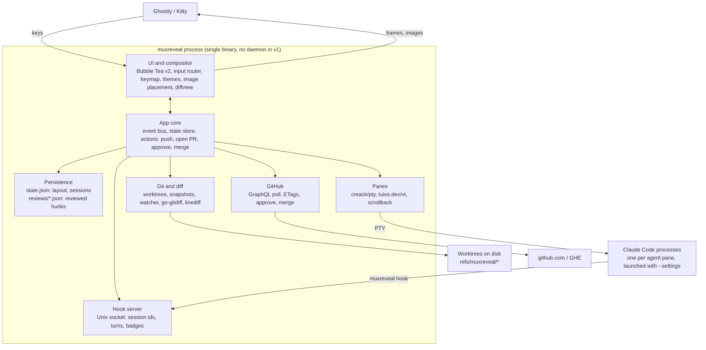

# MuxReveal v1 - Requirements & Architecture

As of 2026-10-26.

## Overview

MuxReveal is a single-binary Go TUI that hosts coding agents in live terminal panes and puts the review loop beside them: live diffs, PR review, CI status, push, open PR and merge. v1 is A-lite: one process owns the PTYs, with no daemon. Layout and agent sessions persist to disk and resume on start.

Terminal emulation comes from `tuios.dev/vt`, the emulator TUIOS publishes as a standalone library. MuxReveal owns everything above it: compositor, panes, review, GitHub.

**Goals for v1**

- Replace herdr for day-to-day agent multiplexing with Claude Code.
- Never open the GitHub web UI to read, approve or merge a PR.
- Look like a next-gen terminal app: own compositor, Catppuccin themes, inline images.
- Be fully keyboard driven.
- Be "just there": the review drawer and its PR mode live next to the agents, not in a separate tool.

**Non-goals for v1**

- Detach and reattach while agents keep running (v2: daemon).
- Our own agent harness. Agents are external CLIs; Claude Code is the only adapter in v1.
- Inline review comments, or request-changes reviews.
- Remote machines over SSH, Windows, and a plugin system.
- Sixel or iTerm2 image fallbacks. Ghostty and Kitty both speak the Kitty graphics protocol.

## Functional requirements

IDs are referenced by milestones and plans; commits and PRs do not carry them. Priority: **P0** blocks v1, **P1** ships in v1 if possible, **P2** is v1.x, **v2** is in the v2 backlog.

### Agents and panes

| ID | Requirement | Pri |
| --- | --- | --- |
| AG-1 | Spawn an agent pane running `claude` in a chosen worktree | P0 |
| AG-2 | Splits (horizontal and vertical), resize, zoom, close, swap, and focus movement | P0 |
| AG-3 | Full-fidelity terminal: truecolor, alt screen, mouse, bracketed paste, synchronized output, Kitty keyboard protocol, OSC 8 and 52, wide chars | P0 |
| AG-4 | Scrollback and copy mode with vim motions | P0 |
| AG-5 | Per-pane state badge (working, blocked, idle) from Claude Code hooks | P0 |
| AG-6 | Desktop notification when an agent becomes blocked or finishes | v2 |
| AG-7 | Plain shell panes (non-agent), the default for splits; running `claude` in one makes it an agent pane, and an agent pane whose Claude exits becomes a shell again; the kind comes from the terminal's foreground process | P0 |
| AG-8 | Harness adapter interface so other agents (Codex, opencode) can be added | P0 (interface), P2 (adapters) |
| AG-9 | Tabs: each with its own split layout, focus and zoom; new, rename, close, jump and cycle; the tabs shown in the workspace bar | P0 |
| AG-10 | Move the focused pane to tab N, either following it there or staying on the current tab. N one past the last tab creates a new tab | P0 |
| AG-11 | Break pane: move the focused pane into a new tab of its own, and follow it | P0 |
| AG-12 | Tiling layouts per tab: BSP with auto-split and preselection, master-stack, scrolling columns; rotate, equalize, promote to master | P0 |
| AG-13 | An agents rail lists every agent in every tab with its state, session name or project, branch, current action and diff stats; it stays open until closed, takes the keyboard on a key, searches, and jumps to any agent | P0 |

### Persistence and resume

| ID | Requirement | Pri |
| --- | --- | --- |
| PR-1 | Persist the layout tree, pane cwd, harness and session id to disk on every change | P0 |
| PR-2 | On start, restore the layout and run `claude --resume <session_id>` in each agent pane | P0 |
| PR-3 | Survives reboots: state is plain files, never process memory | P0 |
| PR-4 | A pane whose session id is missing or invalid falls back to a fresh `claude` and shows a notice | P0 |
| PR-5 | Workspaces: named sets of repos, panes and layouts, switchable | P2 |

### Worktrees

| ID | Requirement | Pri |
| --- | --- | --- |
| WT-1 | Discover existing worktrees with `git worktree list --porcelain` | P0 |
| WT-2 | Create a worktree and branch from a base under the worktree root (default `<repo>/.worktrees/<branch>`), then spawn an agent in it. On first use in a repo, add `.worktrees/` to `.git/info/exclude`, keep it out of MuxReveal's own watcher, and list detected tools that need their own ignore entry (JetBrains, VS Code watcher, Jest/Vitest, pytest, tsc, ESLint, Docker). A sibling `../<repo>.worktrees/` layout is a config option | P0 |
| WT-3 | After merge, offer to remove the worktree and delete the local branch | P1 |

### Agent diff

| ID | Requirement | Pri |
| --- | --- | --- |
| DF-1 | Branch mode: diff from the merge-base with the base branch to the working tree, including untracked files. The base is the PR's base once a PR exists, else the repo default branch | P0 |
| DF-2 | Turn mode: diff of what the agent changed in its last turn; step back through earlier turns | P0 |
| DF-3 | Updates live as files change, debounced | P0 |
| DF-4 | Unified and side-by-side layouts, syntax highlighting, intra-line word diff | P0 |
| DF-5 | File tree with per-file stats; hunk navigation | P0 |
| DF-6 | Toggle any file between diff view and full file with changes highlighted | P0 |
| DF-7 | Reviewed-hunk tracking: mark hunks read, keyed by content hash; only unread shows by default | P1 |

### Pull requests and CI

| ID | Requirement | Pri |
| --- | --- | --- |
| GH-1 | PR list with tabs: agent branches, review requested, all open | P0 (agents), P1 (others) |
| GH-2 | PR diff rendered with the same engine as the agent diff, including the full-file toggle | P0 |
| GH-3 | Rendered PR description and conversation (read only) | P1 |
| GH-4 | Live CI checks per PR: status, duration, and link to logs; failed job log tail in-app | P0 (status), P1 (log tail) |
| GH-5 | Approve a PR | P0 |
| GH-6 | Merge with merge, squash or rebase; respects repo-allowed methods and branch protection; optional branch delete | P0 |
| GH-7 | github.com and GHE, using hosts and tokens from `gh` | P0 |

### Git actions

| ID | Requirement | Pri |
| --- | --- | --- |
| GA-1 | Push the current agent branch, setting upstream on first push | P0 |
| GA-2 | Open a PR: compose overlay with title, body, base branch and draft toggle | P0 |
| GA-3 | Body prefilled from `.github/pull_request_template.md`, else the commit log; edit in-app or in `$EDITOR` | P0 |
| GA-4 | Live markdown preview while composing | P1 |
| GA-5 | Auto-detect PRs that agents opened, by branch lookup | P0 |

### Markdown, UX and themes

| ID | Requirement | Pri |
| --- | --- | --- |
| MD-1 | Render markdown for PR bodies, agent plan files and repo docs: headings, lists, tables, code with highlighting, links | P0 |
| MD-2 | Inline images (local paths and remote URLs, including GitHub user-attachments with auth) via the Kitty graphics protocol | P0 |
| UX-1 | Every action reachable by keyboard; which-key style hint popup after the leader key | P0 |
| UX-2 | Command palette with fuzzy search over all actions | P0 |
| UX-3 | User-remappable keymap in config | P1 |
| TH-1 | Theme engine from day one; ship Catppuccin Latte, Frappé, Macchiato and Mocha | P0 |
| TH-2 | Syntax highlighting themed from the same palette | P0 |
| TH-3 | Follow terminal light/dark mode where the terminal reports it | P2 |

### Mouse and clipboard

| ID | Requirement | Pri |
| --- | --- | --- |
| UX-4 | Focus follows mouse: hovering a pane focuses it, no click needed. Config option, off by default; never steals focus from an open overlay or palette | P0 |
| UX-5 | Copy on select: a mouse selection is copied to the system clipboard on release, pasteable in any app. Config option, off by default | P0 |
| UX-6 | Selection works in terminal panes (including scrollback), diffs and rendered markdown; double-click selects a word, triple-click a line, alt+drag a rectangle | P0 |

```toml
[mouse]
focus_follows_mouse = false
copy_on_select = false

[clipboard]
osc52 = true
native = true
```

- `focus_follows_mouse`: hovering a pane's content or top border focuses it, through the same path as a click, so guests get their focus reports. The outer terminal is asked for all-motion mouse reporting only while this is on, else cell-motion. Hovering the focused pane, a side or bottom border, a bar or an empty cell does nothing, and so does hovering while a confirm, prompt, overlay, the worktree list, the link chooser, copy mode or the leader is open, or while a button is held.
- `copy_on_select`: the release that ends a drag, a double-click or a triple-click copies the selection when its text is not empty. A plain click never copies.

- The compositor gets every mouse event first, so selection lives in MuxReveal's own screen model. While a confirm, prompt, overlay, the review drawer's worktree list or link chooser, copy mode or the leader (with or without its popup) is open, every mouse event is ignored, the agents rail's included.
- A plain left-button drag selects in every pane, without a modifier. The selection stays in the pane where the drag began and is clamped to that pane's content even when the pointer leaves it. A drag is a stream selection, `alt+drag` a rectangle, a double-click selects a word and a triple-click a line (same cell within 400 ms). Soft-wrapped lines copy as one line.
- The selection is stored against the pane's scrollback by stable row, so it stays on the same text while output scrolls, and it is painted onto the rows as drawn, so a held synchronized update does not tear it; one selection exists at a time and it is drawn only while its pane is visible. A click in any pane's content, a new drag, a key or paste sent to its pane, or the pane closing, resizing or switching between the main and alt screen clears it. Opening copy mode (`leader [`) clears it; other leader commands and tab switches do not.
- A click in a pane's content focuses it; a click on its top border only focuses; a click on a tab switches to it; a pane's side and bottom borders, the rule and the toast ignore clicks, and a click on the toast reaches what is under it.
- A program that asked for mouse reporting gets a click (press then release) when the button is released in the cell where it went down, the wheel, middle and right buttons, and button-less motion only while `focus_follows_mouse` is on (the outer terminal is in cell-motion mode otherwise). A drag never reaches it: it selects instead. Selection gestures belong to MuxReveal and single clicks to the program: the second and third press of a double or triple click select a word or line and the program gets nothing for them (it already got the first click).
- `leader y` (`copy.selection`) copies the selection and keeps it. Every copy goes out as OSC 52 to the outer terminal (and as the primary selection on Linux); both Ghostty and Kitty accept it by default, and it works over SSH.
- `leader [` (`copy.mode`) enters copy mode on the focused pane, with a block cursor at the bottom-left of its current view. Copy mode owns every key (and drops pastes) until it ends, and the program receives none of them. The cursor and selection stay on the same text while output arrives, and the pane's top border carries the COPY tag. `y` copies the selection and exits, `q` or `esc` exits and returns the view to live; it also ends when the pane closes, resizes or switches between the main and alt screen. Keys: `h j k l`, `w b e`, `0 ^ $`, `g g` / `G`, `ctrl+u` / `ctrl+d`, `ctrl+b` / `ctrl+f`, `H M L`; `v` stream, `V` line and `ctrl+v` block selection; `/` and `?` search forward and backward, `n` / `N` repeat.
- On a local session (neither `SSH_CONNECTION` nor `SSH_TTY` set) a copy also writes the native clipboard, off the update loop with a 2 s timeout: `pbcopy` on macOS; otherwise `wl-copy` (and `wl-copy --primary`) when `WAYLAND_DISPLAY` is set, else `xclip -selection clipboard` (and `primary`) when `DISPLAY` is set, else no native write. A missing tool is logged once.
- A program's own OSC 52 write takes the same path, hidden tabs included. A program's clipboard read is never answered with the clipboard's content.

## Architecture

One process owns the screen, the PTYs and every service. It talks to Claude Code in two directions: bytes over the PTY, and events back through hooks.



The app core is the only thing that mutates state. Services post events to it; the UI renders from it.

**Module layout**

One Go module, `github.com/mhersson/muxreveal`.

| Package | Responsibility |
| --- | --- |
| `cmd/muxreveal` | Binary: CLI, `hook` and `statusline` subcommands, wiring |
| `internal/core` | Event bus, state store, actions, config, tab layouts (`internal/core/tiling`) |
| `internal/ui` | Compositor, widgets, keymap, themes, syntax highlighting, image placement |
| `internal/term` | PTY plus the `VT` interface; `tuios.dev/vt` adapter (fallback `charmbracelet/x/vt`) |
| `internal/harness` | `Harness` interface; Claude Code adapter (launch args, hook settings, resume, a session's custom name from its transcript) |
| `internal/git` | Worktrees, turn snapshots, watcher and watch set, diff engine; `linediff` and `invisible` (ported from tuios) |
| `internal/github` | Auth via `gh`, GraphQL and REST client, poller, PR actions |
| `internal/md` | Markdown to width-wrapped lines of styled runs, with link targets, image references and folds; no UI imports |
| `internal/store` | `state.json` and reviewed-hunk persistence |

```go
type Harness interface {
	ID() string                                                        // saved with each agent pane: "claude-code"
	Program() string                                                   // foreground process name of a running agent: "claude"
	Launch(settings string, resume core.SessionID) []string            // agent argv; settings "" omits --settings, resume "" starts fresh
	Settings(exe string) ([]byte, error)                               // the --settings file whose hooks run `exe hook <ID()>`
	ParseEvent(payload []byte) (Event, error)                          // one hook payload as read from stdin
	CustomName(ctx context.Context, transcript string) (string, error) // the name the user gave the session, read from its transcript file; "" when it has none (untrusted text)
}

type Event struct {
	Pane         core.PaneID     `json:"pane"`
	Name         string          `json:"name"` // the harness's hook event name, or "statusline", for logs
	Session      core.SessionID  `json:"session,omitempty"`
	Transcript   string          `json:"transcript,omitempty"`
	State        core.AgentState `json:"state,omitempty"`      // AgentUnknown leaves the state as it is
	Start        bool            `json:"start,omitempty"`      // Session is now the pane's current session
	End          bool            `json:"end,omitempty"`        // the session ended
	Cwd          string          `json:"cwd,omitempty"`        // the agent's working directory, from the hook
	TurnStart    bool            `json:"turn_start,omitempty"` // a prompt was submitted
	Action       string          `json:"action,omitempty"`     // the agent's current action (see Current action)
	ActionSet    bool            `json:"action_set,omitempty"` // Action replaces the pane's action, an empty one clears it
	Edit         string          `json:"edit,omitempty"`       // the cleaned absolute path of the file an edit tool changes (see Edits)
	Before       bool            `json:"before,omitempty"`     // a PreToolUse whose Edit its tool has not changed yet (see Edits)
	Subagent     bool            `json:"subagent,omitempty"`   // a subagent sent the event, not the agent's own session
	Changed      []string        `json:"changed,omitempty"`    // the cleaned absolute paths of the files a Bash command changed, one per directory (see Edits)
	Status       bool            `json:"status,omitempty"`     // a statusline update, not a hook (see Status line)
	Model        string          `json:"model,omitempty"`      // the model's display name
	Context      float64         `json:"context,omitempty"`    // percent of the context window in use, when ContextKnown
	ContextKnown bool            `json:"context_known,omitempty"`
	Window       int             `json:"window,omitempty"`       // the context window size in tokens
	InputTokens  int             `json:"input_tokens,omitempty"` // input tokens used so far
	Done         func()          `json:"-"`                      // set by the server on a held event; call it once the turn snapshot is taken
	Snapped      <-chan struct{} `json:"-"`                      // set by the turn gate on a turn start it snapshots; closed when that snapshot is finished
}
```

`internal/harness` also holds the hook socket, server and client (see Claude Code integration via hooks).

## Tech stack

Go 1.27 (`tuios.dev/vt` needs 1.26 or later). The reason for Rust was a proven VT emulator; `tuios.dev/vt` removes that reason, and Go is the team's main language.

| Concern | Choice | Why |
| --- | --- | --- |
| TUI | Bubble Tea v2 + Lip Gloss v2 + Bubbles v2 | Cell-based renderer, mature input handling; TUIOS proves it can host many busy panes |
| VT emulation | `tuios.dev/vt`; fallback `charmbracelet/x/vt` | Emulator TUIOS runs agent panes on daily: scrollback, Kitty graphics and keyboard protocol, OSC 133. Wrapped behind our `VT` interface. The fallback is as fast but has no Kitty keyboard, Kitty graphics, OSC 52 or OSC 133, and Claude Code does not use synchronized output on it (checked live with and without `TMUX` in Claude's environment). |
| PTY | `github.com/creack/pty` | Standard Go PTY package; macOS and Linux |
| Git | `git` CLI (plumbing and porcelain v2, `-z` output) | Keeps the user's credential helpers, hooks and config; fast enough; one code path for reads and writes |
| Diff | `git diff --histogram` parsed with `bluekeyes/go-gitdiff`; intra-line spans from the ported tuios `diffview` (`Changed`), computed when rendering | Same hunks as git; tuios's span rule |
| Diff rendering | Ported tuios `diffview` with its lexers (M2b) | Highlighting, gutter, tints and side-by-side pairing built for the same job |
| Syntax | Chroma v2 | Ships Catppuccin styles; wide language coverage |
| Markdown | goldmark v2 with GFM and footnotes, plus our own layout in `internal/md` | Full control of layout and image placement; Glamour has no images |
| Images | Own Kitty graphics encoder; `image/*` + `golang.org/x/image` for decode and scaling | The protocol is small; port TUIOS's passthrough (MIT) if it's cleaner |
| File watching | `fsnotify` with our own directory walk | Maintained; the walk skips `.git` internals, `.worktrees` and ignored directories; `rjeczalik/notify` is unmaintained since 2023 and uses FSEvents on macOS only with cgo |
| GitHub | `cli/go-gh/v2` for hosts, tokens and the REST and GraphQL clients (GraphQL queries as tagged Go structs); ETags through our own transport under its clients | Same login and host routing as `gh`; no schema file or codegen; conditional requests do not count against the rate limit |
| Fuzzy finder | `sahilm/fuzzy` | Palette and pickers |
| Config and state | `pelletier/go-toml/v2`; `encoding/json` | TOML config, JSON layout state and reviewed-hunk files |
| Clipboard | OSC 52 plus direct exec of `wl-copy`, `xclip` or `pbcopy` with explicit arguments | No cgo and no shell; `atotto/clipboard` is not used because its primary-selection switch is global state and it drops the clipboard arguments |
| CLI | `spf13/cobra` | `muxreveal`, `muxreveal hook claude-code`, `muxreveal statusline`, future subcommands |
| Diagnostics | `log/slog` to a file | Structured logs, never to the screen |

## Key technical designs

### Terminal layer

- `internal/term` defines a small `VT` interface: write bytes, resize, read the cell grid and cursor, scrollback access, title and mode queries, Kitty image events. Only the adapter imports `tuios.dev/vt`.
- Each pane runs one goroutine reading its PTY into the emulator, then sends a "pane dirty" message to Bubble Tea. Rendering is event driven: our code has no fixed tick. Bubble Tea v2's own 60 FPS ticker remains, so idle CPU is near zero (about 0.35 % of one core with six idle panes), not zero.
- Each pane keeps a per-row string cache; a dirty pane re-renders only its rows from cells to strings. Bubble Tea calls `View` after every message, so the frame is rebuilt from the row caches each time as one string that Bubble Tea re-parses and diffs in full, and it writes only the cells that changed. tuios has no damage API, so row-change detection is ours.
- The compositor honors synchronized output (mode 2026). tuios's own sync hold reads the wall clock, so MuxReveal tracks mode 2026 from the emulator's mode callbacks and applies its own 1 s hold on an injectable clock.
- Kitty graphics from MuxReveal's own views (markdown images) and from agents are placed by the compositor, which knows every cell's position. Agent image passthrough is v2.
- Panes answer OSC 10 and 11 queries with the theme's text and background colours (also during the theme picker's preview), through tuios `SetReportColors`; guests that turned on mode 2031 get a notice when they change.
- tuios encodes Kitty and modifyOtherKeys keys; the legacy encoding is ours: an xterm-style encoder with the `CSI 1;<mod>X` modifier forms, nothing sent for a key it cannot encode, and repeat events encoded like presses. Paste goes through tuios `SanitizePaste`.
- A pane can show its history instead of the live screen. Rows are numbered from the oldest history line, with the live screen after the history. A scrolled view is anchored to a row that does not move when output scrolls or when the 10000-line cap drops old lines, so it keeps showing the same text until that text is dropped, then clamps to the oldest line. The anchor is the row plus the number of lines dropped from the history so far, which `VT.HistoryTrimmed` counts (cap overflow, `CSI 3J`, reflow). A scrolled pane draws its history rows from a view cache keyed by the anchor, the history length, the size and the live rows' change count, so an unchanged frame reuses its strings; the live row cache is separate and unchanged. The alt screen has no history and is always live. A resize, a switch between the main and alt screen, a key and a paste all return the view to live; leader commands leave it alone, and `leader ctrl+space`, which sends ctrl+space to the pane, returns it to live.
- The mouse wheel acts on the pane under the pointer, in its content cells only (not the border, the bars or empty cells), without moving focus. If the guest tracks the mouse the event is forwarded in pane coordinates; else on the alt screen three up or down key presses per notch are sent, encoded per the guest's cursor-key mode; else the view scrolls three lines per notch, and scrolling down to the bottom is live. The wheel is ignored in every state where mouse events are (see Mouse and clipboard). The cursor is hidden while the focused pane is scrolled.
- Every pane PTY, agent or shell, gets `TERM=xterm-256color` and `COLORTERM=truecolor` and never inherits `TMUX` or `TMUX_PANE`, because MuxReveal is its terminal.

### Panes and layout

- Each tab has its own layout mode, pane order, focus and zoom; the rules below apply per tab. The mode is `bsp`, `master-stack` or `scrolling`; a new tab starts in the configured `default_mode` (see Config), and `leader space` cycles it in that order (`layout.set.*` in the palette sets one). The layout code is `internal/core/tiling`, tuios's layout package ported with its tests; it knows window ids and rectangles and nothing of MuxReveal. Core keeps each tab's layout as plain values (the mode, the panes in order, the BSP tree, the master ratio, the scrolling columns), so a state copy stays a value copy, and one function, `core.Arrange`, turns a tab into the pane rects the UI draws and the sizes the PTYs get.
- Geometry is integer cells. Tiles are laid out over the body (the rows from the one under the rule to the last, the full width less the agents rail's columns while the rail shows) edge to edge, with no gap, and each tile is a pane's rect: the pane's rounded box is drawn on the rect's outline, so neighbouring boxes touch, and its content is the rect inset by one cell on every side. A BSP split of a box `W` wide at ratio `r` gives its first child `floor(W*r)` columns and the second child the rest; a horizontal split does the same with the height and rows. A pane is drawn only when its rect is at least 3x3 (a frame around one content cell), lies inside the body and is disjoint from the panes kept before it in the tab's pane order; every mode applies this rule. A pane that is not drawn is left out of the rects and sizes, so a tiny terminal drops panes instead of producing negative sizes; the UI gives it a 1x1 PTY. A body under 3x3 yields no rects and stays blank. A pane's PTY size is its content rect. In BSP and master-stack, focus and swap moves read the same rects the UI draws, so a pane that is left out is never a target while the focused pane is drawn; when the focused pane itself is left out, the moves use the rects of a virtual 10000x10000 body instead. Scrolling moves by column and index and reads no rects.
- **BSP** keeps a binary tree. A leaf is a pane; a split has two children, A (left or top) and B (right or bottom), and a `ratio`, the share of the space A takes. `vertical` splits put the children side by side; `horizontal` splits stack them.
- **Master-stack** lays the tab's panes out in their order: the first `master_count` are masters and the rest form the stack, placed by `master_position` (left, right, top, bottom or center) with `master_grid` as configured. The tab has its own master ratio, initially `master_ratio`.
- **Scrolling** keeps columns of panes, each with a width (a share of the body). Only columns that fit whole are drawn, and the visible ones stretch to fill the body, so no pane is clipped and no space is left empty. The tab keeps its first visible column, `first`. The visible set starts at `first` and takes columns while their widths sum to at most 100 %; `first` moves only as far as needed to keep the focused column visible (a focused column left of `first` becomes `first`; one right of the visible set makes `first` the smallest value whose run to the focused column fits). The visible columns split the body width in proportion to their widths, and neighbouring columns' frames touch; the panes of a column split its height equally. Hidden panes are not drawn, not hit by the mouse and not reached by focus moves other than left and right; their PTYs are sized as if their column were shown alone at its nominal width (`round(width x body width)`, at least 3, minus the frame) with the column's height split equally. The bottom borders of the edge panes show how many columns are hidden (see Frames). A new column takes `column_width` percent of the body (50 by default, so two fit).
- Splits follow vim: `leader s` opens a shell below the focused pane and `leader v` one to the right, and the new pane takes focus. In BSP the new pane is child B, takes half of the focused pane (ratio 0.5) and splits it along the matching axis; the auto scheme (`auto_scheme`) decides the axis only where no direction is given, for a pane moved into the tab and for the rebuild on a mode switch. In master-stack the new pane is appended to the end of the order. In scrolling `leader v` adds a column after the focused column and `leader s` adds the pane to the focused column right below the focused pane. `leader n` opens an agent pane to the right of the focused one, as `leader v` places a shell. A preselection overrides the side (see below).
- `h j k l` focus the nearest pane in that direction by tuios's `Neighbour` rule on the tiles: a candidate must lie fully beyond the focused tile on that axis; panes that share at least one cell across the axis win; then the nearest; at equal distance an overlap of two cells or more beats one cell; then the closest centre across the axis; then the largest overlap; then the lowest index in the tab's pane order. There is no wrap. In scrolling, left and right go to the adjacent column, to the pane at the same index in it (clamped to its last pane), and scroll it into view; up and down move within the column.
- `H J K L` resize the focused pane in steps of 0.05, rounded to 0.01 and clamped to [0.1, 0.9]; `L` and `J` grow the left or top child. In BSP they move the nearest divider on that axis. In master-stack, on the axis that divides masters from the stack (left, right and center positions divide columns; top and bottom divide rows), `L` and `J` add to the share of the left or top region and `H` and `K` take it away (with the masters on the right or bottom that region is the stack, so the masters' ratio shrinks; in center `L` grows the middle column); the other axis does nothing. In scrolling `H` and `L` shrink and grow the focused column's width by 0.05 within [0.1, 1.0] and `J` and `K` do nothing.
- `leader ctrl+h`, `ctrl+j`, `ctrl+k`, `ctrl+l` swap the focused pane with its neighbour in that direction, chosen as for focus. In BSP the swap exchanges two leaves and the tree keeps its shape and ratios, so each position keeps its size and the moved pane takes the size of the position it lands in. In master-stack the focused pane exchanges places with its `Neighbour` in the order. In scrolling left and right exchange it with the pane at the same index of the adjacent column, and up and down exchange within the column. Focus stays on the moved pane. A swap clears zoom; one with no neighbour does nothing and keeps it.
- `leader z` zooms the focused pane to fill the body. Opening a pane, closing a pane, or moving focus clears zoom; a focus move that has nowhere to go keeps it.
- Closing a pane gives its space to the rest of its tab, in the pane's own tab even when that tab is hidden. Closing another pane keeps focus. In BSP the sibling takes the space and closing the focused pane focuses the first leaf of the sibling. In master-stack the pane leaves the order, and a closed focused pane passes focus to the pane now at its index, else the one before. In scrolling the pane leaves its column and a column left empty is removed; a closed focused pane passes focus to the pane now at its index in the column, else the one above, else the top pane of the column to the left, else the top pane of the column to the right. Pane and tab IDs (`p1`, `t1`, ...) are never reused within a session.
- **Preselection** (BSP only, per tab, not saved): `leader ;` then `h j k l` sets the side where the next pane opens, and `leader ;` then `esc` clears it. The next pane that opens in that tab by any means (split, agent, a move in) opens on that side of the focused pane at ratio 0.5 (`h` and `k` put the new pane first, `l` and `j` second) and the preselection is cleared. A mode switch clears it too; focus moves keep it. The focused pane's top border shows it as a tag (see Frames). In other modes `leader ;` shows the notice `preselection works in BSP layouts`.
- **Rotate** (`leader r`) flips the axis of the focused pane's parent split and keeps its ratio; a focused pane with no parent shows the notice `nothing to rotate`, and outside BSP the notice is `rotate works in BSP layouts`. **Equalize** (`leader =`) makes panes equal along each axis rather than setting every ratio to 0.5: in BSP each split's ratio becomes `w(A) / (w(A) + w(B))`, where for a vertical split `w` counts columns (a leaf is 1, a vertical split adds its children, a horizontal split takes the larger child) and for a horizontal split it counts rows the same way, rounded to 0.01 and clamped to [0.1, 0.9]; in master-stack it resets the tab's ratio to `master_ratio`; in scrolling it sets every column to `column_width`. **Promote** (`leader enter`, master-stack only, dwm's zoom) swaps the focused pane with the first pane of the order, or with the second when the focused pane is first, and focuses the pane now first; outside master-stack the notice is `promote works in master-stack layouts`.
- **Mode switches** rebuild the tab from its pane order, as tuios does: BSP inserts the panes one by one, each splitting the pane inserted before it with the auto scheme; master-stack uses the order as is (masters first) with the configured ratio; scrolling makes one column per pane at the configured width. Split ratios and column widths reset. A switch clears zoom and the preselection, keeps focus and every pane and process, and shows the notice `layout: <mode>`; setting the mode a tab already has changes nothing, and an empty tab only gets its mode.
- **Moving panes**: `leader > 1-9` moves the focused pane to tab N and follows it, `leader . 1-9` moves it and stays on the current tab, and `leader !` breaks it into a new tab of its own and follows it. N is the tab's 1-based position; N one past the last tab creates a new tab at the end in the configured default mode. The pane keeps its process, PTY, scrollback, id and agent state; only its size changes. Placement follows the target's mode: BSP at the target's preselection, which is then cleared, else beside the target's focused pane with the auto scheme; master-stack appended; scrolling a new column after the focused one. The moved pane becomes the target tab's focused pane, and the target's zoom is cleared. The source tab loses the pane as closing it would treat focus, and its zoom is cleared when the moved pane was the zoomed one; a source tab left empty is removed, and tab numbers shift as when a tab is closed. Following makes the target tab active (by its index after any removal); not following keeps the source tab active, unless that tab was removed, in which case the target becomes active. Copy mode and any selection on the moved pane end. These do nothing and show a notice: a move to the pane's own tab (`the pane is already in tab N`), a move to a tab more than one past the tab count, or above 9 (`there is no tab N`), and moving or breaking the only pane of a tab to a new tab (`the pane is alone in its tab`).
- A session holds at most 64 panes across all tabs (`core.MaxPanes`, also the limit of the saved file). Opening another with a split, `leader n` or a new tab shows the notice `at most 64 panes` and starts no process.
- At least one tab always exists. Closing a tab's last pane removes the tab unless it is the only one, which stays and shows the welcome card. Closing the active tab activates the tab to its left, or the new first tab; closing a hidden tab keeps the active tab. Switching tabs changes only which tab is active; each tab keeps its layout mode, focus and zoom.
- Without a saved layout MuxReveal starts with one shell pane in the launch directory, in the first tab; with one, the first size message starts every saved pane at its own rect (see Persisted state). It never quits by itself.
- Pane output, exit, hold, cwd and grace-probe messages carry the pane they came from; one from a pane since replaced under the same id (a restarted agent) is dropped, so an old process's late exit never closes the new pane.
- Shell panes run `$SHELL -l`. `leader n` opens an agent pane to the right of the focused pane, in its working directory, running `$SHELL -l -i -c '"$@"; exec "$SHELL" -l' sh claude --settings <file>`, with the command, the settings path and any session id passed as arguments after the script and never quoted into it, since no quoting is safe in every shell (fish takes them as `$argv`, and a restore adds `--resume <id>`), so leaving Claude leaves a shell in the pane. `$SHELL` falls back to `/bin/sh`. Shell panes and agent panes both get `MUXREVEAL_PANE` and `MUXREVEAL_SOCK` in their environment.
- `leader x` closes the focused pane at once; for an agent pane it first asks in a confirm overlay (`y` or `enter` confirms, `n` or `esc` cancels). `leader q` quits and asks first when any agent pane is open. `leader X` closes the active tab with all its panes, asking first when it holds an agent pane. A pane whose process exits closes without asking, and so does an open confirm about it or about its tab once the tab is gone. The confirm owns every key while it is open.
- A pane's cwd (`core.Pane.Cwd`) is the last OSC 7 path the pane reported, else on Linux the `/proc` cwd of the terminal's foreground process group, else the cwd the pane started in. It is looked up off the UI loop, at most every 500 ms per pane, and it is the cwd that is saved.
- A pane's working directory (`core.Pane.WorkDir()`) is what a tab's automatic name and the panes opened from it (splits, new tabs, the worktree picker) use. For a shell it is the cwd. For an agent it is the absolute `cwd` its harness last reported in a hook (`core.Pane.AgentCwd`; a subagent's hook does not set it), else the cwd, so these follow the agent into a worktree on Linux and macOS alike; a hook with an empty or relative `cwd` leaves it as it was. It is never saved and a pane that becomes a shell drops it, so after a restart the first hook sets it again. A hook's directory never changes the saved cwd, so a restore (and a fresh restart) starts Claude where it was launched, the directory Claude Code files its sessions under.
- A pane's followed place (`core.Pane.FollowDir()`) is what the rail, the watch, the review drawer, the PR poller, the tray and push use (push prefers what an open drawer shows, see GitHub and CI). For a shell it is the working directory. For an agent it is the root of the worktree of its latest counted edit this session (`core.Pane.Followed()`), else the working directory. After the first edit a hook's `cwd` alone does not move it, and an edit in the working directory's own worktree moves it back. It is never saved; a new session or a pane that becomes a shell drops it, and a followed worktree that no longer exists is forgotten (see Agents rail).
- A pane's kind follows its terminal's foreground process. The same probe reads the name of the foreground process group leader (`/proc/<pgrp>/comm` on Linux; on macOS the base name of its `argv[0]` from `kern.procargs2`, without a login shell's leading `-`, else the `kinfo_proc` `p_comm`, since `p_comm` names a symlink's target and Claude's native install runs as a file named after its version). The harness's program (`claude`) makes the pane an agent; anything else makes it a shell. Becoming a shell clears the pane's harness, session, transcript, state, action and reported directory. Hooks never change the kind, and hook events for a pane that is not an agent are ignored.
- Claude is the foreground leader only when it runs under a shell with job control, which `$SHELL -l -i -c` gives in sh, bash and zsh and an interactive shell pane gives everywhere; for fish the agent command turns it on with `status job-control full`.
- A pane that MuxReveal launched as an agent (`leader n` or a restore) stays an agent until Claude has been seen in the foreground and has left it, or has not appeared within 10 s of the launch (one extra probe fires at 10 s), so a slow shell start-up or a missing `claude` never demotes the pane early. A pane launched with `--resume` that has had no `SessionStart` yet is also exempt from the kind rule until that probe (see Persisted state, Resume).
- A hand-typed `claude` makes the pane an agent by this rule but has no hooks, so it shows no badge and has no session id; restored, it gets a fresh `claude` and a notice.

### Visual design

The chrome is framed: every pane is its own rounded box with its title in its top border. A workspace bar runs along the top row and a rule under it; the body takes every row below. There is no status bar: notices are a toast, and copy mode, the leader and a pending key sequence show in the pane's own borders and in popups. Colours come only from theme roles. Icons are single-cell Nerd Font glyphs (see Glyphs); `icons = false` drops every one of them, the segment edges included, while box drawing, block elements and braille stay.

#### Screen rows

- Row 0 is the workspace bar and row 1 is the rule; the rows from 2 to the last are the body.
- The rule is a full-width `─` in `Border`; it takes no clicks.
- Panes are laid out in the body `{X: 0, Y: 2, W: width, H: height-2}` less the agents rail's columns on the left while the rail shows (see Agents rail), so with the rail `X` is the rail's width and `W` is the width less it; there is no outer frame. The review drawer is an overlay on the body and does not change these rects (see Review drawer).
- Pane rects follow Panes and layout. A pane's frame is on its rect's outline; the first row of the rect is its top border, which is its header row, and its content is the rect inset by one cell on every side. Two neighbours' frames touch (`││`, `╮╭`) and share no cell.
- A pane needs at least 3 rows and 3 columns for its frame, and so does the body; a smaller body stays blank. Height 1 shows the workspace bar only; height 2 adds the rule. Every row is exactly the terminal width.
- An empty tab shows the welcome card in the body, without frames.

#### Frames

- Lines are single-weight box drawing: every pane's box has `╭ ╮ ╰ ╯` at its four corners, `─` along the top and bottom and `│` on the sides. There are no junction glyphs.
- Unfocused borders are `Border`. The focused pane's whole box, all four sides, is its kind colour (`Agent` for agents, `Shell` for shells), except while the agents rail or the review drawer has the keyboard (then it draws as an unfocused pane: `Border` frame, `Muted` title) and for the 600 ms `Match` flash of a pane jumped to from the agents rail (see Agents rail).
- The title is set into the top border from the cell after the corner: `─`, space, kind icon (kind colour, bold), space, title, space. Focused: the title in the kind colour and bold. Unfocused: the title in `Muted`. The title is the guest's OSC title with control and invisible characters removed (an emoji's presentation selector U+FE0F too, so it is left as the bare character), else `claude` or `shell`.
- Tags sit at the right end of the top border, ending one `─` before the corner, with one `─` between two tags. From the right: the state badge (` <icon> working `, ` <icon> blocked `, ` <icon> idle ` in `Working`, `Blocked`, `Idle`, bold), the rightmost tag; the model tag; ` 󰊓 zoom ` (`Accent`, bold) on a zoomed pane; and ` 󰁝 N ` (the same style; ` ↑ N ` with icons off) on a scrolled pane, where N is the number of lines above the live screen. The model tag is ` <model> N% ` on an agent pane whose status line reported a model: the model in `Muted` and the meter in its colour, as on the rail's cards (see Agents rail), or ` <model> ` alone while no percentage is known; without a model there is no tag. For example `─ 󰊓 zoom ─ Opus 5.5 62% ─ ⠙ working ─╮`. The working icon is a braille spinner (`⠋⠙⠹⠸⠼⠴⠦⠧⠇⠏`, about 8 frames a second) that animates only while the agent works, so idle CPU is unchanged; blocked is 󰀦 and idle is 󰗡. With `icons = false` the badge reads ` ⠋ working `, ` blocked ` or ` idle ` (braille stays). An agent pane with no state yet, because Claude has sent no hook, shows no badge.
- In copy mode the copy pane's top border carries the leftmost tag of the border, ` 󰆏 COPY ` (`Info`, bold; ` COPY ` with `icons = false`), left of the preselection and scroll tags. Tags that do not fit between the corners are left out in this order: the model tag (which shows only when every other tag fits and the whole title, kind icon included, still fits beside it, so it never shrinks the title), then the scroll tag, then the preselection tag, then the zoom tag, then the badge; COPY is the last to go.
- While a copy-mode search is typed, that pane's bottom border shows, after `╰─` and a space, the mark `/` or `?` (`Info`, bold), the query (`Fg`, at most 32 characters, cut to the room the border has) and the terminal cursor on the cell after it. `enter` jumps to the next match (an empty query repeats the last search), `esc` closes the prompt and stays in copy mode, and a miss shows the toast `not found: <query>`. In a scrolling tab this prompt takes the place of a hidden-column count in that border.
- While a preselection is set, the focused pane's top border carries the tag ` <arrow> next ` in `Accent`, bold, right of the COPY tag and left of the scroll tag. The arrows are 󰁍 (left), 󰁅 (down), 󰁝 (up) and 󰁔 (right); with `icons = false` they are `←`, `↓`, `↑` and `→`.
- In a scrolling tab, the bottom border of the bottom pane of the leftmost visible column shows how many columns are hidden on the left, ` ‹ N ` after `╰─`, and that of the rightmost visible column shows the hidden count on the right, ` N › ` before `─╯`, in `Accent`, bold, only when N > 0 (the same with `icons = false`). Like a title, they are left out when they do not fit.
- When the title does not fit, it shrinks with `…`, and with three cells or fewer left the whole title goes. The tags stay, except the model tag, which is left out before the title is cut; a tag that does not fit between the corners is left out.
- A title or tag never covers a corner: the title starts after `╭─`, the tags end before `─╮`, and a title with no tag may end right before the `╮`, cut to leave it.
- A zoomed pane's rect is the body, inside its own frame.
- Selected cells, from a mouse selection or copy mode, are drawn on the `Selection` background; the text keeps its colours.

#### Workspace bar (row 0)

Ground `Bar`.

- **Tabs**, from column 0, one segment each: ` N icon name `. N is the 1-based position; the icon is 󱙺 when the tab holds an agent pane, else ; the name is the custom name, else the basename of the tab's focused pane's working directory, else `shell`.
- Active segment: `Accent` background, text `OnAccent` and bold. Inactive: `Surface` background, the number `Muted` and bold, the icon and the name `Dim`. An inactive tab's icon takes the colour of its most urgent agent: blocked, then working, then idle.
- One edge cell follows each segment:  (U+E0BC) in the segment's colour on the next segment's colour, or on `Bar` after the last segment. Between two inactive segments the edge is a thin  (U+E0BB) in `Bar` on `Surface`.
- **Tray**, right-aligned to the last column, at least two cells from the tabs. One `Surface` region opens with  (U+E0BA, `Surface` on `Bar`); its modules are separated by  (`Bar` on `Surface`), and each reads ` icon value `. The clock closes the bar on its own `Clock` segment, opened by  (`Clock` on `Surface`, or on `Bar` when it is the only module): ` 󰥔 14:32 ` in `OnAccent`, bold.
- Modules, left to right:
  - **Layout mode** (absent while the active tab has no mode): ` <icon> <mode> `, with the icon in `Accent` and the name in `Fg`: 󰕴 bsp, 󰛽 master-stack, 󰕭 scrolling. It shows the active tab's mode, and with `icons = false` it reads `layout bsp`.
  - **PR and CI** for the branch of the focused pane's followed place (see Panes and layout; for a shell its working directory), while that branch has an open pull request that is not a draft: ` <icon> #8 <checks> `, the icon  (U+F407) in `Info`, the number (`#8`, `Fg`, bold) and the checks as the card writes them (see Agents rail): 󰔟 and done/total (`3/5`) in `Warning` while any check runs,  and `5/5` in `Success` when all passed,  and `2 failed` in `Error`, bold, when any failed; with no checks the module is the icon and the number. It does not carry the review decision. A draft, merged or closed pull request, no pull request, a detached HEAD and a repository that is not on GitHub leave the module out (the card shows a draft, merged or closed one). With `icons = false` it reads `#8 ci 3/5`, `#8 ci 5/5` or `#8 ci 2 failed`.
  - **Load:** icon 󰻠 in `Load`, a braille sparkline of the last 10 CPU samples (5 cells, two samples per cell, `Load`; a sample fills 1 to 4 dots of its braille column from the bottom, one per started quarter of CPU), the CPU share (` 12%`, `Fg`) (on macOS the one-minute load average over the cores), then `  󰍛 9.8G` of memory in use (`Muted`).
  - **Clock:** `HH:MM`, minute resolution.
- **Narrow terminals** give way in this order: load, PR and CI leave the tray, then the layout mode; inactive tab names shrink to ` N icon `, then to ` N ` (longest names first); the clock leaves; the active tab's name shrinks, to ` N icon ` and then ` N `. The active tab always stays visible: if the ` N ` segments still do not fit, the segments farthest from the active tab are left out.
- With `icons = false`, segments are separated by one `Bar` cell, tray modules by `│` (`Bar` on `Surface`), and there are no edge cells. Text stands in for the module icons: the load reads `cpu ` (`Muted`) before the sparkline and `  mem 9.8G` after the share, and the PR module reads `#8 ci 3/5`.

#### Agents rail

A framed panel on the left of the body lists every agent pane in every tab as a card. It stays open until it is closed on purpose and takes the keyboard on a key; it is part of the layout, so the panes make room for it.

- **Place.** A rounded box under the rule, the full body height, 44 columns wide when the body is at least 84 wide; else the body width minus 40, at least 24. A body under 64 columns does not show the rail: it stays open, gives the panes the whole body and shows again when the terminal widens. While the rail shows, the active tab's panes, and every tab's PTY sizes, are laid out in the body to its right. Its border is `Accent` while it has the keyboard and `Border` otherwise; while it has the keyboard the focused pane draws as unfocused, so only one element shows the focus. The toast and the overlays draw over it.
- **Open or closed** is `core.State.Rail`, saved in `state.json` (see Persisted state). Which of the rail or a pane has the keyboard, the selection, the search text and the probe results are UI state and are not saved.
- **Keys.** `leader a` (`rail.toggle`, "Agents rail", group Panes): a closed rail opens and takes the keyboard when it shows; an open rail without the keyboard takes it; an open rail with the keyboard closes. On an open rail that is hidden by the width rule the key closes it. A hidden rail never holds the keyboard, and a resize that hides it while it has the keyboard returns the keyboard to the focused pane; closing the rail does the same. In the rail `j` / `k` and `down` / `up` move the selection, `/` opens the search, `enter` jumps, and `esc` ends a search (clearing its text) or, with no search, returns the keyboard to the focused pane; these are the defaults of `[keys.rail]`. Typing in the search is not remappable. The leader works as everywhere. Any user action that changes the active tab or its focused pane returns the keyboard to the panes: a leader or palette command (focus moves, tab switches, new panes and tabs, pane moves and breaks), a confirmed close, a click on a tab or a pane, hover focus. Other leader commands (overlays, layout changes, zoom, resize, rename) leave the keyboard with the rail, and so does a change nobody asked for in the UI (a process exiting, a hook, a restore). Every other key is dropped. A paste goes to the search while it is open and is dropped otherwise. Keys are routed in this order: confirm, prompt, copy mode, overlay, leader, rail (while it has the keyboard), review drawer (while it has the keyboard), focused pane. Giving the keyboard to the drawer takes it from the rail, and the other way round.
- **Overflow.** When cards are hidden above or below the list, the rail's bottom border counts them, as a pane's bottom border counts hidden columns: ` ↑ N ` after `╰─` for the cards above and ` N ↓ ` before `─╯` for those below, in `Accent`, bold, with the plain arrows in both icon modes. A card cut off at an edge counts as hidden; a count that does not fit between the corners is left out.
- **Mouse.** A click on a card gives the rail the keyboard and selects the card; a double click jumps; the wheel over the rail moves the selection by one card per notch and the list follows it; a click on a pane gives the keyboard back to the panes. The rail ignores the mouse in the states that ignore it elsewhere (see Mouse and clipboard).
- **Header**, in the top border: ` 󱙺 Agents N ` (icon `Agent`; the word `Accent` while the rail has the keyboard, else `Fg`, bold; N `Muted`) and, at the right end, the count per state in the state colours, bold: ` 󰀦1 ⠙3 󰗡2 ` (blocked, working with the badge spinner, idle; a state with no agents is left out).
- **Search.** `/` opens a row under the header: ` 󰍉 ` (`Accent` while typing, `Muted` while a kept filter shows), the text in `Fg` and, while typing, the terminal cursor after it. It matches, case-insensitively, the project, session name, the name of the other repository a card shows before its branch (see Cards), branch, current action and tab (`tab N` or its name), and draws the matched part in `Match`, bold; a card that shows its session name still matches on its project, which is not drawn then. `enter` ends typing and keeps the filter; `esc` clears it. Whenever the keyboard leaves the rail, typing ends and the filter text is kept. While nothing matches the list reads `no agent matches`, and with no agent pane at all `no running agents`, both in `Subtle`.
- **Cards** are four lines each, with a blank row above every card and one closing each group (so the selection outline always has a blank row to sit in), cut with `…` to the rail's width:
  1. the state glyph (the badge spinner for working, 󰀦 blocked, 󰗡 idle; the robot icon in `Muted` for an agent that has sent no hook), the session's custom name, set with `--name` or `/rename`, else the project, in `Fg`, bold (the name is cleaned like every other card text, so a blank one shows the project, and a name equal to the project shows once; the pane's frame title stays its OSC title), two spaces and the model Claude's status line reported (`Subtle`), and at the right end the context meter, two spaces, the time since the agent's last activity (`8s`, `4m`, `2h`, `3d`; `Subtle`) and a `●` (`Accent`) when it changed state or finished since its pane was last focused. The meter is `N%`, the floored percentage core holds, clamped to 0-100 when drawn, shown whenever Claude reports a number (`0%` too) in `Subtle` below 70, `Warning` from 70 and `Error`, bold, from 90; a null percentage shows no meter, and an agent without hooks shows no model or meter. Both clear with the status line's session (see Claude Code integration via hooks). When the line is short of room the meter goes first, then the model, then the name is cut with `…`; the time and the dot always stay;
  2. `  <branch>` (icon `Git`, branch `Dim`; a detached HEAD shows its first 7 characters), behind the name of the other repository when the followed place (see Panes and layout) is in another repository than the agent's own directory, or the own directory is in none: `   contextmatrix-agent · feat/claim-retry`, the name as the project is named (`Repo.Name`) in `Dim`, bold, ` · ` in `Muted` and the branch in `Dim`; a card that follows a worktree of its own repository shows the branch alone. At the right end, `↑N` (`Info`, bold: the commits the branch has past its upstream, absent with none or with no upstream), then the branch's pull request, two cells after `↑N`: its icon  (`Info`) and `#N` (`Fg`, bold), then the checks and the review decision, a cell apart. The checks are 󰔟 and done/total (`3/5`) in `Warning` while any run,  and `5/5` in `Success` when all passed, and  and `2 failed` in `Error`, bold, when any failed; a failed check outranks one still running, and a pull request with no checks shows none. The review is 󰔓 in `Success` for approved and 󰏫 in `Warning` for changes requested, and nothing otherwise. A draft, merged or closed pull request reads `<icon> #N draft` (, `Muted`), `<icon> #N merged` (, `Accent`) or `<icon> #N closed` (, `Muted`), icon and text in that colour, with no checks and no review. The pull request is the branch's open one the last poll lists, else the lookup's merged or closed one (see GitHub and CI); a detached HEAD, a pane whose repository is not on GitHub or not yet resolved, and a branch with no pull request show none. With `icons = false` there is no pull request icon, the checks read `#N ci 3/5`, `#N ci 5/5` and `#N ci 2 failed`, and the review reads `approved` or `changes`; `↑N` and the words of a draft, merged or closed pull request stay. When the line is short of room the branch is cut with `…` first, down to 8 cells (the whole branch when shorter); with the other repository's name the text before `↑N` is `<name> · <branch>`, cut from its end, so the branch goes first and then the name, and the 8 cells and the whole-text exception count for that text. Then the review goes, then `↑N`, then the check counts (the check icon, `ci` without icons, stays) or the word of a draft, merged or closed pull request; `#N` always stays, and when even the icon and the number do not fit beside 8 cells of that text, it is cut further;
  3. the current action: the tool and its target (`Edit internal/core/modes.go`, `Bash go test ./...`) or the question a blocked agent asks, in `Blocked`, bold; `Muted` otherwise; an idle agent reads `waiting for a prompt`, and an agent without hooks leaves the line empty;
  4. the diff stats against the branch's base: `+N` in `Success`, `-M` in `Error`, `N files` in `Subtle`; empty outside a repo or before the first probe. The counts are of the place line 2 names: once the card names another place, the line is empty until that place's stats are read.
- **Order.** Agents are grouped by state under one-line headers with a count (`Blocked 1`, `Working 3`, `Idle 2` in the state colours, a `Border` rule up to the count), most urgent first: blocked, working, idle, then `No hooks` (`Muted`) for agents without a state. Inside a group they are ordered by tab, then pane order. Idle agents are listed; shell panes never are.
- **Selection.** An `Accent` outline (`╭ ╮ ╰ ╯ ─ │`) surrounds the selected card, drawn in the blank rows above and below it and down the rail's inner edges. It follows the same agent as the list reorders and moves to the nearest card when its agent goes. The list scrolls by whole cards to keep the selected card whole: its top row is a group header or a card's blank row (the bottom may still cut a card), except that a list area shorter than a card with its blank rows starts at the card's first line. `enter` jumps: the agent's tab becomes active, its pane is focused (unzooming as a focus move does, and revealing a hidden scrolling column), its frame flashes in `Match` for 600 ms, the keyboard goes to that pane, and the rail stays open.
- **Effects.** Working spinners animate on the agent tick (see Claude Code integration via hooks). A blocked agent's card has a `▎` bar in `Blocked` at its left edge that pulses between `Blocked` and `Border` every 500 ms; that tick runs only while the rail shows and some agent is blocked, so idle CPU is unchanged otherwise.
- **Hints.** When the rail's inner height is at least 10, its last inner row reads `j/k move`, `enter jump`, `/ search`, `esc back` with the keys as bound (a pair whose command has no key is left out; keys `Key`, bold; labels `Muted`); pairs that do not fit are dropped from the end.
- **Without icons.** With `icons = false` the rail drops its Nerd Font glyphs: the header reads ` Agents N `; the counts read ` blocked N ⠙N idle N ` (braille stays, and a state with no agents is left out); on card line 1 a working card keeps the braille spinner and the other states show no glyph, the cell left blank so names and projects stay aligned; the branch line starts where the icon was; the search row's icon becomes `/`. `●` and `▎` stay.
- **Activity time and the unseen dot.** The UI keeps for each pane the later of its last PTY output and its last hook event (a status update does not count). The dot is set when an agent's state changes, or it stops, while its pane is not the focused pane of the active tab, and cleared when that pane is focused. Neither is saved.
- **Project, branch, session name and diff stats** come from probes that run off the update loop. The head probe runs whether or not the rail is open, so every agent's branch is known; the stats and name probes run only while it is open, and opening the rail starts them. The project is `Repo.Name` of the agent's own directory (`WorkDir()`), so a card keeps its agent's project while it follows another place: the main checkout's directory name (`Repo.MainRoot`, so a repo's worktrees share it; for a bare repo the common dir's name without `.git`); outside a repo it is the own directory's base name. The head and stats probes run in the pane's followed place (`FollowDir()`), and a place outside a repo has no branch line. When the followed place's repository, found by its common dir with symlinks resolved, is not the own directory's, or the own directory is in no repository or does not exist, the head probe also reports the followed place's `Repo.Name` for card line 2. Per agent: a head probe (`git.Head`, then `git.Ahead` for a branch with a commit, which counts the commits past its upstream and finds none for a detached HEAD, no upstream or an upstream that is gone; a count that fails any other way is left out and the branch still shows) when a pane becomes an agent, when its followed place or working directory changes, and on a hook that starts a session or moves the agent to idle, at most once every 5 s; the same probe runs for the active tab's focused pane when it is a shell, when it takes focus and when its working directory changes, and its result is not shown on the rail; a stats probe (`(*Engine).Stats` in branch mode against the default branch) when the rail opens, when a pane becomes an agent, when its followed place changes and on a hook that moves the agent to idle, at most once every 10 s; a name probe (`Harness.CustomName`) when the rail opens, when a pane becomes an agent or its session changes, and on a hook that starts a session or moves the agent to idle (a `/rename` happens between prompts), at most once every 5 s, and never for an agent with no transcript. A trigger inside the interval, or while that probe runs, schedules one delayed probe for when the interval ends, so a directory that changes with every hook event probes no oftener. At most 4 probes (head, stats and name together, with the edit resolutions and the stats probes of the review drawer's worktree list) run at once; the rest wait for a slot and give up when their context ends. Each probe has a 2 s context, counted from the start of its run. A head probe ends with the app; a stats or name probe also ends when the rail closes, and its waiting and delayed probes are dropped then. A result is dropped when stale: the pane closed, its followed place changed since (for a head probe its working directory too), for a stats or name probe the pane is no longer an agent or the rail closed, and for a name probe its transcript changed since. A card keeps its last result until the probe for a new followed place answers, and loses it when that probe fails, except for the diff stats on line 4, which show only while they are of the place the head result names. A head probe that finds the followed place gone, a directory that no longer exists, makes core forget that edit when it is the pane's latest, so the card, the watch and the drawer fall back to the next latest edit, else the working directory, and the head probe runs again at once. A name belongs to the transcript it was read from: it shows only while that is the pane's transcript. A completed read replaces it, and one that finds no name, or fails on a file that cannot be read, clears it, as a missing file does; a name probe that times out or is cancelled gives no answer, so the card keeps its last name. The stats probe is off without the temp directory for the engine, which comes from the hooks' run directory under the state directory, so it is also off while agent hooks are off. A watcher batch for an agent's worktree (see Watch set) also re-probes every agent in that root. A git change or an overflow probes the head at once, ignoring the 5 s interval, with the rail open or not; when that probe finds another branch, detached state or commit, or answers for another followed place than the card's last result, the stats probe runs at once too (at once on opening when the rail is closed), since a switch, a commit or a move changes the totals. A move to another place starts none when that place's stats were already read or are being read; a branch, detached state or commit change in the same place always does. Otherwise stats keep the 10 s interval and run on changed paths or an overflow, so the index rewrite of an agent's own `git status` costs no stats probe. A hook event for an agent whose watch could not be resolved retries it.
- **Session name.** The name is the `customTitle` of the last `{"type":"custom-title","customTitle":"<name>",...}` line in the last 256 KiB of the agent's transcript, the path its hooks report. The file is read by seeking, never whole; a partial first line in that window is skipped, and a line that does not parse is skipped. A missing file, a file that cannot be read, no entry and an entry with an empty name all mean no name, and the card shows the project; a read that times out or is cancelled is no answer, and the card keeps its last name. The name is cut to 120 runes. The transcript format is internal to Claude Code and may change; a change only makes the cards fall back to the project.

#### Review drawer

An overlay that slides in from the right over half the body and shows the focused pane's git diff: an agent's last turn, or its branch against the base. It is not a layout pane: the panes under it keep their rects and PTY sizes, `core.Arrange` does not know it, and their covered cells are not drawn (a pane partly under it draws its uncovered part). The toast and the overlays draw over it.

- **Place.** It covers the right part of the body at its full height, under the rule; with the agents rail open the body is the part right of the rail. Its width is `body.W - body.W/2` (the size a half split would have), at least `min(body.W, 60)` columns. A body under 3 columns or 3 rows shows no drawer.
- **Slide.** In from the right over 120 ms with a cubic ease-out, and out the same way on close. Frames come from a 16 ms tick that runs only during a slide, so idle CPU is unchanged. A resize, a tab switch or a second `leader d` ends the slide at once, and switching to a tab whose drawer is open shows it without a slide. The second `leader d` then acts on the drawer as it stands: it slides out a drawer that was sliding in, and opens a new one in place of a drawer that was sliding out.
- **One drawer per tab.** `core.Tab.Review` holds the reviewed pane, the mode (`turn` or `branch`) and whether its file tree is open, and is saved (see Persisted state). A pane that closes or moves out of the tab closes that tab's drawer and ends its pin. Whether the drawer has the keyboard, the cursor, the rows, the loaded diff, which files show rendered and the markdown pages are UI state and are not saved.
- **Keyboard.** The drawer has the keyboard or the panes do (see the routing order under Agents rail). While the drawer has it, the tab's focused pane draws as unfocused (`Border` frame, `Muted` title), as with the rail, and the drawer's border is the `Review` role; otherwise `Border`. `review.search`, `review.tree` and `review.worktrees` take the keyboard when they run from the palette.
- **`leader d`** (`review.toggle`, "Review drawer", group Panes, icon ):
  - With no drawer in the active tab it opens one for the focused pane and gives it the keyboard. A pane outside a git repository shows the notice `not a git repository`; the check runs off the update loop, and the drawer opens when it answers.
  - With a drawer open and the keyboard elsewhere, it retargets to the tab's focused pane when that pane is not the drawer's pane and is in a repository, then gives the drawer the keyboard.
  - With the keyboard, it closes the drawer (slide out) and the keyboard returns to the panes.
  - The other drawer commands, with no drawer open in the active tab, show the notice `no review drawer is open`; `md.open` is the exception: it opens one first (see Markdown page).
- **Which panes.** Any pane whose followed place is inside a non-bare git worktree. An agent with a session gets turn and branch mode on any worktree the drawer shows, followed or pinned, with the turns of that worktree (the refs are per worktree, so a session that moved lists in each worktree only the turns taken there). A worktree with no turns shows the branch while core keeps turn mode. A shell, or an agent without a session, gets branch mode only; `t` there shows the notice `no turns: this pane has no agent session`. A new drawer opens in the configured `[diff] mode` (default `branch`) when turns exist in the worktree it shows, else in branch mode.
- **Covered panes.** A pane whose rect lies entirely inside the drawer's rect is covered while the drawer shows. `leader h/j/k/l` from a pane skips covered panes, and `leader l` with no visible pane to the right gives the drawer the keyboard. `leader h` from the drawer focuses the visible pane nearest its left edge, by the same neighbour rule. `esc` in the drawer (no search open, tree not focused) returns the keyboard as `leader h` does. `leader h` from the drawer with no pane showing leaves the keyboard where it is. Any user action that focuses a covered pane (a rail jump, a pane moved into the tab and followed, a new pane, copy mode on it) closes that tab's drawer without a slide; a pane the operator closes with `leader x` or the confirm's `y` counts as such an action. A change nobody asked for that leaves the focused pane under the drawer (a restore, a resize, a pane whose process exits, a tab switch back to a tab whose focused pane is under its drawer) gives the drawer the keyboard instead, so the keyboard always has an owner that shows.
- **Pinned.** `core.Tab.Pin` (`Pane`, `Root`; not saved, see Persisted state) holds a tab's drawer on one worktree root while it reviews `Pane`: the drawer shows that root whatever the agent edits afterwards, while the agent's card and its own watch keep following its edits. The pin stays through a new session (which empties the edits), a layout mode switch and closing and reopening the drawer on the same pane; it ends when the drawer opens on another pane (`leader d` with another pane focused), when `Pane` closes or moves to another tab, or when it is released. While pinned, the drawer's repository check and loads run for the pinned root, so a pinned root shows that worktree's turns in turn mode, or the branch when it has none (see Which panes). A pinned drawer watches its root itself (see Watch set). When the pinned worktree is gone, the pin and the title stay, the diff column shows `worktree removed: <path>` in `Muted` (with `~` for the home directory), no notice shows, and the drawer never moves on by itself; a drawer that is opened on a removed pinned worktree opens that way too.
- **Worktree list.** `w` (`review.worktrees`, "Review: worktrees") opens a box over the diff that shows every place the agent touched and the other worktrees of its own repository, and pins the drawer to one of them. It is built off the update loop under a 5 s context and shows when it answers.
  - **Box.** Inside the drawer's border, two cells in from each side and starting on the fourth row, as tall as its rows need plus a blank row, the hint row and the bottom border, and ending at least one row above the drawer's bottom border; with more rows than room it scrolls by whole rows to keep the selected row in view, and keeps its hint row and bottom border. A rounded box on `Panel` with a `BorderFocus` border and the title ` 󰳐 Worktrees ` in `Accent`, bold (` Worktrees ` with `icons = false`), as the palette's. A drawer too short or too narrow for one row draws no box.
  - **Rows.**
    - The **Follow** row first, then the header `Touched by <agent>` (the name the agent's card shows), then the places the agent touched this session, newest edit first, each as `<repo> · <branch>` (`Repo.Name` and `git.Head`, 7 characters when detached): `latest` marks the newest and `agent here` the worktree of the agent's own directory (`WorkDir()`). The own directory's worktree is listed even when no edit was there, unless the directory is in no repository, and a pinned place that no edit names closes the section. A place that no longer exists is left out, so a pinned worktree that was removed has no row: the list then opens on the Follow row, which does not read `on` while the pin holds.
    - When any remain, a blank row, the header `Other worktrees of <project>` and the other worktrees of the agent's own repository (`git worktree list`; bare and prunable ones left out, and any already listed, with paths compared after resolving symlinks, so a worktree reached by two paths is one row).
    - Cell 0 of the selected row holds `▎` in `Accent` and the row sits on `Selection`; the left text starts at inner cell 2 and the right text ends one cell before the inner edge. The Follow row reads `󰆤 Follow the agent` (the icon in `Accent`, bold, none with `icons = false`; the text in `Fg`, bold), then `  on` in `Accent` while the drawer is not pinned, and at the right `now <repo> · <branch>` in `Subtle`, the followed place. Headers are `Muted`, bold, then a space and `─` in `Border` to one cell short of the edge. A place reads its repository in `Fg`, bold, ` · ` in `Muted`, the branch in `Dim`, then `  agent here` in `Subtle` and `  latest` in `Accent`; at the right its changes as a card writes them (`+A -R N files`, or `clean` in `Subtle` for none) once they arrive and nothing before, two spaces, and the age of the latest edit there as on the rail (`8s`, `4m`), three cells wide in `Subtle` and blank for a place with no edit. The left text is cut with `…`; when it would keep under 12 cells the right part drops.
    - Repository and branch names, which come from the repository, are drawn without control and invisible characters.
    - The hint row is drawn as the palette's: `j/k move`, `enter show`, `esc close`.
  - **Keys.** It opens on the Follow row while the drawer follows, and on the pinned place's row while it is pinned (Follow when that place has no row). `j` / `k` and `down` / `up` move the selection over the Follow row and the places, skipping headers and gaps, and stop at the ends. `enter` on a place pins the drawer there (see Pinned) and on the Follow row ends the pin; either closes the list, gives the drawer that place to load and leaves the keyboard with the drawer. `esc` closes the list and changes nothing. `w` builds the list again and keeps the selected place. The leader works as everywhere; every other key is dropped, and so is a paste.
  - **Snapshot.** The list is taken when it opens and its places and marks do not change after, but for the counts, which arrive one place at a time: one stats probe per place under the same 4-probe limit as the rail's probes (see Agents rail), and a place whose probe fails shows none. `w` takes a new snapshot, which replaces the shown list when it answers; an answer for a list that was closed or built again since is dropped.
  - **Closing.** The list closes with `esc`, a pick, `leader h` or anything else that takes the keyboard from the drawer, `leader d`, closing or retargeting the drawer, a tab switch, and opening the search prompt; closing ends the stats probes. While it is open every mouse event is ignored (see Mouse and clipboard).
- **Source.** The drawer holds a `git.Source`. Branch mode is `git.BranchSource{Worktree: root}`, with the base empty (the default branch). Turn mode is `git.TurnSource{Worktree: root, Session: session, Turn: k}`, where `k` is a position in the worktree's list of the session's turns, 1 the oldest and 0 the latest. PR mode (`p`) is `git.PRSource{Worktree: root, Number: n}` over the refs `git.FetchPR` stored, and `Result.Head` is the pull request's head commit, not the worktree's. `core.Review.PR` (`Repo`, `Number`, `Root`; not saved) holds the drawer in PR mode as a pin holds a worktree: the drawer shows `Root` whatever the agent edits afterwards, and `b`, `t`, `,`, `.` or a pick in the worktree list leave PR mode (`core.SetReviewMode` and `core.PinReview` clear it), the first two at the place the drawer follows or is pinned to.
- **Loading.** The diff is computed off the update loop by `Engine.Diff` (after a watcher batch, `Engine.Update`) under a 30 s context that also ends when the drawer loses its pane or its source, or the app quits; an answer for a source that has since been replaced is dropped. A new drawer first finds, off the loop, whether the pane is in a repository and whether its session has turns. Only the active tab's drawer loads: a drawer restored from `state.json` loads when its tab first shows, and one that is hidden when a batch arrives recomputes when its tab shows. Changes that arrive while a load runs wait for it and are applied by one more load; a turn that is not live does not change with the files, so a batch, paths included, only recounts the worktree's turns (`Engine.TurnList`, one working-tree snapshot while the open turn is current), and a drawer on the latest turn (position 0) whose count changed reloads its diff to move to the turn that started to count. An unpinned drawer follows its pane's followed place: when that moves to another repository or worktree it starts over there, and a pane in no repository (it left, or a restored drawer's pane no longer is in one) shows `not a git repository`. A turn drawer whose pane has no session, or whose session has no turns yet, shows the branch (the mode tag and the mode row read branch) while core and `state.json` keep turn mode, and shows the session's latest turn as soon as the session has one; so `/clear`, which sends a session end, then a session start, and later a first prompt, leaves turn mode on. A load for a pane with a session tells whether the shown root is the agent's own directory's root (`WorkDir()`; an own directory in no repository or gone has none) by opening the own directory, which it skips when that is the root's own path; this only picks the no-turns notice, so a move of the own directory recounts without a diff reload. A turn's start recomputes every drawer that reviews the pane once the turn's snapshot is done, since the snapshot ref never wakes the watcher and the turn exists only then (the turn gate puts a channel on the event that it closes after the snapshot or its marker; the app waits on it off the update loop, or until it quits; a drawer on the latest turn moves to the new turn, a past turn only learns the new turn count); while a drawer's root is not watched (no reference is held on it, neither the pane's nor a pin's), every hook event for the pane recomputes that drawer, and a hidden tab's drawer is marked stale instead. The project, branch, base, turn count and the files' hidden-character flags come from the same load, the first three probed again only when git's own state changed. A drawer in PR mode loads the fetched refs once, when `p` or `r` has fetched them, and ignores watcher batches and hook events: the pull request does not change with the files. Its answers (place, fetch and load) each carry the drawer's request counter and the view's epoch, and one that arrives after the drawer closed, retargeted, left PR mode or after a newer `p` or `r` changes nothing and opens nothing; a newer `p` or `r` also drops the action an earlier key was waiting to run. What a key (`c`, `a`, `M` or `O`, or `leader g m`) asked of a pull request that was not yet shown runs when its diff lands only if the active tab's drawer has the keyboard then and no modal is open (a confirm, prompt, copy mode, palette, picker, worktree list, link chooser, checks, merge box, pull request list or compose box); otherwise it is dropped and the notice row says `#N loaded; press M to merge`, `#N loaded; press a to approve`, `#N loaded; press c for checks` or `#N loaded; press O to open it`. A key, `leader g m` included, gives the drawer the keyboard when it asks, and the pull request list's `enter`, `a` and `M` open the drawer focused, so those reach their box. A turn load takes the count from `Result.Turns`; a branch load counts once its diff is done with `TurnListAt`, comparing the open current turn's start with the diff's `New` side (the working tree the diff already snapshotted), so it costs no second snapshot; a load that answers `ErrNoSnapshot`, an info-only load and the check that opens the drawer count with `TurnList`. Without the temporary directory for the engine (agent hooks off) the drawer shows `diffs are off: no run directory for temporary indexes`.
- **Frame.** A rounded box like a pane, on `Bg`, the theme's background, which is also the ground the diff lines are tinted against. The title is `  <project> · <branch> `: the icon in `Review`, bold; the text `Review` and bold while the drawer has the keyboard, else `Muted`. Project and branch are those of the repository the drawer shows, which is the pinned root, else the pane's followed place: the project is `Repo.Name` (the main checkout's base name; for a bare repository the common dir's name without `.git`) and the branch comes from `git.Head` (a detached HEAD shows 7 characters). After an edit in another repository the drawer names that repository, while the rail's card keeps naming its project from the agent's own directory and puts the other repository's name before its branch (see Agents rail).
- **Tags** sit at the right end of the top border, rightmost first: the mode tag, ` 󰘬 branch `, ` 󰋚 turn N/M ` or ` #N ` (PR mode, with the pull request icon ``), in `Accent`, bold; then ` 󰐃 pinned ` (same style) while the drawer is pinned; then ` 󰣟 split ` (same style) while side by side is drawn; one `─` between tags. When the title would be left no room, the split tag drops first, then the pinned tag; the mode tag always stays. With `icons = false` they read ` branch `, ` turn 4/4 `, ` #7 `, ` pinned ` and ` split `.
- **Mode and totals.** The top of the file tree holds two rows, then a blank row. The mode row is one of: `󰘬 branch vs <base>`; `󰋚 turn N of M in this worktree, live` for the latest turn; `turn N of M in this worktree` for a past turn; `turn N of M in this worktree, no snapshot`; in PR mode ` #N vs <base>` (the pull request icon `` in `Accent`, `#N` bold `Fg`, the base `Muted`). The row may widen the file tree, up to its 35 % cap. When the full row does not fit the tree's width, the cap included, ` in this worktree` goes first, so `, live` and `, no snapshot` still show (`turn 2 of 2, live`, `turn 1 of 3, no snapshot`); the tree widens only for the form drawn, and a row too long even then is cut with an ellipsis. The icon is `Accent`, the first word bold `Fg`, the rest `Muted`. The totals row is `N files` (`1 file` for one; `Muted`), two spaces, then `+A` (`Success`) and `-R` (`Error`). When the tree is hidden the mode shows only in the tag.
- **Key hints.** The keys are the ones bound (see Keys): a pair shows each of its commands' first keys, and a pair whose command has no key is left out. The pairs below show the defaults. On the last inner row while the inner height is at least 12, drawn as the rail draws them: keys `Key` and bold, labels `Muted`, three cells apart, pairs that do not fit dropped from the end. With the diff focused: `j/k line`, `]/[ hunk`, `}/{ file`, `tab tree`, `w worktree`, `f full`, `u split`, `b/t mode`, `,/. turn`, `e edit`, `/ search`; `,/. turn` shows only while the drawer shows a turn (the mode tag reads `turn N/M`), so a drawer that shows the branch leaves it out, a turn-mode one included (no session, or no turns in the shown worktree yet). In branch or turn mode `m render` goes in before `f full` while the cursor's file is a markdown file that is neither binary nor deleted. While the cursor's file shows rendered, in any mode: `j/k line`, `]/[ change`, `enter open`, `m source`, `f full`, `/ search`. In PR mode, with the diff focused: `j/k line`, `]/[ hunk`, `c checks`, `a approve`, `M merge`, `O browser`, `b/t mode`. With the tree focused: `j/k file`, `enter jump`, `tab hide`, `esc back`.
- **File tree.** Open, it is on the left of the drawer, then a `│` rule in `Border`, then the diff column. Its width fits the widest row, at least 20 and at most 35 % of the inner width.
  - Folders read `󰉖 name/` (`Muted`; `name/` with icons off), single-child chains are joined (`git/testdata/`), and folders come before files, both by name.
  - A file row is `<status> <name>` with `+A -R` right-aligned. Status letters: `M` `Info`, `A` `Success`, `D` `Error`, `R` and `C` `Warning`; a file git does not track and the old side lacks counts as `A`, and a mode change as `M`. A binary file shows `bin` (`Subtle`) in place of the counts. A file with hidden characters gets 󰀦 (`Warning`, bold) before its counts (`!` with icons off).
  - The file under the cursor sits on `Surface` while the diff has the keyboard. While the tree has the keyboard, the selected file sits on `Selection` with a `▎` in `Accent` in its first cell.
  - The tree is hidden when a drawer opens, at every width, and the diff column then takes the whole inner width. `tab` in the diff shows a hidden tree and gives it the keyboard, or gives a shown tree the keyboard; `tab` in the tree hides it. `enter` in the tree jumps the diff to the selected file and `esc` leaves the cursor where it is; both give the diff the keyboard and leave the tree open. Like the rail, whether it is open belongs to the tab's drawer and is saved with it; a resize never changes it.
- **Diff column.** All files in one scroll. Each file starts with a header row on `Surface`: the status letter; the path in `Fg`, bold (a rename reads `old → new`); at the right the hidden-characters flag `󰀦 hidden characters` (just the icon when the column is under 90), `󰧮 full` (`Accent`) while the file is shown whole, ` rendered` (`Accent`; `rendered` with icons off) in its place while it is rendered, and `+A -R` (`✓ reviewed` in `Success` in place of the counts when every hunk of the file is reviewed). When the top visible row belongs to a file whose header has scrolled off, that header is drawn on the first row instead, but not when the next row is itself a file header, nor when the cursor is on the first row.
  - A hunk header is git's `@@ -43,9 +43,9 @@` in `Info`, then the section in `Muted`, on a ground of `Info` mixed 10 % into the line ground. A reviewed hunk shown with `R` has `✓ reviewed` in `Success` at the right end of its header.
  - Lines are drawn by `diffview`. Tints: line 16 %, changed words 36 %, gutter 26 %; the cursor tint mixes `Accent` 24 %. Unified shows two number columns (old, new), the sign, then the code. Side by side uses `diffview.Pairs` with a `│` in `Border` between the sides; it falls back to unified when either side's code would be under 24 columns, and `u` then shows the notice `side by side needs a wider drawer`. The changed part of a paired line is `diffview.Changed`'s range on the stronger tint.
  - The cursor is a row of the diff. While the diff, not the tree, has the keyboard it takes `diffview`'s cursor tint and a `▎` in `Accent` in its first cell.
  - Hidden characters (`invisible.Rune`) and every C0 or C1 control except tab are drawn as `⟨U+XXXX⟩` (upper-case hex, at least four digits) in `Error`, bold, on the line's ground, so no byte of diff text reaches the terminal unescaped. A CR right before the line end is part of the line ending: it is not drawn and sets no hidden flag. When a removed and an added line differ only in their ending, the side with the CR shows it as a `⟨U+000D⟩` tag (in unified and side by side alike), so the change is visible. A CR anywhere else is tagged and flags the file. Tabs expand to the next multiple of 4 columns. Long lines are cut with `…`; there is no horizontal scroll. A line over 1,024 characters is cut to that length before it is cleaned, so a huge line costs no more to draw than a short one; its row then always ends in `…`, even if what is left is narrower than the column, and it shows no `⟨U+000D⟩` ending tag. The file's hidden-character flag still covers the whole line.
  - **Rendered files (`m`).** A markdown file shows as its header, then its rendered lines (see Markdown on screen), in place of its hunks or its full text; until the file is read and parsed, off the update loop, it shows the info row `rendering…`. The rows are laid out at the diff column's width less 4 and laid out again when that width changes (a resize, the rail, the tree), the cursor kept on its source line. Cell 0 holds `▎` in `Success` on every line of a block that holds an added line, else `▎` in `Error` on the first line of a block that removed lines sit before (after the previous block's last line, up to its own last line); lines removed after the last block, blank lines added, and blank lines removed between blocks mark nothing, and the cursor's `▎` replaces a mark on its row. A block is a run of consecutive lines made by one source range. `f` still toggles the full view under a rendered file; it shows when `m` goes back.
  - With `R` off and every hunk of the files shown as hunks reviewed, the rows end in a blank row and the info row `all N hunks reviewed; R shows them` (`the one hunk is reviewed; R shows it` for one hunk), in `Subtle`, indented 4, with the key as bound.
  - Info rows, in `Subtle`, indented 4: `binary file, not shown`; `too large, press f for the full file`; `mode 100644 → 100755` (a mode change without content); `no changes against <base>`; `turn N changed nothing`; `turn N has no snapshot` and `, and . step through the turns; b shows the branch`; and the diff's error, cut to the width. The error of a worktree that is gone is `worktree removed: <path>` in `Muted`.
  - **PR header.** In PR mode, while the poll knows the pull request, the top of the diff column holds a header that does not scroll with the diff; the diff, the cursor, the page keys and the mouse rows lose its rows (the file tree keeps its height). One cell in, row 1 is `#N title` (`Fg`, bold); row 2 is the branch icon (`Git`, none with `icons = false`), the pull request's branch (`Dim`), ` → ` (`Muted`), the base (`Dim`), three spaces, the checks as the card writes them (`ci` for the glyph without icons), three spaces, the review in words (`approved` `Success`, `changes requested` `Warning`, `no review yet` `Subtle`); a merged or closed pull request has `<icon> #N merged` (`Accent`) or `<icon> #N closed` (`Muted`) there as the card writes it, with no checks and no review, `   @author` and `   <age>` as the rail writes it (`Subtle`). A third row shows only when the worktree has commits its push remote lacks, `↑N not pushed` (`Warning`, bold) then `: the PR shows the pushed head; leader g p pushes` (`Muted`), read once with the pull request's place; or, in its place, when the poll's head is another commit than the one the diff loaded, `the PR moved to <sha7> since this diff; r fetches it` (`Warning`). The last row is a `─` rule in `Border` across the column. Title, branch, base and author are drawn without control and invisible characters and every row is cut with `…`, never wrapped. A column too short to keep 3 rows of diff beside the header draws without it.
- **Live.** After a watcher batch the result is recomputed with `Engine.Update` off the update loop. The cursor keeps its row, else its hunk (same file, the hunk overlapping the old hunk's new-side range), else its file, else the nearest index. Rows whose line was not in the previous result for that file flash `Match` mixed 35 % into their ground for 600 ms (one tick). The full-file view keeps the cursor the same way but flashes nothing. A new source (a turn step, a mode change, another session or repository) starts at the top and drops the full-file view and the rendered files. A rendered file is read and parsed again when a live update changes its blobs: until the new doc lands, the old doc shows with the text it was parsed from, so nothing flashes and marks never mix two versions, and the cursor keeps its source line. A rendered file drops out when it leaves the diff, turns binary or is deleted. A batch computes the new hunk ids: a hunk whose added or removed lines changed is unread again, and the cursor rules are as above.
- **Full file (`f`).** Per file: the new file's lines in order, added lines on the Add tint and sign. Removed lines are ghost lines where `linediff.LCS` puts them: `Muted` text on `Error` mixed 6 % into the ground, no syntax colours, and no line number: the number column counts the new file only, and a ghost row's number cells are blank, as wide as a number, so the rows stay aligned. Ghost blocks start shown; `enter` on a ghost line folds its block into one row, `󱙝 N removed lines` (`1 removed line` for one; `Muted`; no icon with icons off) and `   enter shows them` (`Subtle`), and `enter` on that row shows them again. `]` and `[` move between change blocks, landing on a block's first added or removed row. A binary file shows the notice `a binary file has no full view`. A file shown whole is read again when a live update changes its blobs, and drops out of the full view when it leaves the diff.
- **Highlighting.** `diffview` tokenises each side of a hunk together (a whole file in the full view), only for rows within one screen of the visible ones and at most 2,000 lines per frame; rows not yet tokenised draw plain and a redraw is asked for. Lines are tokenised as drawn, so a cut line is tokenised cut. Spans are cached per result generation, file, hunk and side; a live update or a full-file toggle keeps the spans of a chunk whose text did not change, so it tokenises only the chunks that changed.
- **Reviewed hunks.**
  - **Id.** A hunk's id is `git.HunkID(path, hunk)`: its path and its added and removed lines, so it survives moved line numbers and other context. The ids are computed in the load job, off the update loop, with the repository's marks (see Persisted state).
  - **Where marks live.** One set per repository, in `core.State.Marks` under its resolved common dir: a mark made in any worktree or mode (branch, turn, pull request) counts in every other of the repository, and never in another repository. The first load of a repository's drawer reads the file in the same job, so no frame shows a reviewed hunk before it hides. A file that cannot be read is logged once and the drawer works with no marks. A load that shows a mark dated before today dates it today and saves it once.
  - **What shows.** With `R` off a reviewed hunk is left out; a file whose hunks are all reviewed is its header row alone. With `R` on a reviewed hunk is its header row, folded, with `✓ reviewed`; `enter` on it shows its lines and `enter` again folds them. `R` is a per-view switch that is kept across reloads and new sources, dropped when the drawer closes and not saved.
  - **Where marks count.** Only on files shown as hunks. A file shown whole (`f`) or rendered (`m`), a markdown page, and a file with no hunks (binary, mode only, too large) show as they do without marks and count for nothing; `space` acts only on a file header, hunk header or hunk line of a file shown as hunks, and `R` does nothing while the cursor is on a rendered file or a page shows.
- **Reviewed keys.** `space` (`review.mark`, "Review: mark the hunk reviewed") on a hunk header or line toggles that hunk; on a file header it marks every hunk of the file, or unmarks them all when all are marked. After marking, the cursor goes to the first changed line of the next unread hunk in row order, wrapping to the first; with none left it stays on the marked hunk's header (or the file's header) while `R` shows it, else goes to the first row. After unmarking it stays on the hunk's header. `R` (`review.show.reviewed`, "Review: show reviewed hunks too") toggles the switch. `]` and `[` land on a folded reviewed hunk's header, which has no changed line shown; `/` searches the rows shown only.
- **Keys** while the drawer has the keyboard are in the keymap (see Review drawer under Keymap draft), which is the default of `[keys.drawer]`. Each is a named command, so it is in the palette. `m` (`review.markdown`) toggles the markdown file at the cursor between rendered and its source (its diff, or its full text while `f` is on); on a file that is not markdown, or is binary, it shows the notice `not a markdown file`, and on a deleted file `the file is deleted`; it works in the diff, not in the tree. In a rendered file `]` and `[` land on the first line of each marked block, in the order of the hunks and change blocks, `enter` on a fold's head opens or closes the fold and follows the line's links on another line (see Links), `/` searches the rendered text and `e` opens the editor at the first source line of the row's range (on a row no source made, a blank between blocks, at the next block's first line, else the previous block's last line). `]` and `[` put the cursor on the next or previous hunk's first changed line (the first added or removed row; in side by side the first paired or one-sided changed row), as vim's `]c` does, so a hunk's leading context is skipped; from a row below a hunk's first changed line, `[` goes back to it. `,` and `.` step to the previous and next turn; in branch mode they enter turn mode on the latest turn, and past the ends they show the notice `turn 1 is the first turn` or `turn N is the latest turn`, and on a worktree with no turns `t`, `,` and `.` change nothing and show `no turns yet` when it is the agent's own worktree (`WorkDir()`'s root) and `no turns in <repo> · <branch> yet` otherwise; right after a new session starts they wait for that session's turn count, found off the update loop, before they answer. `/` opens a prompt in the drawer's bottom border like copy mode's: `╰─ /query▏` with the mark in `Info`, bold; `enter` jumps to the next row whose path or text holds the query, case-insensitively (an empty query repeats the last), on diff rows the matches are drawn in `Match`, bold (rendered rows and pages find the text but do not paint matches), a miss shows the notice `not found: <query>`, and `esc` closes the prompt. `p` shows the pull request of the shown place in the drawer (`review.mode.pr`): off the update loop, under 15 s, it finds the place's root, branch and push remote and the GitHub repository the remote is, takes the branch's pull request from the poll (else one lookup, whose pull request may be merged or closed), shows the notice `fetching #N…` and fetches its head and base under 60 s with `git.FetchPR`, then puts the drawer in PR mode and loads `git.PRSource`. With the drawer already in PR mode `p` reads the held pull request's worktree. Notices leave the mode alone: `no pull request for <branch>`; `<branch>'s remote is not on GitHub`; `pull request: <branch> has no remote`; `pull request: HEAD is detached`; `#N is not on <remote>`; the error toast `fetch #N: <reason>`; `pull requests are off` with no GitHub source. `c` (`review.checks`) opens the pull request's checks (see Overlays) and `O` (`review.browser`) opens its page in the browser: in PR mode with the diff loaded they act at once; otherwise they first show the shown place's pull request as `p` does and act when its diff has loaded, which an answer that arrives after the drawer closed, retargeted, left PR mode, was asked again or was refreshed with `r` does not do. `a` (`review.approve`) acts the same way: once the diff has loaded it opens the approve confirm (see Overlays) on the pull request and the `Result.Head` the diff was loaded at; a pull request you opened (the poll's `viewerDidAuthor`) opens nothing and shows `you can't approve your own pull request`, and a merged or closed one shows `#N is merged` or `#N is closed`. The page is the poll's link, else `https://<host>/<owner>/<name>/pull/<n>`; only `http` and `https` links with a host and no control or invisible character are passed to the opener, else the notice `not opening that link: only http and https links open` shows; the opener is `xdg-open <url>` on Linux and `open <url>` on macOS (an error toast `browser: <reason>` anywhere else or when it fails), started with no shell, in its own session, with no stdio, under 10 s and the app's context. `t`, `,` and `.` on a pane with no session or no turns show the no-turns notice and stay in PR mode. `r` (`review.refresh`) with a markdown page shown reads the page again and does nothing else (see Markdown page); otherwise it loads the diff again in branch and turn mode; in PR mode it fetches the pull request again and asks the poller to refresh its repository, so a head the pull request moved to shows. `e` opens `$VISUAL`, else `$EDITOR`, else `vi`, with `+<line> <path>`, in a new shell pane placed as `leader v` places one beside the drawer's pane, in the worktree root: `$SHELL -l -i -c '<editor> "$@"; exec "$SHELL" -l' sh +N <path>`, where the shell reads the editor as git reads `$EDITOR` (so `EDITOR='code -w'` runs `code` with `-w`) and the line and path are arguments after the script, never quoted into it, so a path from the repository is not parsed by any shell (fish takes them as `$argv`). The path is the worktree root joined with the file's path, so it is absolute and starts with neither `+` nor `-`, which an editor reads as a command or an option (`vim` runs `+{command}`), and it does not depend on the directory the pane starts in, which is the launch directory when the root is gone. The drawer closes so the editor shows. The line is the cursor line's new number (its old number on a removed line of a hunk, the hunk's new start on a hunk header, 1 on a file header; a ghost line in the full view opens at the first new line after its block, or at the last line when the block ends the file); a deleted file shows the notice `the file is deleted`.
- **Markdown page.** A rendered markdown file shown over the diff column, opened from the palette.
  - **`md.open`** ("Open a markdown file", icon U+F48A, palette only, no key). With no drawer in the active tab it opens one for the focused pane and gives it the keyboard, as `leader d` does, then lists once the new drawer knows its root; a pane outside a git repository shows `not a git repository` and lists nothing. With a drawer open it gives the drawer the keyboard and lists at once, and does not retarget it; a drawer that has loaded with no root (its pane left the repository) shows `not a git repository` and lists nothing, and a request still waiting for a root is dropped once the drawer has loaded without one, so the palette never opens later on its own. It is the one drawer command that does not answer `no review drawer is open`.
  - **List.** Off the update loop under 5 s, `git.MarkdownFiles` lists the `.md` and `.markdown` files of the shown worktree's root: tracked, untracked and ignored ones, skipping `.git`, `node_modules`, `vendor` and every folder below the root that holds a `.git` entry (another checkout or worktree, so `.worktrees/*`), not following symlinked folders, at most 5,000. They open in the palette (see Overlays) as paths relative to the root, titled `  Markdown files ` (` Markdown files ` with `icons = false`) with the hint `enter open`. No files shows the notice `no markdown files in this worktree`, and a failure `markdown files: <reason>`. An answer that arrives after the drawer closed or retargeted, lost the keyboard, another modal opened, or a newer `md.open` ran changes nothing. At its 5 s deadline the listing returns the files found so far, as the cap does.
  - **Where it shows.** Over the whole diff column, replacing the diff: the file tree and the pull request header are not drawn while a page shows, and the title stays `<project> · <branch>`. The mode tag reads `  <path> ` in place of the mode, the path relative to the shown worktree's root (` <path> ` with `icons = false`). The cursor, the rows and the mode under it are kept.
  - **Stack.** A pick from the list replaces the stack with one page. `esc` pops the top page; popping the last shows the diff as it was. `b`, `t` and `p` drop the stack, then act as they do without one; a new source (the epoch bumps), `reviewReset` and closing the drawer drop it too.
  - **Keys.** These are the drawer's commands, so `[keys.drawer]` remaps them; by default `j` / `k` and `down` / `up` a line, `ctrl+d` / `ctrl+u` half the column, `g` / `G` the ends, `]` / `[` the first line of the next or previous heading, `/` searches the rendered text (`enter` jumps, a miss shows `not found: <query>`), `enter` on a fold's head opens or closes the fold and follows the line's links on another line (see Links), `e` opens the editor at the first source line of the cursor's line in the page's file as the diff's `e` does (the drawer closes; on a line no source made, a blank between blocks, at the next block's first line, else the previous block's last line), `r` reads the file again (a failure shows the notice below), `esc`, `b`, `t`, `p` and the leader. Every other key is dropped, and so is a paste but for the search prompt. The hints read `j/k line`, `]/[ heading`, `enter open`, `/ search`, `esc back`.
  - **Mouse.** A click moves the cursor to the line; the wheel scrolls 3 lines a notch and the cursor follows when it would leave the view.
  - **Reading.** The file is read through `os.OpenRoot` on the drawer's root, off the update loop under 10 s, at most `md.MaxBytes` + 1 bytes, with the file's directory as the parse base; a file past the cap shows as a cut document does (see Markdown layout). A path outside the root, a symlink that leaves it, a missing file and a folder are refused, and nothing outside the root is read. The notices are `not opening <path>: outside the worktree` (the path with `~` for the home directory), `not opening <rel>: no such file`, `not opening <rel>: it is a folder` and `not opening <rel>: <reason>`. An answer for a drawer that has a new source since, or for an ask a newer one or a dropped stack replaced, is dropped; so is an opening answer that arrives while a modal is open or after the drawer lost the keyboard (a pick takes the keyboard when it asks).
  - **Links.** A rendered line's targets are its links, local paths and the link of an image on it, in order and each once; `mailto` links are left out, since the terminal opens them on a click. `enter` on a rendered line, a drawer row of a rendered file or a page, toggles a fold when the line is a fold's head; else it follows the one target, opens the chooser when there are several and does nothing when there is none.
    - **Chooser.** Drawn like the worktree list, inside the drawer's border two cells in from each side from the fourth row, on `Panel` with a `BorderFocus` border and the title `  Links ` (` Links ` with `icons = false`) in `Accent`, bold. A row per target: the link text (`Fg`, cleaned and cut with `…`), two spaces, then the URL or the path relative to the shown worktree's root (`Subtle`, with `~` for the home directory outside it); the selected row is on `Selection` with `▎` in `Accent`. The hints read `j/k move`, `enter open`, `esc close`. `j` / `k` and `down` / `up` move and stop at the ends, `enter` follows the selected target and closes, `esc` closes; every other key, a paste and the mouse are dropped. It closes where the worktree list closes (the drawer losing the keyboard, a tab switch, a retarget, a mode change, a new source). A drawer too small for one row draws no box and `esc` still closes it.
    - **Following.** A URL goes to the browser, which refuses all but `http` and `https`. A path is followed only inside the shown worktree's root: one that lies outside it lexically shows `not opening <path>: outside the worktree` and nothing is read or opened. A markdown file is read through `os.OpenRoot`, which refuses a symlink that leaves the root; any other file is resolved first, off the update loop (symlinks of the root and the path followed), and one that resolves outside the root shows the same notice, while one that cannot be resolved shows `not opening <rel>: <reason>` and a folder shows `not opening <rel>: it is a folder`; the editor opens only for a file that resolved inside, at the path as linked, and an answer for a drawer that closed, retargeted, lost the keyboard or has a new source since is dropped. A `.md` or `.markdown` path opens as a page pushed on the stack, with the notices of Reading when it cannot be read; from a rendered row of the diff, `esc` pops back to that row. Any other path opens in the editor at line 1 as `e` does (the drawer closes).
  - **Live.** The watcher does not report ignored files, so every watcher batch for the drawer's root (whatever paths it names), in pull request mode too, makes the shown page's file be read again off the update loop; the page is parsed again only when its bytes changed, and keeps the cursor on its source line. A page under another is checked the same way when it shows. A page of an ignored file therefore follows its file on the next batch for its worktree, or on `r`. A failed re-read keeps the old text.
- **Mouse.** A click in the drawer gives it the keyboard; a click on a diff row moves the cursor there and a click on a tree file jumps to it. The wheel over the drawer scrolls 3 rows per notch, and the cursor follows when it would leave the view. A click on a visible pane gives the panes the keyboard and the drawer stays open. Nothing inside the drawer reaches a covered pane. The drawer ignores the mouse in the states that ignore it elsewhere (see Mouse and clipboard).
- **Without icons.** `icons = false` drops the drawer's glyphs as the tags, the folder, the hidden-characters flag and the ghost row above say; `▎`, `│` and `⟨U+XXXX⟩` stay.

#### Notices, prompts and pending keys

There is no status bar. Each of these has its own home:

- **Notices:** the toast, below.
- **Leader waiting:** only the which-key popup, after its delay.
- **Pending sequence:** the sequence popup, at once (see Overlays).
- **Copy mode:** the COPY tag in the copy pane's top border; its keys are in the keymap.
- **Copy-mode search prompt:** the copy pane's bottom border (see Frames).
- **Rename:** an in-place input in the workspace bar.
- **Agents:** the agents rail; an inactive tab's icon in the workspace bar keeps the colour of its most urgent agent.
- **Layout mode:** the tray's layout module; the notice `layout: <mode>` also shows when it changes.
- **Working directory:** no screen element shows a pane's full cwd; a tab's automatic name is the basename of its focused pane's working directory, and titles do not carry it.

- **Toast.** A rounded box at the bottom right of the body, one cell from the right edge, its bottom border on the last row. Ground `Panel`; the border and the icon take the toast's level: a notice in `Warning` (the look every command notice has), a success in `Success` or an error in `Error`. One row ` 󰀪 <notice> ` with the icon in the level's colour and the text in `Fg` (no icon with `icons = false`); the glyph is the same at every level. The box is as wide as the text needs and at most the body width minus 2, with the text cut by `…`; it is left out when the body is under 3 rows or the text has no room. It shows while a notice is set and goes with the first key press. It never takes keys or mouse events, which reach what is under it, and the which-key popup and the other overlays draw over it. It draws over the review drawer. The cursor (the pane's, copy mode's or a prompt's) is hidden while its cell is inside the box. Notices are the ones the commands raise (`layout: bsp`, `ctrl+space > x is not bound`, `not found: <query>` and the rest); each is a notice-level toast. A push raises the success and error levels (see Confirm and GitHub and CI). A level belongs to the text it was raised with, so a notice set any other way reads as a notice.

#### Overlays

Rounded boxes (`╭ ╮ ╰ ╯`, matching the pane frames; the which-key rule keeps its joins `┬ ┴`, the palette divider its `├ ┤`) on `Panel`. Each title is set into the top border two cells from the corner. Overlays are clipped to the screen, never wrapped, and draw over the toast.

- **Which-key.** Placed bottom-right, one cell from the right edge, with its bottom border on the last row. Border `BorderFocus`; title ` 󰌌 ctrl+space ` (the leader key, as configured) in `Accent`, bold.
  - Rows come from the merged bindings (the built-in keys with `[keys.leader]` laid over them): a command with several keys gets a row per key, and a family collapses on each member's first key. The rows below are the defaults.
  - Two columns, split by a `Border` rule that joins the top and bottom borders (`┬`, `┴`). Panes, then Layout, are on the left. Tabs, a blank row, Git, a blank row, then App are on the right.
  - The Panes group includes the rows `a  Agents rail` and `d  Review drawer`.
  - The Git group has the one row `g  Push and pull requests`; `g` is a sequence prefix (see Sequence popup) whose second keys are `l`, `p`, `o` and `m`.
  - Group heads `󰯌 Panes`, `󰕴 Layout`, `󰓩 Tabs`, ` Git` and `󰒓 App` are `Accent` and bold, followed by a `Border` rule to the column's end.
  - Rows: the key in `Key`, bold, padded to the column's widest key; two cells; the title in `Fg`.
  - Directional commands collapse into one row each, their keys padded like any other row's: `h j k l` (Focus pane), `H J K L` (Resize pane), `^h^j^k^l` (Swap pane), `s v` (Split below/right), `1-9` (Jump to tab), `> 1-9` (Move pane to tab), `. 1-9` (Send pane to tab) and `; hjkl` (Preselect). A key that starts a two-key sequence closes the popup and opens the sequence popup. The keys come from the bindings: a family collapses only when all its keys are bound (`1-9` only when they are consecutive); otherwise each bound key gets its own row.
- **Sequence popup.** A sequence prefix (`>`, `.`, `;`, `g` after the leader) opens it at once, in the which-key box's place and style: a single column titled ` 󰌌 ctrl+space > ` (the leader's name, then the first key; no icon with `icons = false`) in `Accent`, bold, with one row per second key, laid out like which-key rows, with the key column padded to the widest key as there (`esc      Clear preselection`): after `>`, `1-9  Move pane to tab N` and `esc  Cancel`; after `.`, `1-9  Send pane to tab N` and `esc  Cancel`; after `;`, `h j k l  Preselect side` and `esc      Clear preselection`; after `g`, `l    Pull requests`, `p    Push`, `o    Open a pull request`, `m    Merge pull request` and `esc  Cancel`. These are the defaults: the rows come from the bindings under the prefix, a family under its sequence title (`Move pane to tab N`, `Send pane to tab N`, `Preselect side`), any other command under its short title when it has one (`Push` for push) else its title, and `esc  Cancel` comes last unless `<prefix> esc` is bound. A prefix whose bindings are all preselect commands needs a BSP tab. The second key closes it, as does `esc`, a paste or an opened overlay.
- **Palette and theme picker.** Centred, width min(64, width-4), top at a quarter of the height, border `BorderFocus`. With ten result rows the box is 16 rows tall, so it fits whole on a terminal 22 rows tall; below that the bottom rows are clipped: the count and bottom border first (a terminal 21 rows tall), then the hint row (20 rows and fewer).
  - Title: `  Commands ` (the theme picker: ` 󰏘 Theme `; the markdown files list: `  Markdown files `), in `Accent`, bold.
  - Input row: `❯ ` in `Accent`, then the query.
  - A divider row joined to both sides (`├`, `┤`).
  - Result rows: the command's icon (`Muted`; `Accent` when selected), the title (`Fg`, matched runes in `Match` and bold), and the key hint right-aligned (`Key`, bold): the command's first leader key as the whole sequence, such as `ctrl+space q`; a command with no leader key shows its first drawer key as `drawer: <key>`. The selected row is on `Selection` with a bold title.
  - A divider row joined to both sides (`├`, `┤`), then one hint row: `up/down move`, `enter run`, `esc close`, one cell in from the border, each key in `Key` bold and its label in `Muted`, the three pairs three cells apart. The theme picker has the same footer with `enter apply` in place of `enter run`.
  - ` N of M ` (`Muted`) sits in the bottom border at the right.
- **Review drawer.** Not a centred box: it slides in over the right half of the body (see Review drawer).
- **Worktree list.** A box inside the review drawer, drawn over its diff, with the palette's border, title and hint row (see Worktree list under Review drawer).
- **Worktree picker** (`leader n` in a git repository). Palette-style: centred, width min(64, width-4), top at a quarter of the height, border `BorderFocus`.
  - Title: ` 󱙺 New agent ` in `Accent`, bold. Then an input row `❯ query`, a joined divider, the rows, a joined divider, a hint row (`up/down move`, `enter open`, `esc close`, drawn as the palette's) and ` N of M ` (`Muted`) in the bottom border.
  - Opening: the focused pane's working directory is opened off the update loop. Outside a git repository, or in a bare one, the agent opens at once. So it does when git cannot list the worktrees: the failure goes to the log and the notice `worktrees unavailable: <reason>` shows, unless the pane's own failure notice does. Otherwise the picker opens on the `git.ListWorktrees` result. An answer that arrives after the focus moved, another modal opened or a newer `leader n` was pressed is dropped.
  - Rows: `  <branch>` (the icon in `Git`, `Accent` when selected; the branch `Fg`, bold when selected; a detached HEAD shows 7 characters). With icons off there is no icon. At the right: `● N agent(s)` in `Agent` (agent panes whose repo root is that worktree's path), `locked` in `Warning`, `prunable` in `Subtle`, and the path in `Muted`, relative to the main checkout when inside it, else with `~` for the home directory. The selected row is on `Selection`. Typing filters by `sahilm/fuzzy` over branch and path. Branches, paths and git's error reasons come from the repository, so the picker draws them with control and invisible characters removed, as the rail does its branch (no `<U+XXXX>` tags: those are for the drawer's diff text), and the filter matches the cleaned text. The input fields draw the same way, the base prefilled from `git.DefaultBranch` included, while their value stays as it is, so a worktree is created from the ref git named; the cursor stands after the visible characters before it, so one key press over a hidden character moves it without a visible change.
  - The last row, always shown, is `󱓊 new worktree…` (`+ new worktree…` with icons off).
  - `enter` on a worktree opens an agent pane in its path, placed as `leader n` places one. On a prunable worktree it shows the notice `that worktree is gone; git worktree prune removes it`.
  - The new-worktree page, from the last row: title ` 󱓊 New worktree `. Fields: `branch` (focused first, `❯` in `Accent` and the terminal cursor on the focused field), `base` (prefilled with `git.DefaultBranch`) and `path`, computed from `[worktrees] root` and `git.WorktreeDir`; it reads `(from the branch name)` in `Subtle` while the branch is empty, and an invalid name shows its reason in `Error`. Then a status row (blank until it has a message), the ignore warnings from `git.DetectTools` on the main checkout (`root = inside` only) as `󰀪 <Name>: <Hint>` in `Warning`, a divider, and the hints `tab next field`, `enter create`, `esc back`. `tab` switches between `branch` and `base`; `esc` goes back to the list and the page keeps what was typed.
  - `enter` on the page runs `git.CreateWorktree` off the update loop. On success an agent pane opens there with the notice `created <path>`. An error (`ErrExists`, `ErrBadBranch`, `ErrNoBase` or git's message) shows in `Error` in the status row (git's message is cut to the reason it gave, and to the row with `…`), and the page stays open until the next edit clears it; an empty branch name shows `enter a branch name` there, and while git runs the row reads `creating the worktree…`. The path in the notice is shortened as in the rows.
- **PR list** (`leader g l`, the command `pr.list`, "Pull requests"; `pull requests are off` with no GitHub source). Centred, border `BorderFocus` on `Panel`, width the screen's less 40 (at least min(60, width-4)), top at a quarter of the height, as tall as its rows need and at most to two rows above the bottom. Title ` <PR icon> Pull requests ` in `Info`, bold.
  - A tab row: ` Agents N ` (`OnAccent` on `Accent`, bold; N is the rows), then `  Review requested  ` and `All open` in `Subtle`; neither of those two is built yet. A blank row follows.
  - The rows are the open pull requests (drafts included, merged and closed left out) of the branches the agents' cards show, one row per pull request however many agents share its branch; the agent a row acts through is the first of them in the rail's order. They are read from the store at every draw, so a poll updates them. Repositories come by name (`owner/name`, `host/owner/name` off github.com), each with a header (`Muted`, bold, then a `Border` rule and the count at the right) and its rows newest update first, a blank row between groups.
  - A row: `#N ` (`Fg`, bold), the title, `  <branch>` (`Dim`); at the right the checks as the rail's card writes them, the review (`approved` `Success`, `changes` `Warning`, `no review yet` `Subtle`, `draft` `Muted` for a draft) and the age as the rail writes it (`Subtle`), two cells apart. The branch gives way first, then the age, review and checks, so the number and title stay. The selected row is on `Selection` with `▎` in `Accent`. Titles and branches are drawn through `printable` and cut with `…`. With no rows the list says `no open pull requests on agent branches` (`Subtle`).
  - The selection is kept by repository and number, so a poll that reorders the rows keeps it; when the selected pull request leaves the list it moves to the row now at its place.
  - Hints `enter diff`, `c checks`, `a approve`, `M merge`, `O browser`, `r refresh`, `esc close` with the keys as bound (a pair whose command has no key is left out), dropped from the end when the box is narrow; with too few rows of room the blank rows go first, then the hint row whole, then the list scrolls around the selection.
  - Keys: `j/k` (or the arrows) move and stop at the ends; `enter` closes the list, switches to the agent's tab, focuses the agent and shows the pull request in that tab's drawer, as `p` does; `a` and `M` do the same and then open the approve confirm or the merge box on the head the diff loaded (`pull requests are off` without GitHub writes, and `you can't approve your own pull request`, both leaving the list open); `c` opens the checks over the list, which stays under them and returns on `esc`; `O` opens the page in the browser and keeps the list; `r` asks the poller for each listed repository; `esc` closes. Every other key and the pointer are dropped.
- **Confirm.** Centred, width min(46, width-2), seven rows tall, top at a third of the height, border `Error`.
  - Title: ` 󰀪 <action> ` in `Error`, bold.
  - Inside, two cells from the left border: a blank row, the question in `Fg` and bold, the detail in `Muted`, a blank row, then the answers.
  - Answers: `[y] <action>    [n] Cancel`, with the brackets in `Subtle`, the keys in `Key` and bold, and the labels in `Fg`.
  - The push variant (`leader g p`, see GitHub and CI) is the same modal in another box: width min(60, width-2), ten rows tall with one push URL (one row more for each further URL line, see below), top at a third of the height, border `BorderFocus`, and only `enter` and `esc` answer (`y` and `n` do nothing). Title: `  Push <branch> ` in `Info`, bold (no icon with `icons = false`). Inside, two cells from the left border: a blank row, then one row each for `project`, `branch`, `remote` (the remote's name, two cells, then the first URL the push goes to in `Muted`; each further URL is a row of its own under the first, and past three URLs the third is followed by `and N more` in `Muted`), `commits` (`2 commits`, `1 commit` for one, then `, sets the upstream` or `, upstream already set` in `Muted`) and `newest` (the newest commit's 7-character id and subject, `Subtle`), the labels in `Muted` and padded to 9 cells, then a blank row and the hints `enter push` and `esc cancel` (keys in `Key` and bold, labels in `Muted`, four cells apart). A URL reads `<host>/<owner>/<name>` when it can; any other URL is shown without its userinfo, query, fragment and trailing `.git`, and a local path with `~` for the home directory, so a userinfo or a token is never shown. Project, branch, remote, URLs and subject come from the repository, so they are drawn without control and invisible characters, and a row that does not fit is cut with `…`.
  - The approve variant (`a` in the drawer, see GitHub and CI) is the same modal in a third box: width min(66, width-2), seven rows tall, top at a third of the height, border `BorderFocus`, and only `enter` and `esc` answer. Title: ` 󰔓 Approve #N ` in `Success`, bold (` Approve #N ` with `icons = false`). Inside, two cells from the left border: a blank row, the pull request's title in `Fg` and bold, `at head ` in `Muted`, the head's 7-character id in `Fg` and bold and `, the commit you reviewed` in `Muted`, a blank row, then the hints `enter approve` and `esc cancel` (keys in `Key` and bold, labels in `Muted`, four cells apart). The title comes from GitHub, so it is drawn without control and invisible characters, and a row that does not fit is cut with `…`. The target (repository, number, title and head) is frozen when the confirm opens: a poll that moves the pull request meanwhile changes what `enter` sends no more than what the box shows.
  - The cleanup variant (right after a merge in the app, see GitHub and CI) is the same modal in a fourth box: width min(78, width-2), top at a third of the height, border `BorderFocus` on `Panel`. Title: ` 󰃢 Clean up after #N ` in `Accent`, bold (` Clean up after #N ` with `icons = false`). Inside, two cells from the left border:
    - a blank row; `#N <title>` (`Fg`, bold); `is merged at <sha7>. Clean up its worktree?` (`Muted`); a blank row;
    - `[x] remove the worktree  <path>`, then four cells further in `clean; closes <panes>` or `clean` (`Muted`). The panes read `muxr-worker-2 (idle) and 1 shell`: agents by card name with their state (`idle`, or `no hooks` when the agent reports none), shells counted. The path is as the worktree picker writes it: relative to the main checkout inside it, else with `~`;
    - `[x] delete the local branch  <branch>`, then under it `at <sha7>, the merged head` or `behind the merged head <sha7>` (`Muted`);
    - when the branch is past the merged head, `[-] delete the local branch  <branch>` all in `Muted` with `kept <branch>: it has N commits the PR did not merge` (`Warning`) under it; when the merged head is not in the repository, `kept <branch>: #N's head <sha7> is not in this repository`;
    - a blank row and the hints `enter clean up`, `w worktree`, `b branch` (only when the branch can go) and `esc keep`.
    - `[x]` is `Accent` and `[ ]` is `Fg`; the paths and the branch are `Dim`. Text from git and GitHub is drawn without control and invisible characters, every row is cut with `…`, and a box too tall for the terminal drops its blank rows and then its hint row before it clips anything.
  - Cleanup keys: `w` toggles the worktree; off, the branch reads `[ ]` with `needs the worktree removed` under it, and `b` does nothing, since git refuses to delete a branch a worktree has checked out. `b` toggles the branch while the worktree is on and the branch can go. `enter` runs, `esc` keeps everything, and every other key and a paste are dropped. `enter` with the worktree off says `nothing to clean up`.
  - Cleanup run: on the loop, `enter` reads the panes in the worktree again; a working or blocked agent there, or among the box's listed panes, closes the box with `<name> is still working in <path>` and changes nothing. Otherwise the listed panes that are still open close as closing a pane does. Off the loop, under 30 s and the app's context, it waits up to 5 s for their processes to end, checks the worktree is still on the branch (else `kept <path>: it is no longer on <branch>`), runs `git worktree remove -- <path>` and never passes `--force`, then, with the branch box on, reads the tip again and deletes with `git branch -D` only when the tip is still the one shown and is the merged head or behind it. A removal that fails after the panes closed leaves them closed.
  - Cleanup toasts: `removed <path> and closed N panes` (`closed 1 pane`; just `removed <path>` without panes), then `; deleted <branch>`, `; kept <branch>: it has N commits the PR did not merge`, `; kept <branch>: #N's head <sha7> is not in this repository`, `; kept <branch>: it moved since you asked` or `; deleting <branch> failed: <reason>`. A failed removal is an error toast: `kept <path>: it has uncommitted changes` or `kept <path>: <reason>`, and `clean up <path>: timed out` at the limit.
  - The palette command `worktree.cleanup` ("Clean up a merged worktree", no default key, in the Git group) opens this box without a merge. It works on the focused pane's followed place, found off the loop under 15 s with its pull request as `p` does, and needs the state to read that pull request merged; the merged head is the record's `HeadOID`. It then runs the same check, and each reason the box does not open reads as a notice until the next key: `pull requests are off`, `not a git repository`, `clean up: HEAD is detached`, `no pull request for <branch>`, `#N is not merged`, `#N's branch is in another repository`, `<branch> is the default branch, so it stays`, `#N: its merged head is unknown`, `<path> is outside MuxReveal's worktrees, so it stays`, `<path> has N uncommitted changes, so it stays` and `<name> is still working in <path>`. An answer that arrives after the focus moved, a modal opened or a newer request was made is dropped.
- **Checks** (`c` in the drawer's PR mode). Centred, width min(70, width-4), top at a third of the height, border `BorderFocus` on `Panel`, title ` <PR icon> #N checks ` in `Info`, bold. It lists the checks the poller read for that pull request's head: after a blank row, one row per check, the mark (`` passed in `Success`, `` failed in `Error` with the name bold, `󰔟` running in `Warning`; `✓`, `✗` and `…` without icons), the name, and at the right the time it took (`12s`, `3m 04s`, `1h 02m`; a running one `running 1m 04s`; empty when the times are unknown) in `Subtle`. The order is failed, running, passed, then skipped (mark in `Subtle`, name in `Muted`), each in the API's order. The selected row is on `Selection` with `▎` in `Accent`. Until the checks of that pull request and head arrive it reads `loading checks…`; with none, `no checks on <sha7>`. Durations are computed when drawn from the app's clock; nothing ticks, so a running time moves with each poll and each redraw. Names are drawn through the text cleaner and cut with `…`. The overlay owns every key and drops the mouse: `j`/`k` select, `enter` opens the check's page in the browser (a link that is not http or https is refused with a notice; a check with no page says `no page for that check`), `r` asks the poller to refresh, `esc` closes; these are the defaults of `[keys.checks]` (`checks.next`, `checks.prev`, `checks.browser`, `checks.refresh`, `checks.close`). Hints `j/k check`, `enter open in browser`, `r refresh`, `esc close` with the keys as bound (a pair whose command has no key is left out), the pairs that do not fit dropped from the end. Short terminals drop the blank rows, then the hint row, then scroll the list; nothing wraps.
- **Merge** (`M` in the drawer, `leader g m`). Centred, width min(80, width-2), top at a third of the height, border `BorderFocus` on `Panel`, title `  Merge #N ` in `Accent`, bold (` Merge #N ` with `icons = false`); it owns every key while open and takes `s`, `m`, `r`, `d`, `enter` and `esc`. Inside, two cells from the border: a blank row; the pull request's title (`Fg`, bold); `owner/name` (`Muted`; `host/owner/name` off github.com), two spaces, the branch icon (`Git`), the branch (`Dim`), ` → ` (`Muted`) and the base (`Dim`); a blank row; `head <sha7>` (`Fg`, bold) and `, the commit you reviewed; GitHub refuses if the PR moved since` (`Muted`); the checks as the card writes them, the review in words and the merge state in words, three spaces apart (`CLEAN` and `HAS_HOOKS` `mergeable` in `Success`; `UNSTABLE` `mergeable, checks failing`, `BLOCKED` `blocked by branch protection` and `BEHIND` `behind <base>` in `Warning`; `DIRTY` `conflicts with <base>` in `Error`; `DRAFT` `draft` in `Muted`; anything else `mergeability unknown` in `Subtle`); when checks failed or run, changes were requested or there is no approval, a `Warning` row after the alert glyph with what is wrong: the parts that apply joined by `, ` (`<name> failed` with up to two names from the focused checks and then `and N more`, or `N checks failed` until they load or when the names do not fit the row; `N checks running`; `changes were requested` or `no approval yet`), cut with `…` when it is still too long; and under it, always on its own row in `Warning`, `enter still merges if GitHub allows it`; a blank row; `method` (`Muted`) and a chip per method the repository allows, in the order squash, merge, rebase (` s squash `, ` m merge `, ` r rebase `; the chosen one `OnAccent` on `Accent`, bold, the others `Muted`), preselected merge, else squash, else rebase (all three when the poll has not read the repository's methods yet); a blank row; unless the pull request comes from another repository or its branch is the default branch, `[x] delete <branch> after merging` (`[ ]` when off; `d` toggles it; on at the start when the repository deletes head branches, then followed by `   (the repository deletes head branches)` in `Subtle` when all of it fits beside the text, else left off whole); a blank row; the hints `s/m/r method`, `d delete branch` (only with the delete row), `enter merge` and `esc cancel`, dropped from the end when they do not fit. A key for a method the repository forbids does nothing. The repository, pull request, methods, default branch and head are frozen when the box opens: a poll that moves the pull request meanwhile redraws the checks, review and merge state but changes what `enter` sends no more than what the box names. A pull request that is merged or closed opens no box and says `#N is merged` or `#N is closed`. Text from GitHub is drawn without control and invisible characters, every row is cut with `…` and never wrapped, and a box too tall for the terminal drops its blank rows and then its hint row before it clips anything.
- **Compose** (`pr.open`, "Open a pull request"). Centred, width min(96, width-2), at most height-2 tall, border `BorderFocus` on `Panel`, title `  Open a pull request ` in `Info`, bold (no icon with `icons = false`); it owns every key while open. Inside, two cells from the border: a blank row; `owner/name` (`Muted`; `host/owner/name` off github.com), two spaces, the branch icon (`Git`), the branch (`Dim`), ` → ` (`Muted`), the base (`Dim`) and `   N commits` (`Subtle`); when the remote lacks commits, `↑N not pushed yet: creating the PR pushes <branch> to <remote> first` (`Info`); a blank row; the fields `title` (a single-line input), `base` (the chosen base, then `   ←/→ to change` in `Subtle`) and `draft` (`[ ] open as a draft`, `[x]` in `Accent` when on), each followed by a blank row, and `body`; each label is `Muted` and the focused field has `❯` in `Accent` before it. The body is a rounded `Border` box that takes the rows left (14 at most, 3 at least) with `Write │ Preview` set into its top border at the left (the shown word bold `Accent`, the other `Subtle`, the bar `Border`) and ` from <template path> ` or ` from the commits ` in `Subtle` at the right, cut first, then a blank row, a status row and the hints `tab next field`, `ctrl+e body in $EDITOR`, `ctrl+s create`, `esc cancel` and `ctrl+p preview` (`ctrl+p write` in Preview), dropped from the end when they do not fit. The cursor is the terminal's, in the title or the body while that field has the keyboard; the body opens with its first line at the top and the cursor at the start of the text, and so does the body that comes back from the editor. A box too tall for the terminal shrinks the body to 3 rows, then drops its blank rows and then its hint row before it clips anything. Text from git and GitHub is drawn without control and invisible characters, every row is cut with `…` and never wrapped.
  - Opening reads, off the update loop, the branch `leader g p` would push, the repository its push remote is, the remote's branches, the first pull request template and the commits of `<remote>/<base>..HEAD`; the box opens when they have answered, and an answer for an earlier request, a pane that lost focus or a modal opened meanwhile is dropped. Without GitHub writes, or without a pull request source, the notice is `pull requests are off`. The other notices are push's with `open a PR: ` in place of `push: ` (not a repository, a detached HEAD, no commits yet, no remote), `<branch>'s remote is not on GitHub`, and `<branch> already has #N` when the poll lists an open pull request for the branch.
  - The title and body start as `gh pr create --fill` writes them (see GitHub and CI, Compose defaults) from the first template, else the commits of the base. The base is one of the remote's branches (`refs/remotes/<remote>/*` but `HEAD`, by name), preselected to the default branch the poll names, else the one git finds; `←` and `→` on its field cycle them, and a change recounts the commits but keeps the typed text. `tab` and `shift+tab` cycle title, base, draft and body; `space` on the draft field toggles it; in the body, `enter` starts a line and a paste keeps its newlines (the body holds 65,536 characters at most, the title 256).
  - `ctrl+p` from any field moves the focus to the body and swaps Write and Preview. Preview shows the body as markdown on `Panel` with no cursor column, laid out at the body's text width (the box less 10 cells) and with no base, so relative links stay unresolved. Every change of the body (a key, a paste, the text back from the editor) asks for a render 150 ms later; the render for the latest change parses off the update loop, and an answer for an older change, or for a box that has closed, is dropped. `ctrl+p` into Preview parses at once when the body is newer than the last parse, showing the last render meanwhile (an empty box when there is none). Preview opens with the layout line of the text cursor's source line at the top (the narrowest block holding it, else the next block), kept so the box is full. `up` and `down` scroll a line and `pgup` and `pgdown` the box's rows less one; text keys, `enter`, `backspace`, `delete` and pastes into the body are dropped, and `ctrl+p` goes back to Write with the cursor where it was. `tab`, `shift+tab`, `ctrl+e`, `ctrl+s` and `esc` work as in Write; Preview stays on when the body comes back from the editor and is rendered again at once.
  - `ctrl+e` edits the body in `$VISUAL`, else `$EDITOR`, else `vi`: off the update loop the body is written to a 0600 `pr-body-*.md` file in the state run dir (the only place MuxReveal writes), and a pane opens right of the focused pane running only the editor on that file, so it ends with the editor. The box is hidden while the pane lives and leader keys work; `leader g o` says `the PR body is open in an editor`. When the pane ends, by the editor exiting or by `leader x`, at most 64 KiB of the file replaces the body (CRLF made LF, 65,536 characters at most), the file is removed and the box returns on the body field; a read error shows `could not read the edited body: <reason>` and keeps the body. With agent hooks off there is no run dir: `the editor needs the run directory, which is off with agent hooks`. Closing the app removes the file.
  - `ctrl+s` with an empty title says `enter a title`. Otherwise it freezes the target and, off the update loop, checks that the worktree is still on the branch, head and push URLs the box opened on, pushes the branch first when the remote lacks commits (never forced; the status row says `pushing <branch> to <remote>…`), then creates the pull request (`opening the pull request…`) under 60 s and the app's context. While it runs every key but the leader is dropped. A branch that moved says `<branch> changed since you opened this; nothing created` and creates nothing; `ErrPRExists` says `<branch> already has an open pull request`; any other failure shows its reason in `Error`, and the box stays open. Success closes it with the toast `opened #N` and asks the poller to refresh the repository. Closing the app ends the run and shows nothing.
- **Rename.** Edits the tab in place. The active tab's segment becomes a text input on `Bg` of at most 32 characters that grows with the text: ` N 󰑕 name` with the number and the icon `Accent` and bold, the text `Fg`, the input's cursor, and one more `Bg` cell before the edge cell.

#### Theme roles

Existing roles keep their colours. New roles:

| Role | Catppuccin | Used for |
| --- | --- | --- |
| `Agent` | Mauve | agent frames, titles and icons; the rail's header icon |
| `Shell` | Blue | shell frames, titles and icons |
| `Bar` | Base | ground of the workspace bar |
| `Dim` | Subtext0 | inactive tab text |
| `Clock` | Lavender | clock segment |
| `Git` | Flamingo | the rail's branch icon |
| `Load` | Teal | load icon and sparkline |
| `Review` | Teal | the review drawer's border while it has the keyboard, and its title icon |
| `Working`, `Blocked`, `Idle` | Peach, Red, Green | agent state badges, tab icons, and the rail's state glyphs, counts and group headers |
| `Code` | Peach | inline code in rendered markdown, on `Surface` |

The pull request on cards and in the tray uses existing roles only: `Info` for its icon, `Fg` for its number, `Warning`, `Success` and `Error` for the checks and the review, `Muted` for a draft or closed pull request and `Accent` for a merged one.

#### Glyphs

All single cell (Nerd Fonts v3 names):

| Glyph | Name | Code point | Use |
| --- | --- | --- | --- |
| 󱙺 | nf-md-robot_outline | U+F167A | agent panes, agent tabs, rail header, hook-less card, rail.toggle, worktree picker title |
|  | nf-oct-terminal | U+F489 | shell panes and tabs |
| 󰌌 | nf-md-keyboard | U+F030C | which-key and sequence popup titles |
| 󰑕 | nf-md-rename_box | U+F0455 | rename command |
| 󰊓 | nf-md-fullscreen | U+F0293 | zoom tag, zoom command |
| 󰁝 | nf-md-arrow_up | U+F005D | scrolled pane tag, preselect up |
| 󰥔 | nf-md-clock_outline | U+F0954 | clock |
|  | nf-dev-git_branch | U+E725 | the rail's card branch line, worktree picker rows, the Git which-key group head |
| 󰻠 | nf-md-cpu_64_bit | U+F0EE0 | load |
| 󰍛 | nf-md-memory | U+F035B | memory |
| 󰀪 | nf-md-alert_outline | U+F002A | toast, confirm title, the new-worktree page's ignore warnings |
| 󰯌 | nf-md-view_split_vertical | U+F0BCC | Panes group, split right |
| 󰯋 | nf-md-view_split_horizontal | U+F0BCB | split below |
| 󰓩 | nf-md-tab | U+F04E9 | Tabs group, next, previous and jump |
| 󰝜 | nf-md-tab_plus | U+F075C | new tab |
| 󰒓 | nf-md-cog | U+F0493 | App group |
|  | nf-oct-command_palette | U+F4B5 | palette title and command |
| 󰏘 | nf-md-palette | U+F03D8 | theme picker and theme commands |
| 󰓾 | nf-md-target | U+F04FE | focus commands |
| 󰘖 | nf-md-arrow_expand | U+F0616 | resize commands |
| 󰓡 | nf-md-swap_horizontal | U+F04E1 | swap commands |
| 󰕴 | nf-md-view_quilt | U+F0574 | BSP mode, Layout group, cycle layout |
| 󰛽 | nf-md-page_layout_sidebar_left | U+F06FD | master-stack mode |
| 󰕭 | nf-md-view_column | U+F056D | scrolling mode |
| 󰶭 | nf-md-application_export | U+F0DAD | move and send pane to tab |
| 󰏌 | nf-md-open_in_new | U+F03CC | break pane |
| 󰁍 | nf-md-arrow_left | U+F004D | preselect left |
| 󰁅 | nf-md-arrow_down | U+F0045 | preselect down |
| 󰁔 | nf-md-arrow_right | U+F0054 | preselect right |
| 󰑧 | nf-md-rotate_right | U+F0467 | rotate split |
| 󰇼 | nf-md-equal | U+F01FC | equalize |
| 󰆥 | nf-md-crown | U+F01A5 | promote to master |
| 󰅖 | nf-md-close | U+F0156 | close pane, close tab, clear preselection |
| 󰈆 | nf-md-exit_to_app | U+F0206 | quit |
| 󰍉 | nf-md-magnify | U+F0349 | the rail's search row |
| 󰆏 | nf-md-content_copy | U+F018F | copy commands, copy tag |
|  | nf-ple-upper_left_triangle | U+E0BC | segment edge |
|  | nf-ple-lower_right_triangle | U+E0BA | tray edge |
|  | nf-ple-forwardslash_separator | U+E0BB | thin segment divider |
| 󰀦, 󰗡 | nf-md-alert, nf-md-check_circle_outline | U+F0026, U+F05E1 | blocked and idle badges, card state glyphs and header counts, the review drawer's hidden-characters flag |
|  | nf-oct-file_diff | U+F4D2 | review drawer title, review.toggle |
| 󰘬 | nf-md-source_branch | U+F062C | review drawer branch mode |
| 󰋚 | nf-md-history | U+F02DA | review drawer turn mode |
| 󰣟 | nf-md-format_columns | U+F08DF | review drawer split tag |
| 󰧮 | nf-md-file_document_outline | U+F09EE | review drawer full-file flag |
|  | nf-oct-markdown | U+F48A | the review drawer's rendered flag and markdown page tag, the Markdown files list's title and `md.open` |
| 󱙝 | nf-md-ghost_outline | U+F165D | review drawer folded ghost lines |
| 󰉖 | nf-md-folder_outline | U+F0256 | review drawer tree folders |
| 󱓊 | nf-md-source_branch_plus | U+F14CA | new worktree row and page title |
| 󰐃 | nf-md-pin | U+F0403 | review drawer pinned tag |
| 󰆤 | nf-md-crosshairs_gps | U+F01A4 | review drawer worktree list's Follow row |
| 󰳐 | nf-md-source_repository_multiple | U+F0CD0 | review drawer worktree list title |
| 󰌹 | nf-md-link_variant | U+F0339 | the link chooser's title |
|  | nf-oct-git_pull_request | U+F407 | the pull request on cards and in the tray |
|  | nf-oct-git_pull_request_draft | U+F4DD | a draft pull request on a card |
|  | nf-oct-git_pull_request_closed | U+F4DC | a closed pull request on a card |
|  | nf-oct-git_merge | U+F419 | a merged pull request on a card |
|  | nf-oct-check | U+F42E | checks passed |
|  | nf-oct-x | U+F467 | checks failed |
| 󰔟 | nf-md-timer_sand | U+F051F | checks running |
| 󰔓 | nf-md-thumb_up | U+F0513 | review approved |
| 󰏫 | nf-md-pencil | U+F03EB | review changes requested |
|  | nf-oct-repo_push | U+F403 | git.push, the push confirm's title |
| 󰃢 | nf-md-broom | U+F00E2 | the cleanup confirm's title, `worktree.cleanup` |

The rail also uses `●` (U+25CF, the unseen dot) and `▎` (U+258E, the blocked bar). They are plain Unicode, not Nerd Font glyphs, so `icons = false` keeps them.

#### Command icons

The palette shows each command's icon: `palette.open` , `theme.pick` and `theme.set.*` 󰏘, `agent.new` 󱙺, `pane.split.down` 󰯋, `pane.split.right` 󰯌, `pane.focus.*` 󰓾, `pane.resize.*` 󰘖, `pane.swap.*` 󰓡, `pane.zoom` 󰊓, `pane.close` and `tab.close` 󰅖, `copy.selection` and `copy.mode` 󰆏, `tab.new` 󰝜, `tab.rename` 󰑕, `tab.next`, `tab.prev` and `tab.jump.*` 󰓩, `pane.move.tab.*` and `pane.send.tab.*` 󰶭, `pane.break` 󰏌, `layout.cycle` and `layout.set.bsp` 󰕴, `layout.set.master-stack` 󰛽, `layout.set.scrolling` 󰕭, `pane.preselect.left` 󰁍, `pane.preselect.down` 󰁅, `pane.preselect.up` 󰁝, `pane.preselect.right` 󰁔, `pane.preselect.clear` 󰅖, `layout.rotate` 󰑧, `layout.equalize` 󰇼, `layout.promote` 󰆥, `app.quit` 󰈆, `rail.toggle` 󱙺, `review.toggle` , `git.push` , `pr.list` and `pr.open` , `pr.merge` , `md.open` , `worktree.cleanup` 󰃢.

### Claude Code integration via hooks

MuxReveal never edits the user's Claude settings. Every agent it launches runs `claude --settings <file>` (plus `--resume <id>` on a restore) with `MUXREVEAL_PANE` and `MUXREVEAL_SOCK` in the PTY environment. The settings file is generated per instance at `<state dir>/run/<pid>-claude.json` (mode 0600). Each event in the state table below gets one synchronous command handler, `timeout` 5, in the exec form, so no shell parses the path of the running binary. The file also holds one `statusLine` entry, which does run through a shell (see Status line):

```json
{
  "hooks": {
    "SessionStart":     [{"hooks": [{"type": "command", "command": "/opt/muxreveal/bin/muxreveal", "args": ["hook", "claude-code"], "timeout": 5}]}],
    "UserPromptSubmit": [{"hooks": [{"type": "command", "command": "/opt/muxreveal/bin/muxreveal", "args": ["hook", "claude-code"], "timeout": 5}]}],
    "Stop":             [{"hooks": [{"type": "command", "command": "/opt/muxreveal/bin/muxreveal", "args": ["hook", "claude-code"], "timeout": 5}]}]
  },
  "statusLine": {"type": "command", "command": "'/opt/muxreveal/bin/muxreveal' statusline"}
}
```

The example shows three events; the generated file has the same handler for every event in the table. The command is the absolute path of the running binary. Synchronous handlers keep the events in order, and the hook answers in milliseconds, except a turn start, which waits for its snapshot (see below).

**Status line.** Claude Code runs `statusLine.command` through a shell and has no exec form or `args` field for it, so the generated command is the running binary's absolute path in single quotes, then `statusline`. Inside single quotes sh, bash and zsh read every character literally except the closing `'`, and fish also reads `\\` and `\'` as escapes. `harness.QuotePath` therefore refuses a path with a `'`, a `\` (refused outright, the conservative reading of fish's rule) or a control character (it could end the line), and one that is not valid UTF-8 (the JSON settings file would rewrite its bytes, so the command would name a path that does not exist). For a refused path the settings file holds the hooks and no `statusLine`, and the log gets the warning `status line is off` with the reason. `Claude.ParseStatus` reads the statusline JSON into an `Event` with `Status` set: the session, `model.display_name` (printable runes only, cut like an action), `context_window.used_percentage` (`ContextKnown` is false when it is null or missing), `context_window.context_window_size` and `context_window.total_input_tokens`. The event is named `statusline` whatever `hook_event_name` the payload carries. A configured status line hides most of Claude's footer hints, `esc to interrupt` included. A status event reaches the app through the same channel as a hook event but has none of a hook's effects: it leaves the card's activity time, the unseen mark, the rail probes and the drawer alone. For an agent pane it dispatches `SetAgentStatus{ID, Session, Model, Context, ContextKnown}`, and only when the model, the floored percentage, the known flag or the status session differ from the pane's, so a busy session's repeated updates change and save nothing. An update with no session, or with a session other than the pane's set one, is ignored. `core.Pane.Model`, `Context` (floored and clamped to 0-100), `ContextKnown` and `StatusSession` are not saved; a null percentage clears only the meter. `SetAgentSession` clears them when the session changes or ends, unless the stored status already carries the new session, which keeps a status that arrives before its `SessionStart`. It also empties the places the agent edited (see Edits) on every change or end of session; the status exception does not apply to them.

**State rules**

| Claude hook (`hook_event_name`) | Effect |
| --- | --- |
| `SessionStart` | session id and transcript recorded, the places the agent edited emptied when the id is a new one; state idle, except `source: "compact"`, which leaves the state |
| `SessionEnd` | session, transcript, state and the places the agent edited cleared |
| `UserPromptSubmit`, `PostToolUse`, `PostToolUseFailure`, `ElicitationResult` | working |
| `PreToolUse` | blocked when `tool_name` is `AskUserQuestion`, else working |
| `PermissionRequest`, `Elicitation` | blocked |
| `Notification` | blocked for `notification_type` `permission_prompt`, `elicitation_dialog`, `elicitation_url_dialog` and `agent_needs_input`; idle for `idle_prompt`; any other type changes nothing |
| `Stop`, `StopFailure` | idle |

**Current action.** The adapter reduces each payload to a short action string for the rail, cut to 120 runes after keeping only printable characters, so control and format characters and newlines are removed (only the first line of a command or question is kept). A `file_path` or `notebook_path` that is an absolute path inside the payload's `cwd` is shown relative to it; any other path, one equal to the `cwd` and every other target stay as sent. A `tool_input` that is not an object, or a missing or unusable question, leaves the tool name alone:

| Claude hook | Action |
| --- | --- |
| `PreToolUse` | `<tool_name> <target>`, the target being the first present of `tool_input.file_path`, `notebook_path`, `command`, `pattern`, `url`, `query`, `description`, else the tool name alone; for `AskUserQuestion`, the first question's text |
| `PermissionRequest` | `Allow <tool_name> <target>?` |
| `PostToolUse`, `PostToolUseFailure` | `<tool_name> <target>`, so an answered permission or question no longer shows |
| `Notification` that blocks, `Elicitation` | the payload's `message` |
| `UserPromptSubmit` | `thinking` |
| `Stop`, `StopFailure`, `SessionStart`, `SessionEnd` | empty |
| `ElicitationResult` and the rest | unchanged |

An event with `ActionSet` true sets the pane's action to `Action`, and an empty `Action` clears it; one with `ActionSet` false leaves the action as it is. `core.Pane.Action` is not saved and changes through `SetAgentAction{ID, Action}`, applied with the state from the same event; a pane that becomes a shell loses it. The event's `cwd` reaches `core.Pane.AgentCwd` the same way, through `SetAgentCwd{ID, Cwd}`, when it is absolute, differs from the one held and the event is not a subagent's; `AgentCwd` is not saved and a pane that becomes a shell loses it too. The payload stays bounded by the socket's 64 KiB line limit and nothing of it is logged but the path of an edit that fails to resolve.

**Edits.** The adapter reports the file an edit tool changes as `Event.Edit`. Only `PreToolUse` and `PostToolUse` carry it: a `PostToolUseFailure` does not, since the edit failed, and a `PermissionRequest` does not, since it may be refused. A `PreToolUse` with an edit sets `Event.Before`: its tool has not changed the file yet. A `PreToolUse` runs before the permission prompt and counts, so an edit that is then refused still moves the followed place. The tools are `Edit`, `Write` and `NotebookEdit`, and `MultiEdit`, which Claude Code no longer documents and which stays for older versions. `Edit`, `Write` and `MultiEdit` name the file in `tool_input.file_path` and `NotebookEdit` in `tool_input.notebook_path`. The path must be absolute and is cleaned (`/r/x/../a.go` is `/r/a.go`); a relative path, a value that is not a string, a `tool_input` that is not an object and a path holding a NUL byte are not edits, and `Edit` stays empty. A payload with a non-empty `agent_id` came from a subagent, which fires the same hooks inside the agent's session: `Event.Subagent` is true for it, and `agent_type` alone (a `--agent` session) does not set it.

The files a Bash command changed come as `Event.Changed`, from a `PostToolUse` of `Bash` and its `tool_response.bashEditDiff.changedFiles`, a beta list of the files changed under the repository while the command ran (none for a command that moves the working tree, such as `git checkout`). Claude Code records it in auto and `bypassPermissions` mode when it edits files through Bash, and in every mode when the user's own `bashEditDiffEnabled` setting is on; MuxReveal does not set that, since its settings file carries hooks and the status line only. The list is read leniently, so any other shape gives no paths and never drops the event's state. A path must be absolute and is cleaned; an entry that is not a string, a relative path, a path holding a NUL byte and a path over 1024 bytes are left out, and the rest kept. Only the first path of each directory is kept, at most 16 (so a command costs at most 16 resolutions), and only as many as fit 32 KiB once JSON-encoded, since JSON writes a control character or `<`, `>` or `&` as 6 bytes; that keeps the event inside the socket's 64 KiB line, which would otherwise drop it whole. The list is best effort: reading `cd` or `git -C` out of commands is not done, so a command that changes files with no list is not an edit.

The app resolves an edit's path to the worktree it belongs to off the update loop, through `git.PlaceCache`, under the same 4-probe limit as the rail's probes. The one cache `main` makes serves every resolution (see Worktrees), so a `PreToolUse` and its `PostToolUse` cost one resolution, and a path that does not count (`git.ErrNotCounted`), such as a ledger file written many times, resolves once a minute. A path that does not count changes nothing and is not logged. One that fails to resolve changes nothing and raises no notice, and the failure is logged with the path (at debug level when the app's context ended). A resolved place is recorded with `core.NoteEdit`, ordered by the number each edit hook gets as it reaches the update loop, not by when git answers, so a late answer never moves the latest edit back. An answer that arrives after the pane's session changed, or after the pane closed or became a shell, records nothing. A subagent's edit counts like the agent's own. The paths of a Bash command's list each get a number in the list's order as the event reaches the update loop, and resolve in that order under one probe slot. A path that does not count is skipped, and any other error, the probe's 2 s budget included, ends the list with the places found so far. Each place found is recorded like an edit, so the last place the list reaches is the followed one, and an answer after a session change records nothing. A list resolves through the same cache.

An agent pane whose Claude has sent no hook has no state and shows no badge. The saved session follows every `SessionStart`, which covers `/clear` and fork (they change the id); a plain `--resume` keeps it.

**Quiet output.** Claude redraws its spinner several times a second while it works, and no hook fires when a denied permission prompt is dismissed with `esc`. So a working pane that has printed nothing for 3 s becomes idle, and a key that answers a dialog (`enter`, `esc` or a digit `1`-`9`) sent to a blocked pane makes it working, with the 3 s counted from that key. Hooks always win over these two rules. One app tick of 125 ms runs only while some pane is working; it advances the spinner and applies the quiet rule.

**Hook command and socket**

- `muxreveal hook claude-code` is a subcommand of the same binary. It reads the hook JSON from stdin, parses it with the harness, adds the pane id from `MUXREVEAL_PANE` and sends one compact event (pane, event name, session id, transcript path, state, working directory, current action and the flag that says whether it is set, the file an edit tool changes, whether the edit's tool has run yet, the files a Bash command changed, whether a subagent sent it, and the start, end and turn-start flags) as one JSON line over the Unix socket in `MUXREVEAL_SOCK`.
- The server listens on `<state dir>/run/<pid>.sock` (mode 0600; the `run` directory is mode 0700). Both the socket and the settings file are removed on exit. The client waits up to 2 s for the server's `ok` line, which the server writes once the event is queued, except for a turn-start event (`UserPromptSubmit`) and an edit's `PreToolUse`, which it answers after the gate calls `Done` or after 1.5 s, whichever comes first. The snapshot therefore lands before the agent edits anything, and a slow snapshot never holds the agent longer than the budget.
- The server holds a turn-start event's or an edit's `PreToolUse` `ok` until the event's `Done` is called (`Server.Hold`). A gate in `cmd/muxreveal` sits between the server and the app's event channel: it forwards every event to the app in order, at once, numbers each turn start by its arrival (see Turn snapshots), runs the snapshot for it in its own goroutine with a 1.4 s context, then calls `Done`. The gate keeps each pane's last turn (its session, number, every worktree it started, markers included, and whether a worktree it could not find makes the turn unsure) and keeps a pane's turn starts in arrival order. A turn start ends first the worktrees among them that were started with a snapshot that is written (a marker has no end; a start still being taken when the prompt's deadline comes gets an end marker once it is written, so that turn shows no snapshot and is never live past the next prompt), whatever session that turn was in, so `/clear` and a resumed session end the old turn too: the new start's own worktree through the start itself when the session is the same, any other worktree with `git.EndTurn`, concurrently, all under the start's deadline. A pane with no remembered turn (the first prompt after a start of MuxReveal) ends instead the session's open turns at its highest number in the own directory's repository (`git.OpenTurns`, found from the refs); a `/clear` after such a restart therefore ends nothing, because `OpenTurns` is asked with the new session, and the old session's last turn stays open, shown only if that session is resumed, until its first prompt. A turn that has no snapshot, or whose end failed, ends nothing more: a failed end gets an end marker after the answer. `Stop`, `StopFailure` and `SessionEnd` end nothing and are answered at once with no `Snapped`. The forwarded event carries `Snapped`, a channel closed when the ends and that snapshot (or the marker of a failed one) are finished, for the app to wait on; an event whose `cwd` is not inside a repository, or whose session id is not a UUID, gets no snapshot, no `Snapped` and is answered at once. An edit's `PreToolUse` (`Before`, also a subagent's) is handled like this:
  - With no turn on its pane (no turn start seen for the pane in this run, or a main-session event of another session than the pane's turn), it is answered at once with no lookup. After `Stop` the turn runs on to the next prompt, so an edit then belongs to it.
  - Otherwise the file's worktree is found through the `git.PlaceCache` the app shares, under 2 s, and the event is forwarded at once. A file that does not count (ignored, outside any worktree) is answered. A lookup error makes the turn unsure and the edit is answered.
  - A worktree the turn already started is answered once its start is written, at once when it is. At the event's deadline a start still being taken in that worktree is cancelled first and becomes a marker (a start whose tree already exists keeps its ref write and stays a snapshot, which predates the answer), so an edit is never answered while its before-picture is being read (an edit whose lookup has not answered by then cancels every start of the turn still being taken). Parallel first edits in one new worktree share one start.
  - The first edit in a worktree waits for the turn start's work, then takes the worktree's start with the turn's number under the event's deadline, and the answer follows it. A failure or the deadline answers, then writes a start marker. While the turn is unsure, for a lookup that answers after the deadline, and for a lookup that answers after the pane's next prompt took the turn over (which seals it: no worktree is started after that), a new worktree gets a start marker with no snapshot.
  - A finished Bash command's `Changed` list (Claude Code's list, one path per directory) is looked up the same way in the pane's turn, with nothing held: a counted worktree the turn has not started gets a start marker, and an error makes the turn unsure.

  An edit waits for a snapshot only on the first edit in a worktree in a turn, and never longer than the turn-start budget.
- `muxreveal hook` always exits 0 and prints nothing to stdout or stderr, also when the environment variables are missing, the socket is gone or the payload is bad. Claude adds the stdout of `SessionStart` and `UserPromptSubmit` hooks to the model's context, so any output would leak into the conversation.
- `muxreveal statusline` is the command Claude runs as its status line. It reads the statusline JSON from stdin, parses it with `Claude.ParseStatus`, adds the pane id from `MUXREVEAL_PANE` and sends the status event over the same socket, within a 1 s budget. Whatever the environment, the socket or the payload, it exits 0 and prints nothing to stdout or stderr, so Claude's own status line stays empty in MuxReveal panes. Until the budget ends it reads stdin to the end, so Claude's write does not fail, and it drops the update on any failure. The server answers a status event as soon as it is queued.
- If the socket or the settings file cannot be set up, MuxReveal runs agents without `--settings` and shows the notice `agent hooks are off: <error>`; a socket path over the platform limit (107 bytes on Linux, 103 on macOS) reads `socket path too long (N bytes, at most M)`.
- Events are applied by the core. An event for a closed pane, an unknown pane id or a pane that is not an agent is ignored, as is an event after `SessionEnd` that has nothing to change.

**Observed on Claude Code 2.1.311**

- The exec form runs: a handler with `command` and `args` ran with its arguments.
- The project's hooks kept running alongside the `--settings` hooks; per the Claude Code hooks docs, settings levels merge rather than replace. Handlers of one event run in parallel.
- A denied permission prompt (`esc`) fires no hook. `Notification` with `notification_type` `permission_prompt` follows `PermissionRequest` after about 6 s. A mid-stream `esc` interrupt of a running turn was not observed live; the quiet rule covers it either way.
- A plain `--resume` fires `SessionStart` with `source: "resume"` and the same session id.
- A refused resume prints `No conversation found with session ID: <id>`, exits 1 within about a second, fires `SessionEnd` (reason `other`) and no `SessionStart`.
- The longest gap in Claude's PTY output while it worked was 0.24 s, so 3 s is a wide margin for the quiet rule.
- Claude's process name is `claude`: its comm on Linux, its `argv[0]` on macOS (the native install's `p_comm` is its version, such as `2.1.312`); see Panes and layout for when it is the foreground leader.

### Turn snapshots

Each turn start records the full working tree of the worktree it starts in as a commit under a private ref, taken before the prompt hook is answered. A temporary index leaves the user's index, stash, HEAD and branches untouched; the user's index file is only read.

1. With `GIT_INDEX_FILE` pointing at a temporary file, copy the worktree's index (`<git dir>/index`) to it with mode 0600 and the source's mtime, so git trusts its stat cache. A fresh index would rehash every file; with a refreshed user index a whole snapshot takes about 157-175 ms on 31.5k files.
2. `git ls-files -t -z --modified --deleted --others --exclude-standard` lists what differs. Untracked files over the size cap (default 50 MiB) are dropped and listed as skipped, as is any path ending in `/` (a nested repository that is not a submodule).
3. `git update-index --add --remove -z --stdin` stages the rest, then `git write-tree` gives the tree. Untracked files that are not ignored enter the tree; ignored files never do; submodules stay gitlinks at their recorded commit.

When the index is missing, empty or unusable (a split index, an `update-index` failure), the snapshot falls back to an empty temporary index plus `git read-tree HEAD` (nothing for an unborn HEAD) and the same staging.

The commit is `git commit-tree --no-gpg-sign <tree> [-p HEAD]` with author and committer `MuxReveal <muxreveal@localhost>` set in the environment, so no user identity or signing setup is needed. The refs are written create-only, in one `git update-ref -m "muxreveal turn" --stdin` transaction of `create <ref> <commit>` lines.

- Each turn of each worktree has `refs/muxreveal/turns/<session>/<key>/<n>/start` and, once it ended, `.../<n>/end`. `<key>` is the first 16 hex digits of the SHA-256 of the worktree root (`Repo.Root`). The refs live in the common dir and keep the commits safe from `git gc`; `git.Turns` lists one worktree's turns only, each start paired with its end, so a turn of one worktree is never listed, or diffed, in another.
- The live turn diff is the turn's start against the working tree; a turn that ended is its start against its end. Trees are compared, not HEAD, so agent commits mid-turn don't break the diff.
- `n` orders a session's turns and pairs a start with its end. The turn gate numbers a pane's turns by when the prompt arrived, in milliseconds, raised to one more than the pane's previous number when the clock went back, so every repository a turn touches shares the number. A direct `git.Snapshot` with `Turn` 0 takes one more than the session's highest number in the repository, 1 for the first, and retries once when another writer took it.
- A turn ends at the pane's next prompt, not at `Stop`, so a past turn keeps what changed after `Stop` and nothing that changed after the next prompt. The turn start ends the worktree's open previous turn (`SnapshotOptions.Ends`): the new start's tree is also the end of that turn, both refs in one transaction. `Ends` naming a closed turn, a turn of another worktree or a marker changes nothing. `git.EndTurn` ends a turn on its own (`ErrTurnNotOpen` for a turn with no start in the worktree, a start marker or an end already), with the working tree or, with `Unchanged`, the start's tree; `git.MarkMissing` writes a start marker at the given number (0 for the next) or, with `end`, an end marker on an open turn; the gate writes one for an end that failed. `git.OpenTurns` lists the session's open turns at its highest number in a repository, with their worktree roots, leaving out start markers.
- Before-pictures: the first edit of a turn in a worktree other than the own directory's takes that worktree's start before the edit runs (see Claude Code integration via hooks); the next prompt ends it. A start marker, with no snapshot and no end, stands for a worktree whose snapshot failed, whose turn was unsure, or whose first change came from a Bash command. Without Claude Code's changed-files list, a Bash change before the first counted edit in a worktree is missing from that turn's diff (branch mode shows it), and the turn lists as having no snapshot there.
- A worktree's list holds only the turns that changed it: a closed turn whose end tree differs from its start tree, any turn with a start or end marker, an open turn that is not current, and the open current turn while its start tree differs from the working tree. A turn that changed nothing is left out.
- A turn is current while its number is the session's highest in the repository; only the current turn that is still open is live. An open turn behind a later one has no end and counts as having no snapshot.
- The earlier layout, `refs/muxreveal/<session>/<n>`, is not read; pruning still deletes it.
- The commit message is `muxreveal turn <n>` for a start and `muxreveal turn <n> end` for an end, a blank line, then trailers: `Session: <id>`, `Worktree: <absolute path>`, `Skipped-Count: <k>` and up to 20 `Skipped: <path>` lines when untracked files were skipped.
- Budget: the snapshot runs under a 1.4 s context. One whose tree is not written within it is cancelled and writes no snapshot ref; once the tree exists, the commit and the ref are written under their own 2 s context, since a killed `update-ref` leaves its lock file behind, so a ref may land up to 2 s after the budget. A turn without a snapshot gets a marker from the gate under its turn number, a commit of the empty tree with the trailer `Snapshot: none` (own 5 s context), so later turns keep their numbers and the turn shows as having no snapshot. Turn starts of one pane run one at a time. The socket server stamps a turn start and an edit's before-event with `Event.Deadline = received + Server.Budget` (the gate's 1.4 s) as it reads the line; the gate runs the snapshot under that deadline (an event without one gets its own arrival time plus 1.4 s) and starts it before it forwards the event to the app, so a backed-up app channel cannot delay it.
- Cancelling a git call, a snapshot's or any other, kills the call's process group and re-sends the kill every 1 ms until no member is left, for up to 100 ms, since on macOS a child forked during the kill can miss it. After that, `WaitDelay` (2 s) closes the call's pipes, so a survivor cannot hold the call open.
- `SnapshotOptions.Unchanged` (the watcher saw no change since the last snapshot) makes a snapshot reuse the worktree's latest tree in the session, its latest turn's end else its start, without staging anything. The turn gate sets it for a start or an end only when the worktree is watched and the watcher's change counter is what it was just before the last successful snapshot of that pane and session in that worktree (see Watch set), so the end of a worktree nothing touched since its start reuses the start's tree; a worktree with no watcher, or whose watcher has reported an error or overflowed and not been restarted, snapshots on every prompt.
- Index refresh cache: `WorkingTree` keeps the refreshed temporary index of each worktree in `<cache dir>/index/<hex sha256(git dir)[:16]>-<size>-<mtime ns>-<inode>.idx`, named after the real index's stat when it was copied. The next call copies from that file when the real index still has that stat, else from the real index. Once the modified tracked paths are staged, and before deleted and untracked ones are, it writes the temporary index back (temp file, rename, git's own bytes and mtime) and removes the key's older files; the removal of deleted paths and untracked files never reach the cache. The user's index is never written.
- Pruning: removing a worktree deletes every turn ref of both layouts that names it (by key or by the commit's `Worktree` trailer), and a session's refs can be deleted on their own, each in one `git update-ref --stdin` transaction. Snapshots of old sessions in a repo's main checkout stay until then.
- The temporary index lives in `<state dir>/run/` as `<pid>-index-<random>`; the run-dir sweep removes the files of dead instances.

### Worktrees

`internal/git` discovers and creates worktrees (WT-1, WT-2).

- Discovery parses `git worktree list --porcelain -z`: path, `HEAD`, branch (without `refs/heads/`), `bare`, `detached`, `locked [reason]` and `prunable [reason]`. The first record is the main checkout.
- Creation checks the branch name with `git check-ref-format --branch` and turns it into a directory name: every run of characters outside `[A-Za-z0-9._-]` becomes one `-`, leading and trailing `-` and `.` are trimmed, and an empty result is an error.
- `WorktreePath(repo, style, branch)` gives the path creation uses and reads nothing from the disk, so the new-worktree page previews it with the same function. The root is `<main checkout>/.worktrees/<name>` (inside, the default) or `<parent of main checkout>/<main checkout name>.worktrees/<name>` (sibling). The main checkout is the parent of the common dir when that ends in `.git`; a bare repository has no inside root. An existing path is refused.
- An existing branch is checked out (`git worktree add --quiet -- <path> <branch>`); otherwise it is created from the base (`git worktree add --quiet --no-track -b <branch> -- <path> <base>`). `--quiet` keeps git's progress line out of its stderr, so a failure's text starts with the line that says why. The base defaults to the repo's default branch: `origin/<name>` when `refs/remotes/origin/HEAD` points at an existing branch, else `main`, else `master` (the local names checked as `refs/heads/<name>`). A base starting with `-` is refused. A new branch tracks nothing, and its first push sets its upstream.
- With the inside root, the first creation in a repo appends the line `/.worktrees/` to `<common dir>/info/exclude` unless a line already equals it (`info/` is created when missing). `.gitignore` is never touched.
- Creation also reports the tools found in the main checkout that need their own ignore entry, each with the file that triggered it and a hint such as `add ".worktrees" to files.watcherExclude`: JetBrains (a `.idea/` directory), VS Code (`.vscode/settings.json` whose `files.watcherExclude` has no key containing `.worktrees`), Jest or Vitest (`jest.config.*`, `vitest.config.*` or a `jest` key in `package.json`), pytest (`pytest.ini`, `[tool.pytest.ini_options]` in `pyproject.toml`, `[tool:pytest]` in `setup.cfg` or `[pytest]` in `tox.ini`), TypeScript (`tsconfig.json` with no `include`, or an entry starting with `**`), ESLint (`.eslintrc*` or `eslint.config.*`) and Docker (a `Dockerfile` with no `.dockerignore`, or one with no line containing `.worktrees`). Detection reads files only; JSON that does not parse counts as needing an entry.
- `EditPlace(ctx, path)` finds the worktree a file an agent edited belongs to and returns its root, its common dir and the repository's name (`Repo.Name`). The file need not exist yet, since a hook can arrive before the write: the nearest existing directory above it decides, with symlinks resolved, because git reports real paths, so a path through a symlink gives the root of the real one. The edit does not count (`ErrNotCounted`) when the path is not absolute, has a `.git` component in any case (before or after symlinks are resolved), is outside every work tree (a bare repository is none) or is ignored. The ignore check is `git check-ignore -q` run in the file's own worktree, so a linked worktree under the main checkout's `/.worktrees/` is not ignored as a whole, and a tracked file counts even when a pattern matches it. Git errors and a cancelled context come back as plain errors, not as a refusal.
- `PlaceCache` answers `EditPlace` for the app and the turn gate (`main` makes one and hands the same cache to both). It keeps a counted place and an `ErrNotCounted` answer for 60 s, at most 512 entries with the oldest out, and keeps no other error, so a git failure or a cancelled context resolves again. A second lookup of a path already being resolved waits for that one; when the first ends with its context's error, the waiting one resolves itself. A kept place whose root is no longer a directory (a removed worktree) is a miss, found with a `stat` of the root, so `Place` runs off the update loop. A file whose ignore status changes counts, or stops counting, up to a minute late.
- Removal (worktree cleanup):
  - `ManagedWorktree(repo, path)` is true when the path's parent, symlinks resolved, is the inside root or the sibling root of the repository, whatever `[worktrees] root` says now. The main checkout and a worktree deeper or elsewhere are not.
  - `RemoveWorktree` runs `git worktree remove -- <path>` from the main checkout (the common dir for a bare repository) and never passes `--force`, so git refuses a worktree with modified or untracked files (`ErrWorktreeDirty`) and a locked one. Any other failure carries git's reason.
  - `WorktreeChanges` counts the entries of `git status --porcelain=v1 -z --untracked-files=normal`, a rename or copy once.
  - `BranchAhead` returns the tip of `refs/heads/<branch>` and how many commits it has past a merged head. A tip equal to the head is 0 without needing the object; a head that is not a commit in the repository is `ErrNoCommit`.
  - `DeleteBranch` deletes only when the tip is still the one the caller saw (`ErrBranchMoved` otherwise) and a name starting with `-` is `ErrBadBranch`. It uses `branch -D`, since `-d` refuses a squash-merged branch: the caller's own check of `BranchAhead` replaces it. Git still refuses a branch checked out in any worktree.

### One diff engine, three sources

The agent view and the drawer's PR mode share one engine, so the full-file toggle and reviewed-hunk tracking work in both.

```go
type Source interface{ source() }

type BranchSource struct{ Worktree, Base string } // merge-base(base, HEAD) -> working tree + untracked
type TurnSource struct {
	Worktree, Session string
	Turn              int // a position in the worktree's TurnList: 1 the oldest, 0 the latest
}
type PRSource struct { Worktree string; Number int } // the refs FetchPR wrote

type Status string

const (
	Added       Status = "added"
	Deleted     Status = "deleted"
	Modified    Status = "modified"
	Renamed     Status = "renamed"
	Copied      Status = "copied"
	ModeChanged Status = "mode"
)

type LineKind byte

const (
	Context LineKind = ' '
	Add     LineKind = '+'
	Del     LineKind = '-'
)

type Line struct {
	Kind      LineKind
	Old, New  int    // line numbers; 0 on the side the line is not on
	Text      string // as git printed it, without its newline
	NoNewline bool
}

type Hunk struct {
	OldStart, OldLines, NewStart, NewLines int
	Section                                string
	Lines                                  []Line
}

type FileDiff struct {
	Path, OldPath                string
	Status                       Status
	OldOID, NewOID               string // full ids; "" on the side a file does not exist
	OldMode, NewMode             string
	Binary, Untracked, Truncated bool
	Added, Removed               int
	Hunks                        []Hunk
}

type Result struct {
	Old, New  string // tree ids
	Live      bool   // New is the working tree
	Turn      int    // turn sources: the position shown in the worktree's list
	Turns     int    // turn sources: how many turns the worktree's list held
	Head      string // PR sources: the head commit shown; a merge passes it
	Files     []FileDiff
	Truncated bool
}

type Limits struct{ Files, Bytes, Lines int }

func DefaultLimits() Limits // Files 400, Bytes 2 << 20, Lines 5000

var ErrNoSnapshot, ErrNoTurns, ErrNotFetched, ErrTooLarge error

type Engine struct{ /* limits, temp dir, index cache, hunk cache, repos */ }

type EngineOptions struct {
	Limits     Limits // zero fields take the defaults
	TempDir    string // where working-tree snapshots keep their temporary index
	IndexCache string // keeps a refreshed index copy per worktree; empty = none
}

func NewEngine(o EngineOptions) *Engine
func (e *Engine) Diff(ctx context.Context, src Source) (Result, error)
func (e *Engine) Update(ctx context.Context, prev Result, src Source, b Batch) (Result, error) // live mode, below
func (e *Engine) TurnList(ctx context.Context, worktree, session string) (TurnList, error) // the turns that changed the worktree, oldest first

type TurnList struct {
	Turns []Turn
	Live  bool // the last is the open current turn and differs from the working tree
}
func (e *Engine) Stats(ctx context.Context, src Source) (Stats, error) // Files, Added, Removed: the listing pass only
func (e *Engine) FileText(ctx context.Context, worktree string, f FileDiff) (old, nw []string, err error) // both sides' lines from the object database; ErrTooLarge for a side over 8 MiB
```

- Diffs compare two tree ids in two passes. The listing (`git diff --raw --numstat -z -M -C --histogram`) gives every file's status, modes, full blob ids, line counts and binary flag. The hunk pass is one `git diff --histogram -U3 -M -C --full-index` over the files that need hunks (a rename's or copy's old path goes in the pathspec too, so git detects it again), parsed with `gitdiff.Parse`. The working tree becomes a tree through the temporary-index machinery of a snapshot, without the ref, so agent commits mid-turn never break a diff.
- Caps default to 400 files, 2 MiB of diff text and 5000 changed lines per file. The hunk pass reads up to the byte cap, then git is killed and the output is cut at the last whole file; hunks served from the cache do not count against it. Files past a cap keep their status and counts and are marked `Truncated`; `Result.Truncated` is set when any file is. The review drawer shows "too large, press `f` for the full file".
- Hunks are cached by `(old blob id, new blob id)`, at most 2048 entries, least recently used out. Hunks are line hunks; intra-line spans are computed when rendering.
- A branch source diffs the tree of `git merge-base <base> HEAD` against the working tree. An empty base means the default branch: the target of `refs/remotes/origin/HEAD`, else `main`, else `master`, else `ErrNoBase`; once a PR exists, its base is passed. Files that are untracked in the working tree and absent from the old side are marked `Untracked`, whatever status git guessed (an untracked file can show as a rename or copy). A path the old side holds is never `Untracked`, in any source: its status comes from the comparison, so a file that was untracked when a turn's snapshot was taken and was edited since shows as modified.
- A PR source diffs the tree of the merge base of `refs/muxreveal/pr/<n>/base` and `.../head` against the head's tree, and its `Result.Head` is the head commit. Refs that are not fetched are `ErrNotFetched`.
- A turn source takes its turn from `TurnList` of the source's worktree, and `Result.Turns` is the length of that list. A closed turn is its start tree against its end tree, never live and never against a later state. The open current turn is its start tree against the working tree, live. A position past the end, a start or end marker, and an open turn that is not current are `ErrNoSnapshot`; a worktree whose list is empty is `ErrNoTurns`.
- `Head(ctx, Repo) (HeadInfo, error)` gives `HeadInfo{Branch, Detached, OID}`: `Branch` without `refs/heads/`, `OID` empty on an unborn branch. `Stats{Files, Added, Removed}` counts the changed files and their added and removed lines; it runs the listing pass only, with no hunks and no working-tree snapshot cache: untracked files count as added, and binary files count as files without lines.
- Diffs are computed off the UI goroutine.
- Live mode: one watcher per worktree, shared by every consumer through the watch set (see below). `Engine.Update(ctx, prev, src, batch)` rebuilds the working tree and re-lists only the touched paths (a vanished path stands for everything under it), keeping the other files of `prev`; the result equals a fresh `Diff`. It computes the working tree once for the turn list and the touched paths. It runs a full `Diff` instead when the source is not live, or on a turn source unless the list is live, `prev.Turn` is its last position and that turn starts at `prev.Old` (a live turn whose changes were all undone leaves the list, so the full `Diff` shows the previous listed turn), a rename or copy is involved (in `prev`, among the touched files, or possible between them and the others: a touched new file beside other retained changes, or a touched change beside a retained new file, always falls back, because git may pair them), more than 200 paths are touched, a `.gitignore` is touched, the batch reports git metadata changes or an overflow, any file of `prev` is `Truncated`, or the result is near the file or byte cap. It keeps the `Repo` it opened per worktree path, so a later update does not open the repo again; the engine guards that cache with a mutex, and drops an entry when its git dir is gone or an update for it fails, but not when the update's context ended.
- Full-file view shows the new file with added lines marked and deleted lines as collapsible ghost lines.
- Large files are virtualized; highlighting is capped per frame.
- Reviewed hunks are keyed by a hash of the hunk content, so they stay read across rebases.

**Watcher**

- It watches every directory of the worktree except `.git`, the main checkout's `.worktrees/` and directories git ignores (`git check-ignore -z --stdin` over the walk's directories), so `node_modules` and `target` get no watches. Directories created later are walked the same way.
- Git metadata is watched separately: the worktree's own git dir for `HEAD` and `index`, and the common dir's `packed-refs` and `refs/` except `refs/muxreveal/`, so snapshot writes do not wake it. Events there set `Batch.Git` instead of adding paths.
- File events for paths git ignores are dropped; tracked files are never reported as ignored.
- A batch goes out 100 ms after the last event, or 1 s after the first unsent one while events keep coming. An `fsnotify` overflow sends `Batch{Overflow: true}`.
- A change to a `.gitignore` re-walks to add directories that are no longer ignored; directories that became ignored stay watched until the watcher restarts.
- Running out of watches is an error naming `fs.inotify.max_user_watches` on Linux. `Close` stops every goroutine and closes the batch channel within 1 s.

**Watch set**

- `git.WatchSet` owns one watcher per worktree root, shared and reference-counted. The UI acquires one for every agent pane whose followed place is in a worktree and for each open drawer's pane, and releases it when the pane closes, becomes a shell (unless a drawer reviews it), moves to another repo, or the drawer closes. The repo is resolved off the update loop with `git.Open` and compared by `Repo.Root`, never by the cwd string. An agent that follows another worktree holds that worktree's watch and none for its own directory, so a turn snapshot there cannot skip on an unchanged tree and runs in full, within the 1.4 s budget. A drawer pinned to a worktree holds a reference on that root of its own, taken off the update loop while the drawer is open and released when the pin changes or ends or the drawer closes; an answer for a root the pin has left is released. A root that is gone gets none, and no notice. A pin watch that cannot start shows the notice below, named after the root's base name, and is not retried until the pin changes or the drawer closes.
- Batches: on `Batch.Git` or `Overflow` the head of every agent in that root is re-probed, and its stats while the rail is open; on paths the stats are re-probed while the rail is open. The probes keep their limits. The active tab's drawer recomputes when it reviews that root; a hidden tab's drawer is marked stale and recomputes when its tab shows.
- The set delivers every root's batches on one channel (`RootBatch`, tagged with the root). A watcher's batch waits for a reader, and meanwhile the watcher merges further changes into it. A failed `Acquire` returns the error and also sends one `RootBatch` with `Err` set, dropped when the 16-slot channel is full so the call never blocks. The last release stops the watcher; `Close` stops all and closes the channel.
- Every watcher counts the events it accepts (`Watcher.Seq`, bumped before the debounce and seeded so a restarted watcher never repeats a value); the turn gate reads it for the snapshot skip, kept per pane, session and worktree. A watcher that has reported an error or overflowed may miss changes for good, so `WatchSet.Seq` reports it as unwatched until it is restarted (its last release, then a new acquire).
- A watch that cannot start (no repo, too many watches or open files) shows the notice `watching <project> failed: <reason>` once per root, taken from the error `Acquire` returns (a failure to resolve the repository, such as a timeout, shows it once per project, named after the followed place's base name, and the pane retries on its next hook event or followed place change; the set may report a root several times, or drop the report). A pane that moved to a repository whose watch cannot start releases the old repository's watch too. The drawer then recomputes on opening, on its pane's hook events and on `b`/`t`, and snapshots never skip.
- On macOS, git metadata counts only Create, Write, Remove and Rename events on `HEAD` and `index` (git dir), `packed-refs` (common dir) and ref files under `refs/`, outside `refs/muxreveal/` (the directory itself included) and not `*.lock`; Chmod-only events and Write events on a watched directory never set `Git`; a Create of a directory under `refs/` sets it only when the directory already holds a ref file, because a ref written before the new directory's watch exists has no event of its own; Remove and Rename count as for files. A Write event on a watched worktree directory itself (kqueue's directory note) is dropped, since its entries' own events report the change.

### GitHub and CI

- **Auth:** `Token` (given a context, the host and `TokenOptions` for tests) refuses an empty or option-like host with `ErrNoToken` before any lookup. Otherwise it takes go-gh's `auth.TokenFromEnvOrConfig` (`GH_TOKEN` or `GITHUB_TOKEN` for github.com, `GH_ENTERPRISE_TOKEN` or `GITHUB_ENTERPRISE_TOKEN` for GHE, then `hosts.yml`). Otherwise it runs `gh auth token --secure-storage --hostname <host>` with the context and trims the output. No token is `ErrNoToken`, whose message says `run gh auth login --hostname <host>`. `NewClient` likewise refuses an empty host (`ErrNotGitHub`), so go-gh never picks a host itself. Resolution runs off the UI loop, since it may run `gh`.
- **Repository:** the remote URL gives host, owner and name. `https://` and `http://` (userinfo dropped), `ssh://[user@]host[:port]/owner/name`, `git://` and scp-like `[user@]host:owner/name` are accepted, each with an optional `.git` and trailing `/`; the path must be exactly `owner/name`, each made of letters, digits, `.`, `_` and `-`. Local paths, `file://` and anything else are `ErrNotGitHub`. Hosts go through go-gh's `auth.NormalizeHostname`: lower case, and any subdomain of github.com (such as `www`, `ssh` or `api`) becomes github.com. An ssh or scp-like host is first mapped through `ssh -G <alias>` (its `hostname` line, with the context, cached per alias; on failure the alias stays as written, but a context that ends first is an error and nothing is cached; an alias starting with `-` is never passed). Then github.com is accepted, and other hosts only when go-gh's `auth.KnownHosts()` lists them. A URL is never kept in an error, since it may carry credentials; errors name the remote or `host/owner/name`.
- **Clients:** one per host, with a non-empty token. go-gh's REST and GraphQL clients share one transport: the base transport wrapped by an ETag layer. go-gh routes github.com to `api.github.com` and GHE to `https://<host>/api/v3/` and `/api/graphql`, and honours `gh`'s `api_host` setting for a host. Request logging is off, because go-gh's `GH_DEBUG` logging would print to stderr; nothing is printed. The client timeout is 30 s as a backstop. go-gh's GraphQL client drops the status and headers of a non-2xx response, so the GraphQL client's transport (and only that one's) turns such a response into go-gh's `*api.HTTPError`, the error REST returns; rate limits and other HTTP errors are then classified the same way for both.
- **ETags:** for GET requests the layer sends `If-None-Match` from its cache, keyed by the full URL, and turns a `304` with a cached entry into the cached `200`. It stores `200` responses that carry an `ETag` and a body of at most 1 MiB, keeps at most 256 entries (least recently used out) and passes other methods through. A `304` with no cached entry is an error.
- **Polling:** one GraphQL query per repository returns its default branch, its allowed merge methods and `deleteBranchOnMerge`, the rate limit, and the 100 most recently updated open PRs with number, title, url, draft flag, head and base branch, head commit, review decision, merge state, author (a null author reads as `ghost`), whether the viewer wrote it, whether the PR is from a fork, and the last commit's `statusCheckRollup` with its check and status counts by state. One goroutine polls each watched repository. The next poll comes in 10 s when any visible or focused PR has pending checks, else in 60 s. A rate-limited poll waits until its reset (at least 10 s, at most 1 h); any other error doubles the wait from 10 s up to 5 min. A new repository polls at once. A change of the focused PR and an explicit refresh poll at once, except during a rate-limit wait, which they wait out. A poll fails as a whole when the PR query or the focused PR's checks fail. A missing token is sent as a snapshot error and retried on the error backoff. Closing the poller cancels its requests, waits for its goroutines and closes its channel within 1 s.
- **Check counts:** the total is check runs plus status contexts; done is the total minus the pending ones. Pending runs are `QUEUED`, `IN_PROGRESS`, `PENDING` and `WAITING`, pending statuses `PENDING` and `EXPECTED`. Failed runs are `FAILURE`, `TIMED_OUT`, `CANCELLED`, `ACTION_REQUIRED` and `STARTUP_FAILURE`, failed statuses `FAILURE` and `ERROR`. The rollup state maps to success (`SUCCESS`), failure (`FAILURE`, `ERROR`) or pending (`PENDING`, `EXPECTED`); no rollup has no state.
- **Focused PR checks:** the poll that sees the focused PR (the open checks overlay's, else the merge box's, else the active tab's drawer's in PR mode) also reads its checks for the head commit over REST through the ETag layer: `commits/<sha>/check-runs?per_page=100`, following `Link: rel="next"` for at most 5 pages, and `commits/<sha>/status?per_page=100`. A check run gives its name, status and conclusion, start and completion times and its `html_url` (else `details_url`); a status gives its context, state, `created_at` as start, `updated_at` as completion when not pending, and `target_url`. Runs come first in API order, then statuses by name. GraphQL has no conditional requests, which is why this is REST.
- **PR refs and the PR diff:** `git fetch` brings `refs/pull/<n>/head` into `refs/muxreveal/pr/<n>/head` and the base branch into `refs/muxreveal/pr/<n>/base`, with `--no-tags --no-write-fetch-head --no-recurse-submodules --no-prune` and an empty `--refmap=`, so the fetch changes nothing outside those two refs. A remote without `refs/pull/<n>/head` is `ErrNoPR`. `DeletePRRefs` removes both refs in one `update-ref --stdin` transaction. The diff is local, from the merge base (see above); no checkout is needed, and it works the same on GHE.
- **Push and the network mode:** the remote is `branch.<b>.pushRemote`, else `remote.pushDefault`, else `branch.<b>.remote` (unless `.`), else `origin`, and must be a configured remote (`ErrNoRemote`). The destination is always `refs/heads/<b>` (git's `simple` rule), whatever the upstream is, so a branch cut from `origin/main` is never pushed onto `main`. `--set-upstream` is passed only when the branch has no upstream (`git.HasUpstream`: `branch.<b>.merge` is set, whether or not its remote-tracking ref exists); an existing upstream stays as it is. The command is `git push --porcelain [--set-upstream] <remote> refs/heads/<b>:<dst>`, never forced. A rejected ref is `ErrRejected` with git's summary, such as `(non-fast-forward)`; the result says whether the branch was created or already up to date. Network git (push and fetch) starts in a new session, so it has no controlling terminal and cannot open `/dev/tty`, and runs with `GIT_TERMINAL_PROMPT=0` and `GCM_INTERACTIVE=never`: a credential or ssh prompt fails with an error instead of taking over the TUI's terminal, while ssh-agent and credential helpers still work. Killing the call kills its process group. An error carries git's first stderr line with every `<scheme>://...` URL replaced by `<url>`, so no remote URL reaches an error.
- **Push in the app (`leader g p`):** the command `git.push`, "Push branch" in the Git group, pushes the branch of the worktree the active tab's open review drawer shows (a pinned root included, and a pull request mode's worktree, whichever pane the drawer reviews or wherever the pane has moved since), else of the focused pane's followed place (an agent's latest edit's worktree, or a shell's working directory), else of the directory MuxReveal started in, and always asks first, so a target that changes between looking and pressing the key cannot push the wrong branch. A pin that outlives a closed drawer does not count.
  - It reads, off the update loop under the app's context with a 15 s limit, the worktree root, the project (named as the rail names it), the branch and HEAD, the push remote and the URLs a push to it goes to (`git.PushURLs`: each `remote.<r>.pushurl`, else the fetch URL, with `url.<base>.pushInsteadOf` and `insteadOf` applied), the commits the remote lacks (`git.Unpushed` with the configured remote's name), whether the push sets the upstream (`git.HasUpstream`) and the newest commit (`git.HeadCommit`).
  - With nothing to ask it opens nothing. A detached HEAD gives the notice `push: HEAD is detached`; a directory outside a repository, `push: not a git repository`; a branch with no commit, `push: <branch> has no commits yet`; a branch with no configured remote, `push: <branch> has no remote to push to`; a remote that has every commit and a remote-tracking ref for the branch (`git.RemoteHasBranch`), `<branch> is up to date on <remote>`; a remote that has every commit but no such ref, `<branch> has nothing to push to <remote>`. Any other failure is an error toast, `push: <reason>`.
  - Otherwise the push confirm opens (see Overlays). The answer of a request is dropped when a newer request was made, when the focus moved to another pane, or while an overlay, a confirm, a prompt, copy mode or the worktree picker is open.
  - The target is frozen when the confirm opens. `enter` pushes exactly that branch from that worktree, whatever the focus, the drawer's pin or the agent's edits did meanwhile; `esc` cancels. In one command off the update loop, under a 60 s context derived from the app's, it reads the worktree's branch, HEAD, push remote and the remote's push URLs again; when the branch, HEAD or remote differs from what the confirm named, nothing is pushed and the notice `push: <branch> changed since you asked; nothing pushed` shows, and when the push URLs differ, `push: <branch>'s push URL changed since you asked; nothing pushed`. Otherwise it runs `git.Push`.
  - While a push runs, its worktree is marked and the notice `pushing <branch> to <remote>…` shows until the result replaces it or a key press clears it (it is an ordinary notice; the mark outlives it). A `leader g p` whose answer finds the worktree marked, and an `enter` that finds it marked, open no confirm and start no second push: the notice `push: <branch> is already being pushed` shows, naming the branch being pushed. The mark is cleared when the push's result arrives, whatever it is, so a key press never frees the worktree for a second push.
  - A push shows `pushed <branch> to <remote>: N commits` (`1 commit` for one) as a success toast, `<branch> is up to date on <remote>` when it found nothing to send, and git's reason as an error toast (a rejection reads `push <branch> to <remote>: git: push rejected (<reason>)`; no URL is in it). A read or a push that runs out of its limit is an error toast too: `push: timed out reading the repository` and `push <branch> to <remote>: timed out`. After a push that reached the remote the pane's head is probed again and, when the pushed branch's remote resolves to a GitHub repository, the poller is asked to refresh it; a remote that is not on GitHub refreshes nothing.
  - Closing the app cancels the resolution and the push.
- **Create:** `POST /repos/<o>/<r>/pulls` with title, body, base, head and draft. A `422` whose errors say a pull request already exists is `ErrPRExists`.
- **Approve:** `POST /pulls/<n>/reviews` with `{"event":"APPROVE","commit_id":<sha>}`, so the approval is tied to the reviewed commit.
- **Approve in the app:** `a` in the drawer sends `Approve` with the `Result.Head` of the PR diff the drawer loaded, never the poll's head, so a pull request that moved since the diff loaded is approved at the commit that was read. It runs only after the confirm's `enter`, off the update loop under 30 s and the app's context, through the `prActions` the command fills from its client cache by the repository's host. Success is the toast `approved #N` and a poller refresh of the repository; failure is the error toast `approve #N: <reason>` (`approve #N: timed out` at the limit); closing the app ends the call and shows nothing. With no GitHub source every action says `pull requests are off`.
- **Merge:** `PUT /pulls/<n>/merge` with the chosen method and the reviewed head `sha` (the `Result.Head` of the PR diff) and GitHub's default title and message. An approve or merge without a `sha` is `ErrNoSHA` and sends nothing. If commits landed after you reviewed, GitHub rejects the merge (`409`, `ErrHeadMoved`), so you never merge code you haven't seen; a `405` is `ErrNotMergeable` with GitHub's message.
- **Merge in the app:** `M` in the drawer and `leader g m` (the command `pr.merge`, "Merge pull request" in the Git group) open the merge box on the pull request the drawer shows loaded, after showing it first when it is not (see Overlays, Merge); `leader g m` with no drawer open opens one on the focused pane in PR mode first, and with the active tab's drawer open acts on what it shows. `enter` sends `Merge` with the chosen method, the `Result.Head` of the PR diff the drawer loaded, never the poll's head, and the delete flag (false for a pull request from another repository and for the default branch), off the update loop under 60 s and the app's context, through the same `prActions`. While it runs the notice is `merging #N…` and another `M` or `leader g m` for that pull request says `#N is already being merged`. Success is the toast `merged #N (<method>)`, then `, branch deleted` when it was; when only the delete failed it is still a success toast: `merged #N (<method>); deleting <branch> failed: <reason>`. A pull request that moved since the diff loaded (`ErrHeadMoved`) is the error toast `merge #N: the PR moved since you reviewed it; nothing merged`; any other failure is `merge #N: <reason>` (`merge #N: timed out` at the limit). A success records the pull request as merged in the state at once, so the drawer's header, the approve and merge guards and the pull request list agree before the next poll, which a merged record outranks while it still lists the pull request open, and asks the poller to refresh the repository; closing the app ends the call and shows nothing.
  - The offer: after a success the app checks, off the update loop under 10 s, which worktree of the drawer's repository has the merged branch checked out (`git worktree list`), and reads its changes (`git status --porcelain=v1 -z`), the branch tip and how far it is past the merged head. A pull request from another repository or from the default branch gets no check. The newest check's answer is the only one that counts, and one that arrives while a modal is open is dropped.
  - With no worktree on the branch nothing more happens. Otherwise, while the merge toast still shows, it gains `; <path> is outside MuxReveal's worktrees, so it stays` (the main checkout, or a worktree that is not directly under the inside or the sibling root), `; <path> has N uncommitted changes, so it stays` (`1 uncommitted change`) or `; <name> is still working in <path>` (a working or blocked agent whose `Cwd` or `WorkDir()` is inside the worktree). Past those it opens the cleanup confirm (see Overlays, Confirm). A key that cleared the toast first leaves nothing appended, and the box still opens.
  - Without a merge, `worktree.cleanup` starts the same check for the focused pane's merged pull request (see Overlays, Confirm).
- **Delete branch:** after a successful merge, when asked: `DELETE /repos/<o>/<r>/git/refs/heads/<branch>`. It is skipped for a PR from a fork, for the repository's default branch, when the default branch is unknown and when the head branch is empty; a `404` or `422` counts as already deleted. A failed delete leaves the merge reported as done, with the delete error set.
- **PR for a branch:** a GraphQL query on `pullRequests(headRefName: $branch)` over open, merged and closed PRs, same-repository only. The newest open one wins, else the newest of any state; none is `ErrNoPR`.
- **Watched repositories:** the app polls the repository of every agent's followed place, at most one per agent, and of the focused pane when it is a shell on a branch, given to the poller as one watch each whenever the set changes. An agent that edits in another repository stops holding its own directory's repository, which is polled only while another agent's followed place or the focused shell is in it. A branch's open PR counts as visible when it belongs to an agent's followed branch or the focused shell's; the focused PR stays unset. Closing the last agent whose followed place is in a repository, or moving the focus off a shell's, drops the repository from the next set. The panes' branches come from the rail's head probe, which is event-driven; the watch set adds no probe, timer or git call per tick.
- **Resolving a repository:** off the loop, when a pane's followed place or branch changes (a detached HEAD keeps what is known). `git.Open` gives the worktree root, `git.PushRemote` the branch's push remote, `git.RemoteURL` its URL, and the resolver the repository. The result is kept per worktree root and remote while the URL is unchanged. A directory outside a repository, a branch with no such remote and a remote that is not on GitHub are silent: nothing is watched and nothing is shown. Any other failure (git, a timeout) is logged and tried again at the pane's next head result. A failed `ssh -G` leaves the alias as written, so such a remote reads as not GitHub; one the limit cuts short is a timeout. A resolution runs under the app's context, with a 10 s limit.
- **PR data in the app:** per repository, keyed `host/owner/name`, the state holds the default branch, the open PRs (each with whether the signed-in user opened it), the merge methods the repository allows, whether it deletes branches on merge, the checks of the focused PR (the one the open checks overlay shows, else the merge box's, else the one the active tab's drawer shows in PR mode), the last poll error and, per branch, the PR a lookup found. A poll replaces all of these but the error and the lookups; a poll that equals what is held changes nothing. A failed poll keeps the last good ones and sets the error, so a card keeps its PR through a bad poll. The PR of a branch is the newest same-repository open one the last poll lists (the highest number), else the lookup's, which is a merged or closed one. A PR from a fork never matches. A card and the tray read the pull request of the branch the pane's head probe found, in the repository a resolution answered for that very followed place and branch; until that answer arrives (after a move, a branch switch or a failed resolution), for a detached HEAD and for a remote that is not on GitHub they show none. The poller's watch set holds the repository of every watched agent and of the focused pane and, while the active tab's drawer shows a pull request in PR mode, that pull request's repository (an agent need not follow it) with the pull request visible and focused; while the merge box is open its pull request is the focused one instead, and while the checks overlay is open its pull request is, and visible too.
- **Merged and closed PRs:** a branch with no open PR gets one `PRForBranch` lookup, with the same client as the poller, when it is first seen in a polled repository or the repository is first polled, and another when its open PR leaves the poll's list, so `#N merged` and `#N closed` show. It runs off the loop under the app's context with a 15 s limit. Open PRs come from the poll alone: a lookup that finds an open one (older than the poll's page, or opened since the poll) records nothing, and the branch counts as looked up until the poll lists an open PR for it and later loses it. A branch with no PR keeps nothing; a failed lookup is asked again at the next poll and shows nothing.
- **Poll errors:** a failed poll shows the notice `pull requests for <host/owner/name>: <reason>` once for each repository and error text; a good poll resets it, so a later failure shows again. The reason is the error's text on one line, and a missing token's is gh's own `run gh auth login --hostname <host>`.
- **Shutdown:** closing the app cancels its context, which ends the wait for polls, every repository resolution and every lookup. The command then closes the poller, which cancels its requests and ends its goroutines; a snapshot it has not delivered never holds the close up.
- **Compose in the app:** `pr.open` ("Open a pull request" in the Git group, `leader g o` or the command palette; see Overlays, Compose) opens the compose box on the branch of push's target, after reading it off the update loop. The pull request is created through `prActions.CreatePR` with the box's title, body, base, the branch as head and the draft flag, after pushing the branch when the remote lacks commits; a branch that already has a pull request says so and opens nothing.
- **Compose defaults:** as `gh pr create --fill`. The title is the subject of the only commit; with zero or several commits it is the branch name with `-` and `_` turned into spaces and its first letter upper-cased. A non-empty template is the body; otherwise one commit gives its body and several give `- <subject>` lines, oldest first. Templates are `pull_request_template.md` in the worktree root, `.github/` and `docs/` (names matched case-insensitively), then every `*.md` in a `PULL_REQUEST_TEMPLATE/` directory in those places, by name. They are read through `os.OpenRoot`, so a symlink cannot leave the worktree, and one over 64 KiB is skipped. Commits are `base..HEAD`, oldest first, at most 250.
- **Errors:** `ErrNoToken`, `ErrNotGitHub`, `ErrNoPR`, `ErrNoSHA`, `ErrHeadMoved`, `ErrNotMergeable`, `ErrPRExists`. A rate limit is `*RateLimitError` with the reset time, matching `ErrRateLimited`. It is a `403` or `429` with `Retry-After` or `X-RateLimit-Remaining: 0`, or one whose message names a secondary rate limit (a minute's wait when it gives no reset), or a GraphQL error of type `RATE_LIMITED`. GitHub sends that last as a `200`, so its reset is the response's `X-RateLimit-Reset` when `X-RateLimit-Remaining` is `0`, else a minute away. Other HTTP errors stay go-gh's `*api.HTTPError`, wrapped. A token never appears in an error or a log line.

### Images and markdown

- MuxReveal owns the whole screen, so it knows where every image cell sits. Images are sent once per id over the Kitty graphics protocol, then placed and deleted as panes scroll or re-layout.
- Support is detected with a Kitty graphics query at startup. If it's missing, an image is drawn as the layout's image line (the image icon, or `image: ` with icons off, then the alt text and the host).
- Remote images, including GitHub user-attachments, are fetched with the host token and cached under the cache dir.

#### Markdown layout

`internal/md` turns markdown (PR bodies, agents' plan files, repo docs) into width-wrapped lines of styled runs, so the screens that show markdown never know markdown. It is pure: bytes in, values out, no IO and no UI imports.

- **API.** `Parse(src, ParseOptions{Base})` reads the source once with goldmark v2 (GFM and footnotes) and never fails. `(*Doc).Layout(LayoutOptions{Width, Open, Icons, Highlight})` returns `Lines` of `Runs` plus the `Source` ranges, `Links`, `Images` and `Folds` found. `Doc.FoldCount` is the number of folds, numbered from 0. `IsMarkdown(name)` is true for a `.md` or `.markdown` extension in any case. `Doc.Cut` reports that the input was cut. `Layout.Plain` gives each line's text for search and copy.
- **Source lines.** `Layout.Source[i]` is the 1-based, inclusive range of source lines that made line `i`, and the zero value for a line no source made (a blank between blocks, the footnote rule). A block's range runs from the line of its position to the line before its next sibling's (the last one: its parent's end), with trailing blank lines dropped. A line carries the range of the innermost leaf block it was laid out for (paragraph, heading, code block with both fences, HTML block, table, thematic break, footnote definition); the lines a container draws itself carry the container's: an alert's title, a fold's head (the whole `<details>` block, open or not) and a code box's borders. A block md builds from another (an alert, a fold, a piece of a split paragraph) stands where its source did. A paragraph split by an inline `<details>` can repeat a range around the fold's head, since the pieces start on one source line.
- **Runs carry roles, not colours.** A run has a semantic `Role`, the attributes bold, italic, underline and strike, the highlighter's class for code, a `Link` index (-1 for none) and a `Path`. The UI maps roles to theme colours by the table below. Adjacent runs with equal fields merge.
- **Widths.** Lines wrap at the width given, at most 100 cells. Widths are cells, wide characters count 2, and no line is ever wider than the width used. One blank line separates blocks; none sits inside a list or between a list item's paragraphs.
- **Text safety.** Prose goes through `invisible.Strip`; C0 and C1 controls and DEL are dropped (a tab becomes a space) and invalid UTF-8 becomes U+FFFD. In code, inline and blocks, every `invisible.Rune` character and every control except tab becomes `⟨U+XXXX⟩` (upper-case hex, at least four digits) in `RoleHidden`, as the review drawer draws them. No run's text holds a control character.
- **Bounds.** Input past `MaxBytes` (4 MiB) is cut at the last line break before it. Lists, quotes, alerts and open folds nested deeper than 16 are laid out at depth 16: past it they add no bars or indentation, and their content is still laid out. List items keep their marker, number or task mark on their first line, which is narrower by it; the item's other lines use the whole width, except that a fold head, code box, table or rule that starts the item is laid out whole in the room the marker leaves. A marker that a non-empty first line has no room for is dropped, never the text, and an item with no text keeps its marker, cut to the width if need be. An alert keeps its title line. Past 32 levels the walk stops recursing and lays the rest out flat at the cap by the same rules, so no input within `MaxBytes` overflows the stack in our code. A table with more than 64 columns (the header row's cells count) is laid out as paragraphs of its source lines; rows stop once a table holds 4,096 cells, followed by a `RoleFoldHint` line `N more rows`. Parse is goldmark's: linear on `[` repeated 100,000 times, `>` repeated 10,000 times, 100,000 list items and 4 MiB of one paragraph, quadratic on repeated `[a](` and superlinear on deep nesting, and it recurses once per nesting level at about 60 bytes of stack each, so callers parse off the update loop. Layout is ours and linear in the input.
- **Inline.** Emphasis, strong and `~~` strike set attributes. Inline code gets one space on each side. Inline HTML drops its tags and keeps their text: `<kbd>` is `RoleKey`, `<br>` breaks the line, `<b>`/`<strong>` are bold and `<i>`/`<em>` italic. HTML comments are dropped wherever they are. An HTML block other than a `<details>` part or a comment (such as `<p align="center">`) lays out as a paragraph by the same rules, alignment ignored.
- **Links.** Only `http`, `https` and `mailto` targets get a `Link`, which the UI emits as OSC 8. Any other scheme keeps the underlined text with no `Link`. Autolinks and GFM bare URLs count as links.
- **Base.** `ParseOptions.Base` is a URL base (an absolute http or https URL) or a local base (an absolute path); anything else counts as no base and leaves relative targets unresolved. Against a URL base a relative link resolves to a URL and is linked if the result is http or https. Against a local base it resolves to `Run.Path`, a cleaned absolute path with no `Link`, and md opens nothing; a local Path is not confined to the base; the UI opens one only inside the shown worktree (see Review drawer, Links). A `#fragment` link resolves against a URL base and is linked; against a local base it gets neither a link nor a path. `//host/x` takes a URL base's scheme and otherwise gets neither. Image sources resolve the same way.
- **Lists.** Bullets are `•`, `◦`, `▪` by depth (deeper levels repeat `▪`); ordered lists use right-aligned numbers plus `.`; continuation lines and the item's other blocks hang under the item's text. A list outside any other list is indented 2 cells. Task items show `✓` (done, text dimmed) or `○` (open); both are plain Unicode and stay with icons off.
- **Code blocks.** A rounded box across the full width with the fence's first word (at most 20 cells) in the top border (`╭─ go ───╮`; no label without one), right-aligned line numbers as wide as the last number, and the code below. Lines are cut with `…`, never wrapped, and tabs expand to 4-cell stops. The `Highlighter` gets each code line as written, before tab expansion and hidden-character tags, and its spans index those bytes. With no highlighter the code is plain. The package never imports a highlighter, which keeps it free of UI imports.
- **Quotes and alerts.** A quote draws `▎` on every line. A quote whose first line is `[!NOTE]`, `[!TIP]`, `[!IMPORTANT]`, `[!WARNING]` or `[!CAUTION]` is a GitHub alert: a bold title line (icon and title) in the alert's role. The icons are nf-md-information_outline U+F02FD (note), nf-md-lightbulb_outline U+F0336 (tip), nf-md-message_alert_outline U+F0A04 (important), nf-md-alert_outline U+F002A (warning) and nf-md-alert_octagon_outline U+F0CE6 (caution); there is no icon with icons off. The body follows, with the bar in the same role.
- **Images.** ``, `` and badges inside links are one line: the image icon (U+F0976, or `image: ` with icons off) and the alt text, then two spaces and the source's host (a local source shows its file name). The line is also an `Image` reference carrying the resolved source and, inside a link, the link, so M4b can place the picture there. An image inside a paragraph takes a line of its own and the text continues on the next line; one hard break (`<br>` or a line break) straight after an image is dropped, since the image already ended its line, and whitespace between consecutive images (badge rows) is dropped.
- **Folds.** Folds come from `<details>` and `<summary>` tags read in HTML blocks and in paragraphs: `<details>` opens a fold, `</details>` closes the innermost open fold of the same container (a stray one is dropped, and one inside a nested container closes nothing outside it), and `<summary>` names the innermost fold. A paragraph splits at those tags: the text before stays a paragraph, the text after an opener is the fold's body, and the text after a closer follows the fold. A `</details>` nested in emphasis or link text closes the innermost open fold after its paragraph (after its part of a paragraph split at other tags), or is dropped when none is open; a nested `<details>` or `<summary>` is not read. A fold starts folded unless its `<details>` has the `open` attribute (any case, with or without a value); `LayoutOptions.Open`, keyed by `Fold.ID`, overrides that default when it holds the key. Folded shows `▸ `, the summary and `   enter opens`; open shows `▾ ` and the summary, then the body indented 2. The summary is the first `<summary>` in the opener's block or paragraph, or in the HTML block right after it, with tags dropped and entities decoded, else `Details`. A one-line `<details>...</details>` is a fold whose body is its text after `</summary>`.
- **Tables.** A rounded grid with a header rule and per-column GFM alignment. Columns start at their widest cell; when the table is wider than the width the widest column shrinks first, down to 6 cells, and cells wrap inside their columns keeping their inline styles. A table still too wide at 6-cell columns is cut at the right edge with `…`.
- **Footnotes.** A reference is `[n]`, numbered as goldmark numbers it. At the end of the document come a 16-cell `─` rule, then `n. text` for each footnote referenced from the body or from a footnote listed, in number order. A label with several definitions shows the first.
- **Headings.** Bold; `#` is followed by a full-width rule. Thematic breaks are a full-width rule.

The UI maps roles to theme colours by the table below (`mdPainter`), then adds the run's own attributes. `RoleCode` is `Code` text on `Surface`, its pads included, so inline code reads as a pill. `RoleCodeText` takes its class's syntax colour from the review palette, and code blocks sit on the view's ground. A link goes out as OSC 8 only when its URL is http, https or mailto with no control or invisible character; a `Path` run is underlined `Info` text with no OSC 8.

| Role | Theme role | Attributes | Used for |
| --- | --- | --- | --- |
| `RoleText` | `Fg` | | body text |
| `RoleHeading1` | `Accent` | bold | `#` headings |
| `RoleHeading2` | `Accent` | bold | `##` headings |
| `RoleHeading3` | `Fg` | bold | `###` to `######` headings |
| `RoleRule` | `Border` | | the rule under `#`, thematic breaks |
| `RoleCode` | `Code` | | inline code, on `Surface` |
| `RoleLink` | `Info` | underline | link text, and unlinked targets |
| `RoleKey` | `Key` | bold | `<kbd>` text |
| `RoleBullet` | `Accent` | | bullets and ordered numbers |
| `RoleTaskDone` | `Success` | bold | `✓` |
| `RoleTaskDoneText` | `Dim` | | done items' text |
| `RoleTaskOpen` | `Muted` | | `○` |
| `RoleCodeFrame` | `Border` | | code box |
| `RoleCodeLang` | `Subtle` | | language label |
| `RoleLineNumber` | `Muted` | | code line numbers |
| `RoleCodeText` | `Fg` | highlighter class | code text |
| `RoleHidden` | `Error` | bold | `⟨U+XXXX⟩` tags in code |
| `RoleQuoteBar` | `Border` | | `▎` of a quote |
| `RoleQuoteText` | `Dim` | | quoted text |
| `RoleAlertNote` | `Info` | bold title | note alerts: bar and title |
| `RoleAlertTip` | `Success` | bold title | tip alerts |
| `RoleAlertImportant` | `Accent` | bold title | important alerts |
| `RoleAlertWarning` | `Warning` | bold title | warning alerts |
| `RoleAlertCaution` | `Error` | bold title | caution alerts |
| `RoleSummaryMark` | `Accent` | bold | `▸` and `▾` |
| `RoleSummary` | `Fg` | bold | fold summary |
| `RoleFoldHint` | `Subtle` | | `enter opens`, `N more rows` |
| `RoleImage` | `Muted` | | image icon and alt text |
| `RoleImageHost` | `Subtle` | | image host or file name |
| `RoleTableFrame` | `Border` | | table grid |
| `RoleTableHeader` | `Fg` | bold | header cells |
| `RoleFootnoteRef` | `Info` | | `[n]` references |
| `RoleFootnoteRule` | `Border` | | rule above footnotes |
| `RoleFootnoteNumber` | `Info` | | footnote numbers |
| `RoleFootnoteText` | `Dim` | | footnote text |

#### Markdown on screen

A markdown doc on screen is an `mdDoc` under an `mdView`. Parsing and tokenising the code run off the update loop in a `tea.Cmd`, because `md.Parse` recurses per nesting level: `parseMarkdown` lays the doc out once at width 100 with every fold open and tokenises each code block once, folded ones included, through `diffview.Highlighter.HighlightLang`, at most 20,000 code lines a doc (later blocks stay plain). Layout runs on the loop and is cached until the width, the icons or a fold changes; its highlighter only reads the spans kept at parse, which index the code as written and so hold at every width.

The view's rows are `w` cells wide: cell 0 holds `▎` in `Accent` on the cursor's line (on `Accent` mixed into the ground, as the review drawer tints its cursor row), cell 1 is blank, and the text starts at cell 2, laid out at `w - 4`, so two cells stay free on the right. An unfocused view draws no cursor.

### Config

The config file is `$XDG_CONFIG_HOME/muxreveal/config.toml` when `XDG_CONFIG_HOME` is set to an absolute path, else `~/.config/muxreveal/config.toml`, the same on Linux and macOS. `--config <path>` overrides it.

- A missing file at the default path means the defaults. A `--config` path that does not exist is an error.
- The file is strict: invalid TOML, unknown keys and values of the wrong type are errors.
- MuxReveal prints a config error, naming the file, and exits with status 1 before it takes over the terminal.
- `theme` is one of `catppuccin-latte`, `catppuccin-frappe`, `catppuccin-macchiato` or `catppuccin-mocha` (default). It sets the startup theme; a live switch lasts for the session. An unknown name is an error.
- `icons` is `true` by default; `false` drops every Nerd Font glyph (see Visual design).
- `[layout]` has `default_mode`, `auto_scheme`, `master_ratio`, `master_position`, `master_count`, `master_grid` and `column_width` (see the example for the values; the meanings are tuios's `tiling_scheme`, `master_*` and `scroll_column_width`). A value out of range or an unknown name is an error that names the key. `auto_scheme` applies to the auto splits of new BSP tabs; a tab does not keep its own scheme.
- `[diff]` has `layout` (`unified` or `split`, the layout a drawer starts in), `mode` (`turn` or `branch`: what a new review drawer opens in) and the engine's limits `max_files`, `max_bytes` and `max_lines` (positive integers, defaulting to 400, 2097152 and 5000). An unknown name or a non-positive limit is an error that names the key.
- `[worktrees]` has `root`, `inside` (default) or `sibling`: where a new worktree goes (see Worktrees). An unknown name is an error that names the key.
- `[keys]` has `leader_key` (default `ctrl+space`) and `which_key_delay` (milliseconds, 0-5000, default 300), and one table per context: `[keys.leader]` (the keys after the leader), `[keys.drawer]`, `[keys.rail]`, `[keys.pr_list]` and `[keys.checks]`. An entry is `"<key>" = "<command>"`, and `"none"` unbinds the key. A key is a Bubble Tea key string: modifiers in the order `ctrl+`, `alt+`, `shift+`, `meta+`, `hyper+`, `super+`, then a printable character or a name such as `enter`, `space`, `pgup` or `f1` to `f63`. `shift+` before a character is an error (write `"H"`). Only `[keys.leader]` takes two-key sequences, such as `"g l"`. `leader_key` needs a modifier other than `shift` alone, or must be a function key. A mistake in the section is an error that names the key and stops the start.
- `[keys.leader]` remaps the keys after the leader; its commands are checked against the app's own (`keys.leader: "w" = "pr.lst": no such command`).
  - A key goes right before its command's first remaining default binding, so it is the command's first key (the palette and the welcome card show it); a command with no default key left takes the end of its which-key group. The file's order holds among the config's own keys.
  - A command with no default leader key is listed under its id prefix's group: `layout.` Layout, `tab.` Tabs, `pr.`, `git.` and `worktree.` Git, `pane.`, `agent.`, `copy.`, `rail.`, `review.`, `md.` and `plan.` Panes, anything else App.
  - A key may not be both a key and the start of a sequence (`keys.leader: "g" is bound and starts "g l"`), and the leader key may not be bound under `[keys.leader]` (`keys.leader_key: "ctrl+a" is also bound under keys.leader`).
- `[keys.drawer]` remaps the review drawer's keys; it takes the `review.*` commands (`keys.drawer: "o" = "pr.list": not a drawer command`). `[keys.rail]` takes the `rail.*` commands, `[keys.pr_list]` the `prlist.*` ones and `[keys.checks]` the `checks.*` ones (`keys.rail: "x" = "prlist.next": not a rail command`), and each follows the rules below.
  - A key goes right before its command's first remaining default key, as in `[keys.leader]`, so it is the command's first key; a key that is a default key of another command replaces that binding. The tree takes the same keys (only the commands in the tree's list work there).
  - Typing in the search, the worktree list and the boxes inside the drawer are not remappable, nor is typing in the rail's search.
  - The rail's, PR list's and checks' commands are scoped to their view: they are registered, so their `[keys.<context>]` table can name them, but they are not in the palette, since they act only on a view that holds the keyboard, and `[keys.leader]` cannot bind them (`keys.leader: "x" = "rail.next": a rail command`). Each does nothing when its view is not open.
- `[mouse]` has `focus_follows_mouse` and `copy_on_select`, both `false` by default (see Mouse and clipboard).
- `[clipboard]` has `osc52` and `native`, both `true` by default. `osc52 = false` stops copies from being sent to the outer terminal as OSC 52; `native = false` stops the native tool writes on a local session. Programs' own OSC 52 writes follow the same switches. Unknown keys in either section are errors.
- `--fresh` starts with one shell for this run, ignoring the saved layout; the first change replaces the saved state (see Persisted state).
- The hidden `--record <dir>` flag (diagnostics, not shown in `--help`) writes each pane's PTY output and resizes to `<dir>/<pane id>.rec`. It creates the directory with mode 0700 and each file with mode 0600, never overwrites an existing file, writes from a goroutine per pane (a full queue drops records and a write error stops the recording, each logged once). The files hold everything the guest printed. They exist for replay bench inputs and VT fixtures.
- The log is `muxreveal.log` in the state dir (see Persisted state). At startup the previous run's log is kept as `muxreveal.log.1`, replacing any older one.

```toml
theme = "catppuccin-mocha"
icons = true

[layout]
default_mode = "bsp"        # bsp | master-stack | scrolling
auto_scheme = "spiral"      # spiral | longest_side | alternate | smart_split
master_ratio = 50           # 10-90: percent of the body the masters take
master_position = "left"    # left | right | top | bottom | center
master_count = 1            # 1-9
master_grid = true          # one master on the left with 4 or more panes: an equal grid
column_width = 50           # 10-100: percent of the body a new scrolling column takes

[mouse]
focus_follows_mouse = false
copy_on_select = false

[clipboard]
osc52 = true
native = true

[diff]
layout = "unified"   # unified | split
mode = "branch"      # turn | branch: what a new drawer opens in
max_files = 400      # the engine's limits; positive integers
max_bytes = 2097152
max_lines = 5000

[worktrees]
root = "inside"      # inside | sibling: where a new worktree goes

[keys]
leader_key = "ctrl+space"
which_key_delay = 300    # milliseconds, 0-5000

[keys.leader]            # keys after the leader; "none" unbinds
# "w" = "pr.list"

[keys.drawer]            # also [keys.rail], [keys.pr_list], [keys.checks]
# "o" = "review.browser"
```

### Persisted state

State lives in the platform state dir (`$XDG_STATE_HOME/muxreveal` on Linux, `~/Library/Application Support/muxreveal` on macOS).

```json
{
  "version": 2,
  "active": 0,
  "rail": true,
  "tabs": [{
    "id": "t1",
    "name": "api",
    "focused": "p1",
    "zoomed": true,
    "review": { "pane": "p2", "mode": "turn" },
    "mode": "bsp",
    "pane_ids": ["p1", "p2"],
    "layout": { "split": "vertical", "ratio": 0.55, "children": [ { "pane": "p1" }, { "pane": "p2" } ] }
  }, {
    "id": "t2",
    "focused": "p3",
    "mode": "master-stack",
    "pane_ids": ["p3", "p4", "p5"],
    "master_ratio": 0.5
  }, {
    "id": "t3",
    "focused": "p7",
    "mode": "scrolling",
    "pane_ids": ["p6", "p7", "p8"],
    "columns": [ { "panes": ["p6"], "width": 0.5 }, { "panes": ["p7", "p8"], "width": 0.5 } ],
    "first": 1
  }],
  "panes": {
    "p1": {
      "kind": "agent",
      "harness": "claude-code",
      "cwd": "/home/me/code/api/.worktrees/feat-auth",
      "session_id": "7c0b6f1e-3a52-4d8e-9b41-2f5e8a1d0c37",
      "transcript": "/home/me/.claude/projects/-home-me-code-api--worktrees-feat-auth/7c0b6f1e-3a52-4d8e-9b41-2f5e8a1d0c37.jsonl"
    },
    "p2": { "kind": "shell", "cwd": "/home/me/code/api" },
    "p3": { "kind": "shell", "cwd": "/home/me/code/web" },
    "p4": { "kind": "shell", "cwd": "/home/me/code/web" },
    "p5": { "kind": "shell", "cwd": "/home/me/code/web" },
    "p6": { "kind": "shell", "cwd": "/home/me/code/docs" },
    "p7": { "kind": "shell", "cwd": "/home/me/code/docs" },
    "p8": { "kind": "shell", "cwd": "/home/me/code/docs" }
  }
}
```

- A tab has `id`, `name` (omitted when the name is automatic), `focused`, `zoomed` (omitted when false), `review` (the open review drawer's `pane`, `mode` (`turn` or `branch`) and `tree`, true while its file tree is open and omitted when false; the whole object is omitted when the drawer is closed), `mode` (`bsp`, `master-stack` or `scrolling`) and `pane_ids` (the tab's panes in layout order: BSP leaf order, master order, or columns left to right and top to bottom), then by mode: a `bsp` tab has `layout` (`null` for an empty tab), a `master-stack` tab has `master_ratio` (0.1 to 0.9), and a `scrolling` tab has `columns` (each `{ "panes": [ids], "width": 0.1 to 1.0 }`) and `first`, its first visible column (omitted when 0). A BSP layout node is either `{ "pane": id }` or a split: `split` is `"vertical"` (children side by side) or `"horizontal"` (children stacked), `ratio` is the first child's share, and `children` lists the first child (left or top) before the second. A pane has `kind` (`shell` or `agent`) and `cwd` (omitted when empty), and for agents `harness`, `session_id` and `transcript` (each omitted when empty).
- `review` is additive, so the format stays version 2; a file without it has no drawer open.
- `tree` is additive, so the format stays version 2; a `review` without it opens with its tree closed. Each tab's drawer keeps its own.
- `rail` is `true` while the agents rail is open and omitted when it is closed; a file without it opens closed, and the format stays version 2.
- An agent pane without a harness is saved as a shell pane (its cwd kept), so the file always passes validation.
- The layout's JSON form is read and written by one pair of functions in `internal/store/layout.go`; the JSON types are unexported and `core` has no JSON tags, so a layout change edits that file and the version only.
- Saved: the version, the active tab, whether the agents rail is open, per tab its id, name, focused pane, zoom, review drawer and whether its file tree is open, mode, pane ids and the mode's layout (ratios and widths rounded to 0.01), and per pane its kind and cwd and, for agents, the harness, session id and transcript path. Not saved: the theme (the config decides), the drawer's keyboard, cursor, scroll, folds, full-file set, split layout and the turn being stepped through (a restore shows the latest turn), agent states, the directory an agent's hooks reported, the places an agent edited this session, the worktree a drawer is pinned to (a restored drawer follows its pane again), the model and context an agent's status line reported, the drawer's PR mode (a restored drawer shows a diff), each repository's pull requests (the open ones, the merge details, the focused checks, the default branch, the poll error and the branch lookups), scrollback, what a shell was running, and the reviewed-hunk marks (their own files, see Reviewed hunks).

**Reviewed hunks**

- Each repository has `<state dir>/reviews/<hex of the first 16 bytes of SHA-256 of its common dir>.json` (mode 0600, `reviews/` 0700), where the common dir is `git.Repo.CommonDir` with symlinks resolved. The shape is `{"version": 1, "repo": "<common dir>", "marks": {"<id>": "2026-10-30"}}` with sorted keys. A mark's day is the UTC date it was last set or last matched a shown hunk.
- The id is `git.HunkID(path, hunk)`: the hex of the first 16 bytes of SHA-256 over the path, a NUL, then for each added or removed line its kind byte, its text, a `\` when it has no newline at the end, and `\n`. Context lines, line numbers and a rename's old path are left out.
- At load a mark whose day is more than 90 days before today's UTC date is dropped, as is one whose day does not parse. `core.TouchMarks` sets today's day on the already-marked ids it is given: after every load the drawer touches the ids of the hunks it holds, and saves the repository's marks once when that dates any of them today. It also saves after each `space`. The UI logs a bad file's error once (see the Review drawer's Reviewed hunks bullet).
- A `MarkFiles` goroutine writes the files with `WriteAtomicNoSync` (marks need not survive a crash); the latest marks per file win and `Close` writes what is pending. A second instance that does not save has none.
- A file that does not decode, has another version or names another `repo` is renamed to `<name>.bad` (replacing an older one), and the marks start empty.

**Writing**

- A saver goroutine gets the state after every successful dispatch and writes `state.json` atomically: a temp file in the same directory, fsync, then rename, mode 0600. The latest state wins, and a state that encodes to the bytes last written is skipped. Every successful dispatch counts as a change, cwd probes included, so the first change after the start writes the file.
- Dispatches made while the restored panes start are not saved; the next change saves the state as it then is.

**Two instances**

- The first instance holds an exclusive non-blocking `flock` on `<state dir>/state.lock`. A second instance starts fresh, never saves, and shows the notice `another MuxReveal is running; this one does not save its layout`. A lock file that cannot be opened stops the start with an error.

**Start-up**

- MuxReveal always restores. `--fresh` starts with one shell for this run and replaces the saved state at the first change. No file, or one with no panes, starts as without a state: one shell in the launch dir.
- A file whose tabs or panes do not decode or validate is renamed to `state.json.bad` (replacing an older one) and the start is fresh, with the notice `the saved layout could not be read; it was kept as state.json.bad`. A file that cannot be read at all is treated the same; when the rename fails too, the notice is `the saved layout could not be read`.
- A file whose `version` is not 2 (1, newer, missing or not a number) is not an error: its tabs and panes are read, every tab gets the default layout over its `pane_ids`, and the notice is `saved layout format <v> is not supported; restored the tabs with default layouts`, with `<v>` the version as written (cut to 16 characters, control characters removed) or `unknown` when it is missing. A tab whose layout cannot be read gets the default layout too, and the notice is `a saved tab layout could not be read; restored it with a default layout`, or `N saved tab layouts could not be read; restored them with default layouts`. The default layout of a tab is the configured `default_mode` built from `pane_ids` by the rebuild rule of Panes and layout, except that BSP uses equal columns, because no screen size exists at decode time: the panes side by side in `pane_ids` order in a chain of vertical splits where pane i takes `1/(n-i)` of what is left, rounded to 0.01 and kept within [0.1, 0.9]: the columns are equal up to 10 panes, and beyond that each split keeps at least 0.1. Saving goes on as usual, so the first change writes a version 2 file.
- A restored pane that fails to start is closed as `ClosePane` does, so a tab whose panes all fail goes away; if no pane is left, one shell opens in the launch dir.
- The start-up notices (from the command, then any from starting the restored panes, such as a missing cwd) are collected in order and shown as one notice joined with `; `. It stays until the first key press like any notice; after start a new notice replaces the current one.

**Validation**

- Decoding checks, and a failure makes the file invalid: at least one tab; `active` in range; tab ids `t<N>` and pane ids `p<N>` (a positive number without leading zeros) unique; every id in a tab's `pane_ids` names a pane in `panes`, no pane is in two tabs and every pane is in one; kind `shell` or `agent`, and an agent's harness `claude-code`; a tab with no panes only when it is the only tab; at most `core.MaxPanes` (64) panes, the same limit the app enforces; a file of at most 16 MiB; valid JSON (a syntax error, such as a bare `NaN`, is an invalid file).
- The layout codec checks one tab's layout, and a failure there means the default layout with the per-tab notice, not an invalid file: an unknown or missing `mode` on a tab with panes; a `bsp` tab without a valid `layout`, where a node is a leaf (`pane`) or a split with `vertical` or `horizontal`, a finite `ratio` and exactly two children, and the leaves are exactly the tab's `pane_ids`, each once; `columns` whose panes are not exactly `pane_ids` in order, or an empty column; a width or ratio that is not a finite number (a string, for one). A finite ratio or width out of range is clamped without the notice and rounded to 0.01 (split and master ratios to [0.1, 0.9], widths to [0.1, 1.0]), and a `first` out of range becomes 0. A `master-stack` tab without `master_ratio` takes the configured ratio, and fields that belong to another mode are ignored.
- These fall back instead of failing: a tab's `review` is dropped without a notice when its pane is not in that tab, its mode is not `turn` or `branch`, or a field has the wrong type; a focused pane that is not a leaf of its tab's final layout becomes that tab's first leaf; a session id that is not a UUID is dropped, and so is that pane's transcript; a cwd that is not absolute becomes empty (the launch dir); a name is cut to 32 runes with control characters removed.
- `NextID` and `NextTabID` become the highest numbers in the file, so ids are not reused. Nothing from the file reaches a shell unquoted.

**Resume** (PR-2, PR-4)

- Before the TUI starts, an agent whose session is empty, or whose transcript file does not exist (`os.Stat` of the path Claude reported), starts a fresh `claude` with a notice. Every other agent starts `claude --settings <file> --resume <id>` in its saved cwd.
- A resumed pane stays marked resuming until its `SessionStart` arrives or a probe after the 10 s grace period finds Claude in the foreground (a refused resume exits within about a second, so a Claude still running then resumed; its later exit follows the kind rule). A refused resume (Claude exits 1 within about a second and fires `SessionEnd`, no `SessionStart`) clears the session as the state table says, but the pane stays marked resuming, and the kind rule does not turn it into a shell before its 10 s probe. At that probe the resume check runs first: no `SessionStart` and Claude not in the foreground (which includes a Claude that was never seen in the foreground) means the pane restarts once, not demoted, in place, with a fresh `claude` and the notice; then the kind rule applies. The restarted pane is a new launch (launched now, not yet seen, not resuming), so the kind rule treats it as any agent launch.
- With hooks off, a restored agent runs `claude --resume <id>` without `--settings`, is not marked resuming, and a refused resume follows the kind rule and becomes a shell.
- Notices: `started a fresh claude in <cwd basename>: its session could not be resumed`, or `started N fresh claudes: their sessions could not be resumed` when several panes fall back at start-up. A restart at the probe always shows the single form. A pane with no saved cwd shows `the launch directory` in place of the basename.

**Quit**

- The saver is closed (the pending state is written, later saves are dropped) before any pane is closed, so agents that die on quit, `SIGHUP` or `SIGTERM` are not saved as shells.

## Keymap draft

Terminal panes pass every key through to the agent, so global actions sit behind a leader key, `ctrl+space` by default, which few CLIs use. The review drawer and the PR and CI views aren't terminals, so they take single keys directly. Pressing the leader and waiting shows a which-key popup that groups the bindings under Panes, Layout, Tabs, Git and App. The leader is `ctrl+space` by default (`leader_key`), and the popup waits `which_key_delay` (300 ms by default). `config.toml` remaps the keys after the leader, the leader itself and the delay (see Config, `[keys]`).

### Global (after leader)

| Key | Action |
| --- | --- |
| `ctrl+space` | Send ctrl+space to the pane |
| `q` | Quit |
| `n` | New agent pane in the focused pane's working directory; in a git repository the worktree picker opens first (see Overlays) |
| `a` | Agents rail: open it, give it the keyboard, or close it (see Agents rail) |
| `s` / `v` | Open a shell below / to the right of the focused pane (same working directory) |
| `h` `j` `k` `l` | Focus pane left, down, up, right (panes covered by the review drawer are skipped) |
| `H` `J` `K` `L` | Resize pane |
| `ctrl+h` `ctrl+j` `ctrl+k` `ctrl+l` | Swap pane left, down, up, right |
| `z` | Zoom pane |
| `space` | Cycle the tab's layout mode: BSP, master-stack, scrolling |
| `;` then `h` `j` `k` `l` | Preselect where the next pane opens (BSP); `;` then `esc` clears |
| `r` | Rotate the split at the focused pane (BSP) |
| `=` | Equalize splits |
| `enter` | Promote the focused pane to master (master-stack) |
| `x` | Close pane (confirms for agents) |
| `y` | Copy the selection |
| `d` | Review drawer for the focused pane: open it, give it the keyboard, or close it (see Review drawer) |
| `g l` | PR list: the open pull requests of the agents' branches, by repository (see Overlays, PR list) |
| `g p` | Push what the review drawer shows, else the focused agent's followed place (a shell pushes its working directory's branch); always confirms, naming the target (see Overlays, Confirm) |
| `g o` | Open a pull request through the compose box (see Overlays, Compose) |
| `g m` | Merge the pull request the review drawer shows, else the focused pane's: a closed drawer opens on the focused pane in PR mode first; the merge box then opens on the head the diff loaded (see Overlays, Merge) |
| `[` | Copy mode on the focused pane: `h j k l`, `w b e`, `0 ^ $`, `g g` / `G`, `ctrl+u` / `ctrl+d`, `ctrl+b` / `ctrl+f`, `H M L` move; `v` / `V` / `ctrl+v` select by stream, line or block; `y` copies and exits; `/` / `?` search, `n` / `N` repeat; `q` or `esc` exits |
| `:` | Command palette |
| `t` | Theme picker |
| `c` | New tab: a shell in the focused pane's working directory |
| `,` | Rename the active tab in place (`enter` saves, `esc` cancels, empty restores the automatic name) |
| `X` | Close the active tab (confirms when it has agent panes) |
| `tab` / `shift+tab` | Next / previous tab, wrapping |
| `1`–`9` | Jump to tab |
| `>` then `1`–`9` | Move pane to tab N and follow it |
| `.` then `1`–`9` | Move pane to tab N, stay on this tab |
| `!` | Break pane into a new tab |

A key written `> 1` is a two-key sequence: after the leader, a key that starts a sequence keeps the leader pending, the which-key popup closes and the sequence popup opens at once, titled with the leader and the first key (`ctrl+space >`). The second key runs its binding; `esc` cancels unless it is bound (`; esc` clears the preselection); the leader key sends the leader to the pane; any other key shows the notice `ctrl+space > x is not bound`. A paste or an opened overlay ends the sequence, as it ends a pending leader. `leader enter` collides with `leader ctrl+j` only on terminals that send 0x0a for Enter without the Kitty keyboard protocol. Layout and move commands without a key (`layout.set.*`) are in the palette.

### Agents rail (while it has the keyboard)

| Key | Action |
| --- | --- |
| `j` / `k`, `down` / `up` | Move the selection |
| `/` | Search (`enter` keeps the filter, `esc` clears it) |
| `enter` | Jump to the selected agent |
| `esc` | End a search, else return the keyboard to the focused pane |

`[keys.rail]` remaps these keys (not the search's typing). They are the commands `rail.next`, `rail.prev`, `rail.search`, `rail.jump` and `rail.back`. The leader works as everywhere; every other key is dropped.

### Review drawer (while it has the keyboard)

| Key | Action |
| --- | --- |
| `j` / `k`, `down` / `up` | Next / previous line |
| `]` / `[` | Next / previous hunk, on its first changed line (change block in the full-file view, on its first changed row; the first line of the next / previous marked block in a rendered file; the next / previous heading on a markdown page) |
| `}` / `{` | Next / previous file |
| `ctrl+d` / `ctrl+u` | Half a page down / up |
| `g` / `G` | Top / bottom |
| `tab` | Show the file tree and focus it, or focus a shown tree (in the tree: hide it) |
| `f` | Toggle diff and full file for the file |
| `m` | Toggle a markdown file between rendered and its diff (its full file while `f` is on) |
| `u` | Toggle unified and side-by-side |
| `enter` | Fold or show a block of ghost lines; open or close a fold of a rendered markdown file, else follow the links of a rendered line; in the tree, jump to the selected file and focus the diff (the tree stays open) |
| `b` / `t` | Branch mode / turn mode (`t` returns to the latest turn); both leave PR mode and drop the markdown pages |
| `,` / `.` | Previous / next turn (in branch mode, enter turn mode on the latest turn; past the ends the notice `turn 1 is the first turn` or `turn N is the latest turn`; with no turns in the shown worktree the notice `no turns yet` on the agent's own worktree, else `no turns in <repo> · <branch> yet`) |
| `/` | Search paths and diff text, or the rendered text of a rendered file or page (`enter` jumps, an empty query repeats, `esc` closes) |
| `p` | Pull request mode: show the shown place's pull request, fetched from its remote (see Review drawer) |
| `c` | The pull request's checks (see Overlays); outside PR mode it shows the pull request first |
| `a` | Approve the pull request at the head the diff loaded, after a confirm; outside PR mode it shows the pull request first (see Overlays, Confirm) |
| `M` | Merge the pull request at the head the diff loaded, through the merge box; outside PR mode it shows the pull request first (see Overlays, Merge) |
| `O` | Open the pull request in the browser; outside PR mode it shows the pull request first |
| `w` | Worktree list: follow the agent or pin the drawer to a worktree (see Review drawer) |
| `e` | Open the file at the cursor line in `$VISUAL`, else `$EDITOR`, else `vi`, in a new shell pane; on a rendered row at the first source line of its range, on a page at the cursor's source line (a row no source made: the next block's first line, else the previous block's last) |
| `r` | Refresh: load the diff again; in PR mode fetch the pull request again; on a markdown page read the page's file again |
| `esc` | Close the search; close the links chooser; pop the top markdown page; in the tree, focus the diff and keep the cursor (the tree stays open); else return the keyboard to the panes |
| `space` | Mark the hunk at the cursor reviewed (on a file header: every hunk of the file) |
| `R` | Show reviewed hunks too, folded |

In the tree, `j` / `k` select files; `enter` jumps the diff to the selected file and `esc` leaves its cursor where it is, and both give the diff the keyboard and leave the tree open; `tab` hides the tree. The leader works as everywhere; every other key is dropped, and a paste goes to the search while it is open. While a markdown page shows, only the keys of the Markdown page's Keys bullet act and the rest are dropped. `[keys.drawer]` remaps these keys (not the search's typing, the worktree list, the links chooser or a box inside the drawer). Each key is a named command (`review.line.next`, `review.hunk.next`, `review.file.next`, `review.page.down`, `review.top`, `review.tree`, `review.full`, `review.split`, `review.fold`, `review.mode.branch`, `review.mode.turn`, `review.turn.prev`, `review.search`, `review.worktrees` and the rest) in the palette.

### PR list

The keys of the list (`leader g l`); the drawer's own keys for a pull request are under Review drawer.

| Key | Action |
| --- | --- |
| `j` / `k` | Select the next / previous pull request |
| `enter` | Show the pull request's diff in its agent's drawer |
| `c` | The pull request's checks, over the list |
| `a` | Approve at the head the diff loaded (confirm) |
| `M` | Merge at the head the diff loaded: method, delete branch, confirm |
| `O` | Open in browser |
| `r` | Refresh every listed repository now |
| `esc` | Close |
| `i` (M4) | Rendered description and conversation |

`[keys.pr_list]` remaps these keys. They are the commands `prlist.next`, `prlist.prev`, `prlist.show`, `prlist.checks`, `prlist.approve`, `prlist.merge`, `prlist.browser`, `prlist.refresh` and `prlist.close`.

### Checks overlay

The keys of the checks overlay (see Overlays, Checks): `j` / `k` and `down` / `up` select, `enter` opens the check's page, `r` refreshes, `esc` closes. `[keys.checks]` remaps them; they are the commands `checks.next`, `checks.prev`, `checks.browser`, `checks.refresh` and `checks.close`.

## Milestones and v2 backlog

v1 ships in six milestones, preceded by a VT spike. Each ends on a gate you can try yourself, and the terminal core gates everything after it.

0. **Spike: VT.** Two to six `claude` PTYs side by side on `tuios.dev/vt` + Bubble Tea v2 in `spikes/vt`. Confirm which features the published module has (scrollback, Kitty graphics and keyboard, OSC 133) and which backend it uses; measure frame time and CPU while panes are busy; compare with `charmbracelet/x/vt`.
    - Gate: a written go/no-go with numbers.
1. **M0 Skeleton.** Module layout, config, theme engine with all four Catppuccin flavors, command palette, empty app shell. Covers TH-1, TH-2, UX-1, UX-2.
    - Gate: the app launches and switches themes live.
2. **M1 Terminal core.** PTYs, `tuios.dev/vt` adapter, compositor, splits, tabs, tiling layouts, tab moves, shell panes, copy mode, mouse and clipboard, hook socket, state badges, persistence and resume. Covers AG-1 to AG-5, AG-7, AG-8 (interface), AG-9 to AG-13, PR-1 to PR-4, UX-4 to UX-6.
    - Gate: six busy Claude panes stay smooth at 60 fps, and a reboot brings back the same layout with every session resumed.
3. **M2 Worktrees and agent diff.** Worktree discovery and creation, branch and turn modes, live updates, and the review drawer with its file tree and full-file toggle, the worktree picker, and per-agent watchers. Covers WT-1, WT-2, DF-1 to DF-6.
    - Gate: a saved file shows in the open drawer within 300 ms, and turn mode isolates the last turn's changes.
4. **M3 GitHub loop.** Agent PRs, PR diff, CI status, push, PR compose, approve and merge on github.com and GHE. Covers GH-1 (agents), GH-2, GH-4 (status), GH-5 to GH-7, GA-1 to GA-3, GA-5.
    - Gate: agent change → push → PR → green CI → approve → merge, without opening a browser.
5. **M4 Markdown and polish.** Rendered markdown with images, PR conversation, compose preview, reviewed hunks, other PR tabs, CI log tail, remapping, worktree cleanup. Covers MD-1, MD-2, GH-1 (others), GH-3, GH-4 (logs), GA-4, DF-7, UX-3, WT-3. M4 ships as two plans:
    - **M4a Markdown layout:** headless, in `internal/md`; MD-1's layout.
    - **M4b:** the rest of M4, including MD-2.
    - Gate: rendered markdown with images, the polish items and the requirements above work in Ghostty and Kitty on macOS and Linux.
6. **M5 Docs and demo.** A README (what MuxReveal is, install, first run, the main keys and workflows) and user docs (keys, config, layouts, review, PRs), with screenshots and a short demo video or recording.
    - Gate: the v1 release on macOS and Linux, tested in Ghostty and Kitty, with the README, user docs, screenshots and demo video done: someone new can install and run MuxReveal from the README alone, and the README shows it working.

**v2 backlog**

- Daemon with detach and reattach while agents keep running
- Workspaces (PR-5)
- Inline review comments and request-changes reviews
- Harness adapters for Codex and opencode
- Remote machines over SSH
- Image passthrough from agent panes
- Sixel fallback
- Follow terminal light and dark mode (TH-3)
- Desktop notifications when an agent becomes blocked or finishes (AG-6): OSC 99 for Kitty, OSC 9 or 777 for Ghostty, `gen2brain/beeep` else

## Risks

The biggest risk is terminal-layer correctness and performance, so the spike and M1 are gated on it before any review work starts.

| Risk | Impact | Mitigation |
| --- | --- | --- |
| `tuios.dev/vt` is young or changes its API | Broken builds, emulator bugs | Pin the version, keep it behind the `VT` interface, keep `charmbracelet/x/vt` as a tested fallback |
| Published module lacks features TUIOS has internally | More work in M1 | The spike checks this first; port missing pieces under MIT with attribution |
| Frame rate with 4–8 busy Claude panes in Bubble Tea | Laggy, unusable | Event-driven rendering, per-row string cache, synchronized output; benchmark is the spike and M1 gate. Measured in the spike: 6 busy panes at p99 5 ms; 83-92 % of summed frame time is Bubble Tea's presenter, about half re-parsing the view string and half diffing cells and generating escapes. If M1's chrome pushes p99 toward the budget, draw pane cells directly instead of through a string (Bubble Tea v2.1's `View.Content` is a string, so this needs a cell-level path); that saves roughly half of present, not most of the frame time. |
| Claude Code changes `--settings`, hook payloads or resume behavior | Resume or turns break | Everything lives in the harness adapter; a weekly CI job runs against the latest `claude` |
| `--resume` fails for a session | Lost context on restore | Fresh `claude` with a visible notice (PR-4) |
| Kitty graphics differences between Ghostty and Kitty | Broken or ghost images | Test both from M3; detect support at startup; disable images under tmux or over SSH |
| Turn snapshots slow on large repos | Prompt submit feels sluggish | Index copy keeps git's stat cache; measured in M2a; skipped when the watcher saw no change (M2b) |
| `fsnotify` uses kqueue on macOS | One descriptor per watched file; a large repo can reach the open-file limit | Ignored directories get no watches; FSEvents backend later |
| GitHub rate limits with many PRs | Stale CI | Poll only repos with open panes, adaptive intervals, ETags on focused PRs |
| Merging something unreviewed | Bad merge | Head `sha` guard plus a confirm dialog |
| Scope | v1 never ships | P0 cut is strict; everything else waits for v1.x |

## Decisions

| Topic | Decision |
| --- | --- |
| Architecture | A-lite: own terminal layer, single process, no daemon until v2 |
| Language | Go 1.27 |
| Terminal emulator | `tuios.dev/vt` behind a `VT` interface; not the whole of TUIOS (`pkg/tuios` can't host our own panes as tiles) |
| Leader key | `ctrl+space` |
| Worktree root | `<repo>/.worktrees/<branch>`, managed through `.git/info/exclude`; sibling layout is a config option |
| Branch-mode base | The PR's base once a PR exists, else the repo default branch |
| Review drawer (2026-10-27) | An overlay that slides over the right half of the body, one per tab in `core.Tab.Review`, saved with the tab; not a layout pane kind, so the panes keep their rects and `core.Arrange` is untouched |
| Hand-typed `claude` | Becomes an agent by its foreground process; hooks for it (a shim or shell integration) come later |
| New panes | `leader n` opens an agent; splits open a shell in the same working directory |
| Pane kind | The terminal's foreground process, on the cwd probe |
| State file | One per user, locked; a second instance runs unsaved |
| Terminals | Ghostty and Kitty on macOS and Linux; Kitty graphics protocol only |
| GitHub | github.com and GHE via `gh` tokens; approve and merge only in v1 |
| Third-party code | Porting TUIOS pieces (MIT) is allowed with attribution in `THIRD_PARTY.md` |
